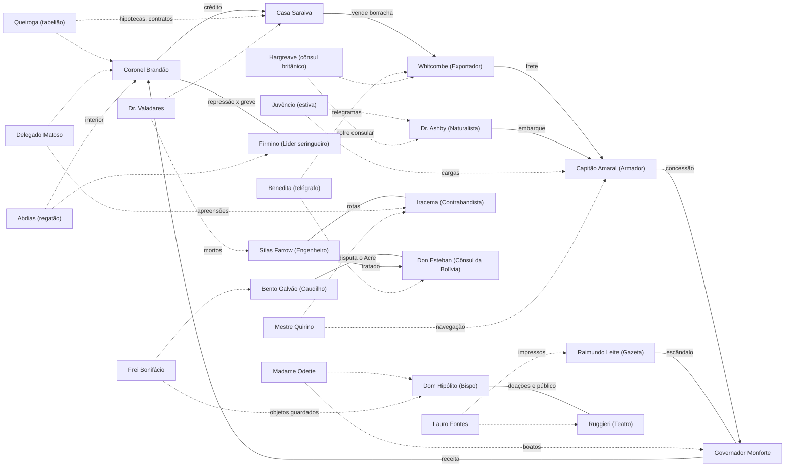
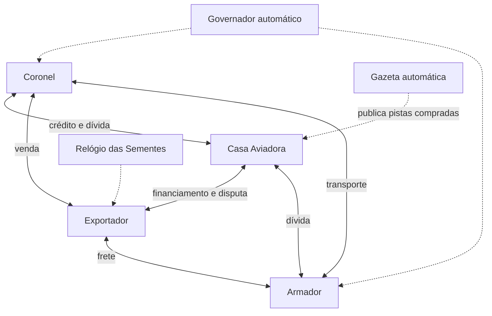
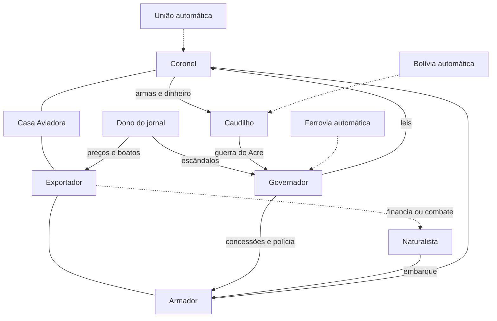
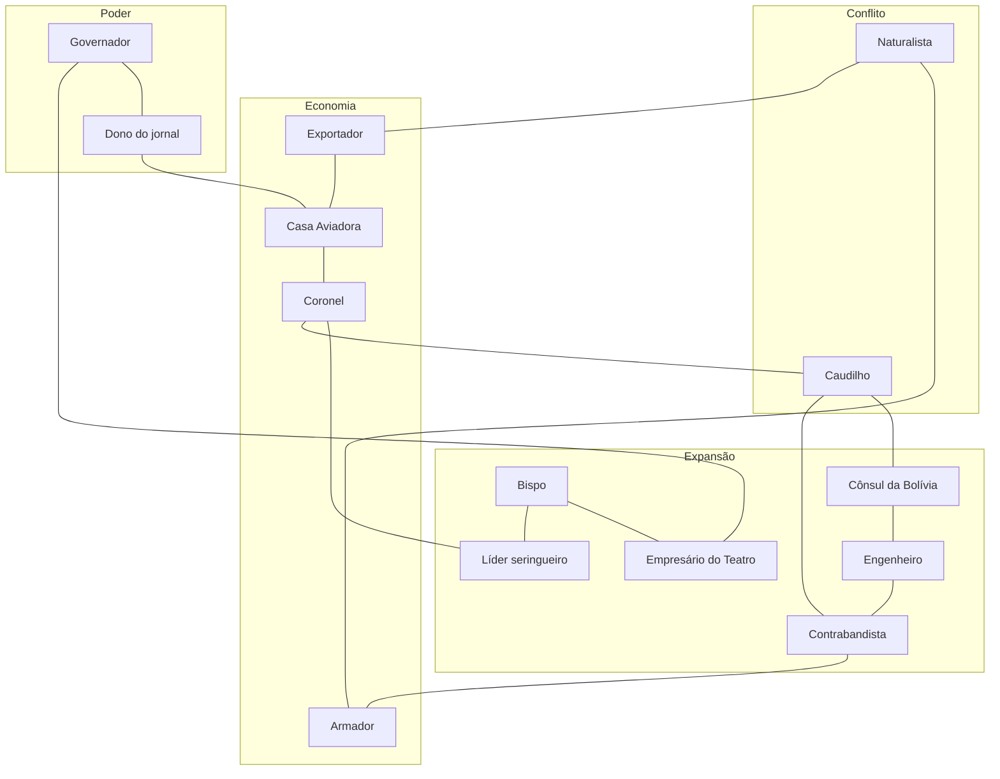

# Ouro Branco — Personagens e Relações

> Documento 2 de 3. Usa os nomes, lugares e datas definidos em `01-historia-base.md`. O jogo é **história alternativa**: os lugares, as potências e os grandes acontecimentos são os reais (Manaus, o Amazonas, o Acre, a Bolívia, o Império Britânico, Kew, o Tratado de Petrópolis), mas a pergunta de partida é *"e se as sementes de seringueira ainda não tivessem saído do Brasil em 1890?"*. Os personagens, jogáveis e não-jogáveis, são fictícios; figuras históricas reais aparecem no máximo de passagem, como pano de fundo. Os nomes dos personagens são sugestões e podem ser trocados sem afetar as regras, desde que a troca seja feita nos três documentos.

---

## 1. Como ler este documento

**A regra de vitória em um parágrafo.** Vence quem cumprir **primeiro** o próprio objetivo secreto. Cada objetivo é feito de **três marcos**, e cada marco é um estado do jogo que o sistema verifica sozinho (um contrato ativo, um desfecho de bifurcação, a posição do Relógio, a faixa de prestígio, uma denúncia com prova). Todo marco exige lidar com pelo menos um outro jogador (contrato, voto, conflito ou troca), e marcos podem ser perdidos e reconquistados, salvo quando o texto diz que são evento único. A partir do turno 8, quem estiver com os três marcos cumpridos pode fazer a **reivindicação**: a Gazeta anuncia **quem** reivindicou a vitória, mas não qual é o objetivo, e os demais têm **um turno** para derrubar pelo menos um dos marcos; se nenhum cair, o reivindicante vence e a partida termina. Quando alguém cumpre o 2º marco, a Gazeta publica uma **nota indireta**, sem nomes, que serve de sinal de proximidade. O **prestígio não decide a vitória nem o desempate**: é ferramenta. Abre portas de PNJs que exigem prestígio mínimo, dá peso nos votos da Assembleia, torna as denúncias contra você mais difíceis de colar e pode ser exigido por algum marco (por exemplo, faixa Alta para um título ou uma cadeira). A meta de desenho é que, sem oposição, os três marcos levem de 7 a 9 turnos, e com oposição de 10 a 12. Se ninguém vencer por reivindicação até o fim do turno 12, vale a regra do documento 1 (vence quem tiver mais marcos cumpridos; no empate, quem chegou primeiro a esse número).

### 1.1 Estrutura de cada papel

Cada um dos 14 papéis jogáveis é descrito com os mesmos campos:

- **Nome sugerido, grupo e entrada**: a partir de quantos jogadores o papel entra na partida.
- **Identidade pública**: o que todos sabem sobre o personagem desde o turno 1.
- **Recursos e poderes iniciais**: descritos qualitativamente; os números ficam para a fase de balanceamento.
- **Dependências**: de quem esse personagem precisa e quem precisa dele.
- **Três variantes de segredo e objetivo secreto (A, B e C)**: sorteadas pelo sistema no início da partida. Cada variante tem um segredo, um objetivo secreto escrito como **três marcos**, uma lista de alvos, uma dificuldade estimada, a indicação de como os outros podem derrubá-la numa reivindicação, a nota indireta que a Gazeta publica quando o 2º marco é cumprido e uma tabela de pistas em três níveis.
- **Arco em três atos**: as cartas privadas que chegam por volta dos turnos 1, 5 e 9. Os arcos **não mudam o objetivo**: a carta do turno 1 apresenta o objetivo, os marcos e o contexto (com uma escolha de flavor); as cartas dos turnos 5 e 9 trazem, cada uma, um **atalho** (caminho alternativo e mais arriscado para um dos marcos) e uma **complicação** (um obstáculo novo ou uma pista do personagem que vazou para algum PNJ). A variante A é descrita em detalhe; as variantes B e C recebem um resumo.
- **Comportamento automático**: o que o sistema faz com o papel quando nenhum jogador o ocupa.

### 1.2 Pistas: boato, indício e prova

Todo segredo é decomposto em três pistas, cada uma guardada por um PNJ (personagem não-jogável) plausível:

- **Boato**: algo que se diz por aí. Pode ser falso (o sistema também gera boatos plantados). Serve para orientar investigações e para vender ao jornal, mas uma denúncia baseada só em boato é arriscada.
- **Indício**: um fato verificável que aponta para o segredo sem prová-lo. Permite chantagem leve e dá peso a uma matéria na Gazeta.
- **Prova**: documento, testemunha ou objeto que confirma o segredo. Permite denúncia formal com penalidade ao alvo e chantagem pesada.

Os PNJs referidos abaixo estão descritos na seção 3. Para leitura rápida, as abreviações usadas nas tabelas são:

| PNJ | Quem é |
|---|---|
| **Frei Bonifácio** | Confessor da Matriz |
| **Queiroga** | Anselmo Queiroga, tabelião do Cartório do Primeiro Ofício |
| **Benedita** | Benedita Lins, telegrafista-chefe da Estação Subfluvial |
| **Madame Odette** | Dona da Pensão Flor-de-Lis |
| **Juvêncio** | Juvêncio Mares, estivador-chefe do Porto Flutuante |
| **Dr. Valadares** | Heitor Valadares, médico da Santa Casa |
| **Delegado Matoso** | Severino Matoso, chefe de polícia |
| **Hargreave** | Mr. Lionel Hargreave, cônsul britânico |
| **Abdias** | Abdias Salomão, regatão do Purus (PNJ acrescentado) |
| **Mestre Quirino** | Prático-mor do Amazonas (PNJ acrescentado) |
| **Lauro Fontes** | Chefe da oficina tipográfica da Gazeta (PNJ acrescentado) |

### 1.3 Alvos dinâmicos

Os objetivos secretos que mandam atrapalhar alguém apontam sempre para jogadores reais. Por isso cada objetivo traz uma **lista de alvos em ordem de prioridade**: o sistema escolhe o primeiro papel da lista que estiver ocupado por um jogador. Como os quatro papéis de Economia estão sempre presentes, toda lista termina em pelo menos um deles. O alvo aparece sempre em um dos marcos. Quando o alvo efetivo não é o primeiro da lista, o marco usa a **forma genérica** indicada, que é sempre um estado verificável: normalmente "o alvo ter contrato ativo com cláusula de silêncio (ou de não-agressão) a seu favor, ou ter sofrido denúncia com prova num dos últimos três turnos", ou "o alvo ter perdido um contrato, uma concessão ou um bem específico num dos últimos turnos". Nenhuma forma genérica compara prestígio.

### 1.4 O Agente de Kew

Três variantes transformam um jogador no agente que move o Relógio das Sementes: o Naturalista A ("O Ladrão de Sementes"), o Exportador A ("O Homem de Kew") e a Contrabandista B ("As Sementes"). Para evitar dois agentes concorrentes, o sistema sorteia as variantes nesta ordem e, se um agente já existir, a variante seguinte que também seria agente é trocada por uma variante não-agente do mesmo papel (decisão a revisar; ver documento 3). Se nenhum jogador for agente, o relógio é movido pelo PNJ oculto "senhor Grey". Para o agente, "Relógio das Sementes em 5 ou mais" é um dos marcos; para quem o combate (Exportador C, Naturalista B), "Relógio em 4 ou menos com o turno 6 encerrado" é o marco espelhado. Depois da Germinação (5), o relógio não recua por ações locais, então esse marco do agente é praticamente permanente.

### 1.5 Vocabulário dos marcos

Os marcos usam um vocabulário fixo para que o sistema possa verificá-los sem interpretação. Os números marcados como provisórios ficam para o balanceamento.

| Termo | O que o sistema verifica |
|---|---|
| **Contrato ativo** | Contrato registrado no app **durante a partida**, vigente: não vencido, não rescindido, não quebrado e não executado. Dívidas, títulos, concessões e contratos que já existem na preparação (por exemplo, a carteira inicial da Casa Aviadora ou a dívida do Armador) **não contam** para marcos, a menos que sejam renegociados em contrato novo. Rescindir custa a multa prevista no próprio contrato. |
| **Cláusula de silêncio** | Cláusula de um contrato registrado (por exemplo, o fecho de uma chantagem, ver documento 3) em que uma parte se obriga a não publicar nem denunciar a outra. Publicar ou denunciar é quebra de contrato. |
| **Prova em mãos** | O jogador tem no inventário a carta de pista de nível prova. Ela sai das mãos dele se for vendida, entregue, roubada ou enterrada em leilão. |
| **Faixas de prestígio** | Baixa, Média, Alta e Eminente (nomes e limites provisórios). |
| **Patamar** | Valor de dinheiro, caixa, contrato ou tropa que o marco exige; todos são provisórios e serão fixados no balanceamento. |
| **Evento único** | Marco ligado a um desfecho de bifurcação (B1, B4, B5, B7) ou a uma votação. Depois que acontece, não se perde nem se recupera, salvo exceção escrita no próprio marco (por exemplo, perder depois o cargo conquistado). Antes da resolução, não conta como cumprido. |
| **"Num dos últimos N turnos"** | Janela móvel: o marco vale enquanto o fato tiver acontecido dentro dela, e cai quando sai da janela. |

**Nenhum marco começa cumprido.** Todo marco exige algo que algum jogador provoca durante a partida (um contrato novo, um voto, uma denúncia, uma ação, ou uma bifurcação que só se resolve depois do turno 5), e cada objetivo tem pelo menos um marco que depende de ação do próprio dono. Condições passivas ("o relógio estar baixo", "não haver intervenção") só aparecem combinadas com uma exigência ativa ou com um prazo posterior ao turno 6.

**Nenhum objetivo fica impossível.** Quando um marco depende de uma bifurcação, de um evento único, de uma votação única ou de um estado do mundo que pode se fechar de vez (por exemplo, o Relógio das Sementes passar da Germinação), existe sempre um caminho de recuperação: ou um atalho de carta de arco que cobre o desfecho desfavorável, ou uma linha **Se a bifurcação fechar** logo abaixo do marco. Esse caminho só abre se o desfecho for desfavorável, é mais caro ou arriscado que o original, cabe em 2 a 3 turnos, exige outro jogador e deixa rastro. Um marco cumprido por atalho depende de contrato e **pode ser derrubado** como qualquer contrato, mesmo que a ficha diga "intocável" para o caminho original (ver 04, seção 2.6).

Para cada variante, a linha **Como derrubar na reivindicação** resume o que os outros podem atacar no turno de resposta, e a **Nota da Gazeta no 2º marco** é o texto indireto que o sistema publica quando aquele jogador cumpre o segundo marco.

---

## 2. Os 14 papéis jogáveis

### Resumo

| # | Papel | Nome sugerido | Grupo | Entra com |
|---|---|---|---|---|
| 1 | Coronel seringalista | Coronel Anacleto Vasconcelos Brandão | Economia | 4 |
| 2 | Casa aviadora | Dona Eulália Saraiva | Economia | 4 |
| 3 | Exportador estrangeiro | Mr. Edmund Whitcombe | Economia | 4 |
| 4 | Armador dos vapores | Capitão Teodoro Amaral | Economia | 4 |
| 5 | Governador | Dr. Aristides Monforte | Poder | 5 |
| 6 | Dono do jornal | Raimundo Leite | Poder | 6 |
| 7 | Caudilho do Acre | Bento Galvão | Conflito | 7 |
| 8 | Naturalista | Dr. Matias Ashby | Conflito | 8 |
| 9 | Engenheiro da ferrovia | Silas Farrow | Expansão | 9 |
| 10 | Líder seringueiro | Firmino Cabral, "o Cearense" | Expansão | 10 |
| 11 | Bispo | Dom Hipólito Arcoverde | Expansão | 11 |
| 12 | Contrabandista | Iracema Bastos, "a Viúva do Furo" | Expansão | 12 |
| 13 | Cônsul da Bolívia | Don Esteban Arriaga | Expansão | 13 |
| 14 | Empresário do Teatro | Ottavio Ruggieri | Expansão | 14 |

> Os papéis são sorteados entre os jogadores, mas o **conjunto** de papéis em jogo segue a ordem de entrada acima: com 9 jogadores, entram os papéis 1 a 9.

---

### 2.1 Coronel Anacleto Vasconcelos Brandão — o Seringalista

**Grupo:** Economia. **Entra com:** 4 jogadores.

**Identidade pública.** Dono do Seringal Boa Esperança, no médio Purus, o maior do Estado, com cerca de seiscentos seringueiros espalhados por oitenta léguas de mata. Chegou do Ceará há trinta anos como seringueiro e hoje é deputado estadual, padrinho de metade dos afilhados do Purus e dono de um palacete na Avenida Sete de Setembro com escadaria de mármore italiano. É generoso em público, temido em particular, e fala de si mesmo na terceira pessoa quando está bêbado.

**Recursos e poderes iniciais.**

- A maior produção de borracha do jogo (em quantidade, não em qualidade).
- Homens armados (jagunços e capatazes) capazes de reprimir fugas, proteger cargas ou ameaçar rivais rio acima.
- Uma cadeira na Assembleia e influência sobre outros deputados do interior ("votos do Purus").
- Uma dívida grande e antiga com a Casa Saraiva, que é ao mesmo tempo fraqueza e arma (devedor grande demais para ser deixado quebrar).
- Ação especial: **Expandir colocações** (aumenta a produção, exige trabalhadores e crédito).

**Dependências.**

- Precisa da **Casa Aviadora** para o crédito de cada safra.
- Precisa do **Armador** para subir mercadoria e descer borracha.
- Precisa do **Exportador** para vender a bom preço.
- Precisa do **Governador** para manter a lei que prende o seringueiro ao seringal e a polícia do seu lado.
- É temido pelo **Líder seringueiro** e cobiçado pelo **Caudilho** (que quer seus homens) e pela **Contrabandista** (que quer sua borracha sem selo).

#### Variante A — "O Igarapé das Cruzes"

**Segredo.** Em 1888, sessenta seringueiros tentaram fugir do Boa Esperança pelo Igarapé do Jacamim. O Coronel mandou os capatazes atrás deles. Nenhum voltou. Os capatazes enterraram os corpos à beira do igarapé e alguém, depois, fincou cruzes de pau no barranco. O Coronel registrou as mortes como "febre" e cobrou as dívidas dos mortos das famílias no Ceará.

**Objetivo secreto — manter o barracão de pé.** O seringal precisa sobreviver intacto e a mão de obra precisa continuar presa, enquanto quem poderia contar a história das cruzes fica calado.

**Marcos.**

1. **Barracão fechado.** B4 **não** terminar em Acordo e Lei do Aviamento: a lei rejeitada na votação do turno 8, com a greve esmagada ou mesmo em revolta (a lei que prende o seringueiro ao barracão continua valendo). Evento único: depois do turno 8 o marco não se perde nem se recupera. Exige votos ou polícia de outros jogadores.
   - *Se a bifurcação fechar (B4 em Acordo e Lei do Aviamento):* **Barracão cercado.** O marco 1 passa a valer, já no turno seguinte à votação, enquanto o Coronel tiver contrato ativo com o Governador de destacamento policial no Boa Esperança (por Decreto), que impede os seringueiros de descer o rio sem passe do barracão. Risco: o Governador cobra caro pelo serviço; cada turno de cerco deixa rastro de violência com o Delegado Matoso, e os foragidos que escapam se confessam: Frei Bonifácio ganha um indício novo sobre o Coronel.
2. **Seringal sustentado.** Possuir o Boa Esperança sem hipoteca executada **e** ter contrato ativo de crédito de safra novo com a Casa Aviadora (a dívida antiga não conta) **e** contrato ativo de frete com o Armador, ambos registrados durante a partida.
3. **Boca calada.** O alvo ter contrato ativo com cláusula de silêncio a favor do Coronel **ou** ter sofrido denúncia com prova num dos últimos três turnos.

**Alvo (prioridade):** Líder seringueiro → Bispo → Dono do jornal → Exportador. Forma genérica: a mesma do marco 3, aplicada ao alvo efetivo.

**Dificuldade estimada:** média.

**Como derrubar na reivindicação:** depois do turno 8 o marco 1 é intocável; ataque os outros dois. A Casa pode cortar ou executar o crédito, o Armador pode rescindir o frete (pagando a multa), o alvo pode quebrar a cláusula de silêncio publicando o que sabe, e uma denúncia com prova contra o Coronel deixa os parceiros livres para romper os contratos sem multa.

**Nota da Gazeta no 2º marco:** *"Nos barracões do Purus diz-se que certo patrão voltou a dormir tranquilo: os rios correm de novo para o lado dele."*

| Nível | Pista | PNJ que guarda |
|---|---|---|
| Boato | Um capataz bêbado, na Flor-de-Lis, falou em "sessenta cruzes num igarapé" e chorou | Madame Odette |
| Indício | O regatão viu as cruzes no barranco do Jacamim e sabe que o lugar não tinha cemitério; tem um terço com nome gravado que encontrou lá | Abdias |
| Prova | A carta original do capataz-mor ao Coronel ("está feito, patrão, ninguém volta para contar") foi apreendida pela polícia anos atrás e está numa gaveta do delegado, que a guarda como seguro | Delegado Matoso |

**Arco em três atos (detalhado).**

- **Ato 1 (turno 1) — "A safra da República".** Carta do Coronel ao próprio Coronel, escrita pelo guarda-livros: a safra foi recorde, mas trinta homens fugiram rio abaixo no último mês e um deles levava a caderneta de um morto de 1888. A carta apresenta o objetivo e os três marcos e oferece uma escolha de flavor: mandar buscá-los (ganha produção, gera rastro) ou deixar ir (perde produção, ganha um pouco de prestígio com o Bispo).
- **Ato 2 (turno 5) — "A sobrevivente".** Joana do Jacamim aparece em Manaus dizendo que o marido morreu no igarapé e que ela viu tudo de longe. Ela fica sob a proteção da Matriz (ou da União, se o Líder seringueiro for jogador).
  - *Atalho (marco 1):* **Comprar a pauta.** Subornar deputados (ação secreta cara) para tirar a Lei do Aviamento de votação. Se der certo, B4 se resolve em greve esmagada já no fim do turno 7. Risco: o suborno deixa indício com Queiroga, e se for denunciado com prova a lei volta à pauta no turno 8.
  - *Complicação:* quem protege Joana ganha um indício extra contra o Coronel (o testemunho dela), e Madame Odette passa a vender o boato das cruzes pela metade do preço.
- **Ato 3 (turno 9) — "O herdeiro".** Anacleto Júnior volta de Londres formado em direito e anuncia que quer vender o seringal "antes que a borracha vire charque".
  - *Atalho (marco 3):* **Queimar as cruzes.** Expedição de jagunços ao Jacamim para sumir com cruzes e ossos. Se nenhum jogador tiver a prova no fim do turno, o marco 3 conta como cumprido por dois turnos, com ou sem o alvo. Risco: rastro de violência pesado (Frei Bonifácio reage) e, se a expedição for descoberta, ela vira prova contra o Coronel: denunciada, custa-lhe prestígio e sai na Gazeta.
  - *Complicação:* Júnior acha no escritório a lista dos mortos de 1888 e a entrega ao Bispo "por escrúpulo": Frei Bonifácio passa a guardar um segundo indício.

#### Variante B — "Falido de Casaca"

**Segredo.** O Coronel está secretamente insolvente. A dívida com a Casa Saraiva é o dobro do que se diz, e ele hipotecou o Boa Esperança duas vezes: uma à Casa Saraiva e outra, por baixo dos panos, ao Banco Thornbury por intermédio de um procurador em Belém. Se uma das duas hipotecas for executada, a outra descobre o golpe.

**Objetivo secreto — fazer a dívida desaparecer antes que alguém cobre.** O Coronel precisa domar a dívida com a Casa, mostrar caixa ao Banco Thornbury e arranjar quem lhe segure as costas antes que as duas hipotecas se encontrem.

**Marcos.**

1. **Dívida domada.** Ter contrato ativo de reestruturação com a Casa Aviadora que reduza a dívida em pelo menos um terço **e** empurre o vencimento para depois do turno 10 (provisório), as duas coisas no mesmo acordo, **ou** a Casa estar em Falência depois de B7.
2. **Caixa para o Thornbury.** Ter contrato ativo de venda antecipada de safra com outro jogador (normalmente o Exportador), com adiantamento de pelo menos uma safra média (provisório), **e** já ter entregue ao comprador pelo menos dois lotes dessa safra, em turnos diferentes (o banco só acredita no adiantamento quando vê borracha no armazém do comprador).
3. **Fiador de casaca.** Ter contrato ativo de fiança ou aval em que um jogador que não seja a Casa garante parte da dívida com o Banco Thornbury, **e** não ter sofrido denúncia com prova num dos últimos três turnos.

**Alvo (prioridade):** Casa Aviadora (sempre presente).

**Dificuldade estimada:** média.

**Como derrubar na reivindicação:** a Casa pode rescindir a reestruturação (pagando a multa) ou executar outro título vencido; o comprador da safra pode desfazer o contrato ou rebaixar a borracha na classificação até o adiantamento ficar abaixo do patamar; uma denúncia com a prova da segunda hipoteca derruba o marco 3 e dá ao fiador motivo para rescindir a fiança (pagando a multa).

**Nota da Gazeta no 2º marco:** *"Nas mesas da Rua da Alfândega comenta-se que um devedor dos grandes já não teme o oficial de justiça."*

| Nível | Pista | PNJ que guarda |
|---|---|---|
| Boato | "O Coronel está devendo até a alma"; dizem que o palacete tem a mobília alugada | Madame Odette |
| Indício | Telegramas cifrados entre o procurador do Coronel em Belém e o Banco Thornbury em Londres, todos pagos em dinheiro vivo | Benedita |
| Prova | O registro da segunda hipoteca, lavrado num livro auxiliar que o tabelião não deveria ter aceitado | Queiroga |

**Arco resumido.** Ato 1: o Banco Thornbury pede "garantias adicionais"; a carta apresenta os marcos. Ato 2 (turno 5): o procurador de Belém morre. *Atalho (marco 1):* chantagear a Casa com a existência da segunda hipoteca ("se executar, o banco executa primeiro") para arrancar a reestruturação de uma vez; a Casa passa a ter um indício sobre a hipoteca. *Complicação:* os papéis do procurador vão parar na gaveta do Delegado Matoso, que passa a guardar uma cópia do indício. Ato 3 (turno 9): o Pânico de 1907 faz o banco cobrar tudo. *Atalho (marco 2):* vender o palacete a outro jogador com cláusula de recompra; conta como caixa no lugar da venda antecipada, mas se não recomprar em dois turnos perde o palacete e prestígio. *Complicação:* o Thornbury exige que o fiador reafirme o aval por novo contrato; até lá o marco 3 fica suspenso.

#### Variante C — "O Dono das Terras do Acre"

**Segredo.** O Coronel possui, por meio de um testa-de-ferro boliviano, três grandes seringais no Acre, registrados em La Paz. Ele paga imposto à Bolívia e, em público, discursa contra a Bolívia. Se o Acre for tomado à bala, seus títulos bolivianos não valem nada; se for anexado por tratado, só valem se forem revalidados a tempo; se o Acre for arrendado ao Bolivian Syndicate, ele perde tudo; se ficar independente, depende de quem mandar lá.

**Objetivo secreto — salvar as terras do Acre, seja qual for a bandeira.** Os títulos bolivianos só sobrevivem se o Acre virar brasileiro por papel passado, se o cartório e alguém com poder os reconhecerem, e se ninguém mais puser o pé nos seus seringais.

**Marcos.**

1. **Acre brasileiro por tratado.** B1 resolvida em **anexação por tratado** (evento único, turno 7). Exige financiar a indenização, votar ou negociar com o Governador e o Cônsul.
   - *Se a bifurcação fechar (B1 em independência ou arrendamento; a anexação pelas armas tem atalho no Ato 2):* **Tributo ao novo dono.** O marco 1 passa a valer enquanto o Coronel tiver contrato ativo de reconhecimento dos seus títulos, com o tributo pago de uma vez na assinatura, com quem manda no Acre: o Caudilho, se o Acre ficou independente; o procurador do Bolivian Syndicate (Exportador ou Cônsul), se foi arrendado; sem esse jogador, com o Governador como intermediário. Risco: o tributo é alto, o pagamento deixa indício com Juvêncio (os recibos sobem o rio), e o Coronel, que discursa contra a Bolívia, passa a ter o nome ligado ao inimigo.
2. **Títulos revalidados.** Ter registrado os títulos dos três seringais no Cartório do Primeiro Ofício (ação aberta; gera pista para Queiroga) **e** ter contrato ativo de reconhecimento desses títulos com o Governador ou o Cônsul da Bolívia; se nenhum dos dois for jogador, um contrato de sociedade ou garantia sobre esses seringais com qualquer outro jogador. O reconhecimento pode ser pago em votos do Purus ou apoio na Assembleia, sem dinheiro.
3. **Fronteira respeitada.** O alvo ter contrato ativo com cláusula de não-invasão sobre os seringais do Coronel **ou** ter sofrido denúncia com prova num dos últimos três turnos.

**Alvo (prioridade):** Caudilho → Cônsul da Bolívia → Governador → Armador. Forma genérica: a mesma do marco 3, aplicada ao alvo efetivo.

**Dificuldade estimada:** média.

**Como derrubar na reivindicação:** antes do turno 7, empurre B1 para armas, independência ou arrendamento. Depois, ataque os marcos 2 e 3: uma denúncia com os títulos guardados por Hargreave torna o registro "contestado" (o marco 2 cai até o registro ser revalidado em contrato) e custa prestígio ao Coronel, e o alvo pode quebrar a cláusula de não-invasão pagando a multa.

**Nota da Gazeta no 2º marco:** *"Um senhor do Purus dorme melhor desde que a fronteira foi desenhada a tinta e não a bala."*

| Nível | Pista | PNJ que guarda |
|---|---|---|
| Boato | "O Coronel tem gente dele em Puerto Alonso" | Mestre Quirino |
| Indício | Cópia de um recibo de imposto boliviano em nome do testa-de-ferro, com a letra do guarda-livros do Coronel | Abdias |
| Prova | Os títulos de La Paz, guardados no cofre do consulado britânico como garantia de um empréstimo | Hargreave |

**Arco resumido.** Ato 1: a Bolívia instala o posto de Puerto Alonso; a carta apresenta os marcos. Ato 2 (turno 5): o testa-de-ferro quer mais dinheiro e ameaça vender os títulos ao Bolivian Syndicate. *Atalho (marco 1):* se B1 terminar em anexação pelas armas, o marco também conta desde que o Coronel tenha contrato ativo de financiamento com quem venceu a guerra; risco: o financiamento deixa indício com Juvêncio e torna o vencedor credor de favores. *Complicação:* o testa-de-ferro procura o Syndicate e Hargreave passa a guardar também o indício do recibo. Ato 3 (turno 9): *Atalho (marco 2):* pagar Queiroga para registrar os títulos com data retroativa (Falsificar documento); conta como registro, mas se a falsificação for denunciada com prova, o registro cai e o Coronel perde prestígio (a denúncia sai na Gazeta). *Complicação:* La Paz contesta os títulos por nota diplomática; o reconhecimento do marco 2 precisa ser renovado em contrato.

**Comportamento automático.** Quando não há jogador, o Coronel produz sempre o máximo possível, pede crédito à Casa Aviadora todo turno e paga o mínimo exigido. Contrata o Armador que cobrar menos e vende ao Exportador que pagar mais. Na Assembleia, vota contra qualquer aumento de imposto, contra a Lei do Aviamento e a favor da anexação do Acre. Reprime fugas sempre (o que gera rastros automáticos sobre ele, úteis para os outros jogadores). Nunca visita PNJs e nunca trai contratos registrados, mas também nunca perdoa dívidas.

---

### 2.2 Dona Eulália Saraiva — a Casa Aviadora

**Grupo:** Economia. **Entra com:** 4 jogadores.

**Identidade pública.** Viúva de Joaquim Saraiva, fundador da **Casa Saraiva & Filhos**, a maior casa aviadora de Manaus, com armazéns na Rua da Alfândega e crédito aberto em quase todos os seringais do Purus. Assumiu a casa há dois anos, quando o marido morreu de febre, e surpreendeu a praça com uma dureza que ninguém esperava. Veste luto fechado, comunga todo domingo e não perdoa um conto atrasado. Os coronéis a chamam de "a Viúva de Ferro" pelas costas.

**Recursos e poderes iniciais.**

- O maior volume de **capital de giro** do jogo.
- Uma **carteira de dívidas**: começa com títulos de dívida de pelo menos dois outros jogadores (sempre o Coronel; mais um sorteado entre Armador e Governador, quando presente).
- Armazéns com estoque de mercadorias (pode abastecer ou estrangular seringais).
- Acesso ao livro-razão de clientes: ao visitar o Tabelião, tem bônus para pistas financeiras.
- Ação especial: **Executar título** (cobrança judicial de dívida vencida; gera pista pública no Cartório).

**Dependências.**

- Precisa que o **Coronel** produza e pague.
- Precisa do **Exportador** para transformar borracha recebida em dinheiro.
- Depende do **Banco Thornbury** (PNJ via Hargreave) e de Belém para crédito de segunda linha.
- Precisa do **Governador** em caso de crise (resgate).
- É alvo natural de quem deve (Coronel, Armador) e concorrente do Exportador na hora de financiar.

#### Variante A — "Os Livros Duplos"

**Segredo.** A Casa Saraiva está tecnicamente quebrada desde a morte de Joaquim. Ele tinha perdido uma fortuna em ações de uma mineradora na Bolívia, e Eulália escondeu o rombo com uma contabilidade dupla: um livro para os sócios e o fisco, outro verdadeiro, guardado em casa. A casa sobrevive porque novos depósitos pagam juros antigos.

**Objetivo secreto — atravessar o Pânico com a Casa de pé e o prejuízo no colo de outro.** A pirâmide de Joaquim só sobrevive se dinheiro novo continuar entrando e se alguém absorver os títulos podres.

**Marcos.**

1. **Casa de pé.** A Casa Saraiva não estar em Falência e ter caixa de pelo menos um patamar (provisório), com ao menos um contrato ativo de depósito ou empréstimo tomado de outro jogador que tenha cláusula de não-saque antecipado (o depositante só retira antes do prazo pagando multa).
   - *Se a bifurcação fechar (a Casa entra em Falência em B7):* **Concordata.** A Falência deixa de contar contra o marco enquanto houver contrato ativo com outro jogador que assuma ou garanta parte do passivo da Casa (pelo menos um patamar, provisório) e a Casa tiver de novo caixa de um patamar. Risco: o novo sócio ganha acesso aos livros e recebe um indício (o livro verdadeiro existe), e a concordata registrada no Cartório deixa outro indício com Queiroga.
2. **O prejuízo do outro.** O alvo ter contrato ativo, registrado durante a partida, em que comprou títulos da carteira da Casa, assumiu uma dívida dela ou lhe deve valor de pelo menos um patamar (provisório), **e** já ter pago à Casa pelo menos a primeira parcela desse contrato; a dívida inicial do Armador não conta.
3. **Pirâmide em dia.** Ter pelo menos dois contratos ativos de crédito novo (registrados durante a partida, não a carteira inicial) concedido a jogadores diferentes, sem atraso de pagamento no último turno, **e** não ter sofrido denúncia com prova num dos últimos três turnos.

**Alvo (prioridade):** Exportador → Armador (ambos sempre presentes).

**Dificuldade estimada:** média.

**Como derrubar na reivindicação:** os devedores podem atrasar um pagamento de propósito (marco 3), o depositante pode sacar (marco 1), o alvo pode revender os títulos a terceiros ou rescindir pagando a multa (marco 2), e uma denúncia com o livro verdadeiro derruba o marco 3, custa prestígio a Eulália e provoca saques (caixa cai um patamar, provisório).

**Nota da Gazeta no 2º marco:** *"Uma casa que muitos davam por morta voltou a pagar em dia, e alguém na praça, não se sabe quem, ficou com o mico."*

| Nível | Pista | PNJ que guarda |
|---|---|---|
| Boato | O guarda-livros da Casa, bêbado, disse que "a casa anda em cima de pernas de pau" | Madame Odette |
| Indício | Telegramas repetidos a bancos de Belém e Londres pedindo prorrogações, sempre no fim do mês | Benedita |
| Prova | O livro verdadeiro, que Eulália deixou com o confessor num momento de pânico ("guarde isto até eu pedir") | Frei Bonifácio (só por Pressionar ou relação 5) |

**Arco em três atos (detalhado).**

- **Ato 1 (turno 1) — "O inventário".** Carta do advogado da família: os herdeiros de Joaquim (dois sobrinhos em Belém) querem ver os livros em dois anos. A carta apresenta o objetivo e os marcos e oferece uma escolha: atrair um grande depositante novo (ganha caixa, cria um alvo de vazamento) ou cortar crédito a um coronel (perde receita, ganha tempo).
- **Ato 2 (turno 5) — "Os sobrinhos".** Os sobrinhos chegam a Manaus e se hospedam na Flor-de-Lis.
  - *Atalho (marco 2):* **Títulos maquiados.** Oferecer ao alvo um pacote de títulos "de primeira" com documentos retocados por Queiroga. Se ele aceitar, o marco 2 se cumpre de uma vez. Risco: a falsificação deixa indício com Queiroga, e se o alvo descobrir pode anular o contrato sem multa.
  - *Complicação:* um dos sobrinhos bebe com Madame Odette, que passa a guardar também o indício dos telegramas de prorrogação.
- **Ato 3 (turno 9) — "O Pânico".** O Banco Thornbury chama os empréstimos.
  - *Atalho (marco 1):* **Resgate do Palácio.** Pedir ao Governador (jogador ou automático) o decreto de resgate de B7. O caixa conta como suficiente por dois turnos, mas a Casa fica devedora do Tesouro e o Governador recebe um indício sobre os livros.
  - *Complicação:* o banco exige o livro verdadeiro como garantia e manda Hargreave procurar Frei Bonifácio; se a relação de Eulália com o Frei estiver abaixo de 4, a prova passa ao cofre do consulado.

#### Variante B — "O Marido Não Morreu de Febre"

**Segredo.** Joaquim Saraiva não morreu de febre. Eulália o envenenou com arsênico em pequenas doses depois de descobrir que ele pretendia deixar a Casa para um filho que tinha com outra mulher. O Dr. Valadares assinou o atestado de óbito por febre em troca de uma doação à Santa Casa.

**Objetivo secreto — subir na sociedade e nunca deixar reabrir a morte de Joaquim.** Eulália quer o lugar social que o marido nunca teve, e quer que ninguém com tinta ou tribuna fale dela.

**Marcos.**

1. **Lugar na sociedade.** Prestígio na faixa Alta ou acima **e** contrato ativo de patrocínio ou doação com outro jogador (Teatro, Bispo, Jornal ou qualquer jogador que promova evento ou obra), com cláusula que dê a Eulália lugar de honra público (camarote, placa ou nome na obra).
2. **A boca fechada.** O alvo ter contrato ativo com cláusula de silêncio a favor de Eulália **ou** ter sofrido denúncia com prova num dos últimos três turnos.
3. **Sócia respeitável.** Ter contrato ativo de sociedade, fiança ou crédito recíproco com um jogador de Poder ou de Economia que não seja o alvo, **e** não ter sofrido denúncia com prova num dos últimos três turnos.

**Alvo (prioridade):** Dono do jornal → Governador → Coronel. Forma genérica: a mesma do marco 2, aplicada ao alvo efetivo.

**Dificuldade estimada:** média.

**Como derrubar na reivindicação:** uma denúncia com a prova do arsênico derruba o marco 3 e, pela perda de prestígio, pode derrubar o marco 1; o alvo pode quebrar a cláusula de silêncio (pagando a multa); o patrocinado ou o sócio podem rescindir.

**Nota da Gazeta no 2º marco:** *"Uma fortuna de luto subiu mais um degrau nos salões, e certas bocas da cidade parecem costuradas a ouro."*

| Nível | Pista | PNJ que guarda |
|---|---|---|
| Boato | A cozinheira da casa Saraiva conta que "o patrão vomitava toda noite antes da febre" | Madame Odette |
| Indício | O atestado de Joaquim foi assinado sem exame de sangue, e na semana seguinte a Santa Casa recebeu uma doação de vinte contos | Dr. Valadares |
| Prova | A farmácia da Rua dos Barés vendeu arsênico "para ratos" em nome da Casa Saraiva, com a assinatura de Eulália no livro de venda de venenos controlados que a polícia recolheu | Delegado Matoso |

**Arco resumido.** Ato 1: o filho ilegítimo de Joaquim, um rapaz de dezenove anos, começa a trabalhar como estivador no porto; a carta apresenta os marcos. Ato 2 (turno 5): o rapaz descobre quem é o pai e pede reconhecimento. *Atalho (marco 3):* adotá-lo e registrá-lo como sócio menor, com um jogador como tutor em contrato; conta como sociedade respeitável, mas o rapaz passa a ter acesso aos papéis da casa. *Complicação:* o rapaz conta a Juvêncio o que ouviu da cozinheira; Juvêncio passa a guardar o boato. Ato 3 (turno 9): o Dr. Valadares, doente, quer se confessar. *Atalho (marco 2):* financiar uma "viagem de estudos" do médico à Europa; enquanto ele estiver fora (dois turnos), o marco 2 conta mesmo sem o alvo calado. Risco: custa caro e, se ele se confessar antes de embarcar, Frei Bonifácio ganha uma pista. *Complicação:* se o médico ficar, ele procura o Frei no turno 9 ou 10.

#### Variante C — "A Agente de Londres"

**Segredo.** A Casa Saraiva pertence, desde 1887, ao Banco Thornbury & Filhos, por meio de um contrato de sociedade oculta. Eulália é sócia minoritária e executora das ordens de Londres, que quer controlar diretamente a produção do Purus tomando seringais em pagamento de dívidas.

**Objetivo secreto — entregar a Londres um grande ativo produtivo.** O Banco Thornbury quer controlar a produção diretamente, tomando seringais e vapores em pagamento, e quer a borracha saindo pelo comprador que ele indicar.

**Marcos.**

1. **O ativo de Londres.** Possuir, por execução de título ou por contrato de dação em pagamento, o seringal, pelo menos metade dos vapores ou a concessão de linhas do alvo.
2. **Carteira grossa.** Ter pelo menos dois contratos ativos de crédito novo (registrados durante a partida, não a carteira inicial) com jogadores diferentes, de valor somado de pelo menos um patamar (provisório), cada um com garantia real registrada no Cartório (seringal, vapor, estoque ou imóvel do devedor).
3. **Ordens cumpridas.** Ter contrato ativo de fornecimento exclusivo da borracha da Casa (ou do ativo tomado) com o Exportador, **e** não ter sofrido denúncia com prova num dos últimos três turnos.

**Alvo (prioridade):** Coronel → Armador (ambos sempre presentes).

**Dificuldade estimada:** média.

**Como derrubar na reivindicação:** o devedor pode quitar ou recomprar o ativo se o contrato tiver cláusula de resgate, ou pedir ao Governador revisão da execução; os devedores podem quitar antecipadamente e esvaziar a carteira; o Exportador pode romper a exclusividade; a prova do contrato de sociedade oculta, levada a denúncia, derruba o marco 3 e custa prestígio a Eulália.

**Nota da Gazeta no 2º marco:** *"Um seringal inteiro mudou de mãos sem tiro nem leilão, e há quem jure ter ouvido sotaque de Londres no cartório."*

| Nível | Pista | PNJ que guarda |
|---|---|---|
| Boato | "A Viúva recebe ordens de Londres" | Juvêncio (estivadores veem os caixotes de correspondência diplomática) |
| Indício | O cônsul britânico visita a Casa Saraiva toda primeira segunda-feira do mês | Hargreave (deixa escapar se a relação for alta) |
| Prova | O contrato de sociedade oculta, registrado em Londres e com cópia autenticada guardada no Primeiro Ofício | Queiroga |

**Arco resumido.** Ato 1: Londres envia a lista de seringais "de interesse"; a carta apresenta os marcos. Ato 2 (turno 5): Londres exige pressa. *Atalho (marco 1):* comprar com desconto, do próprio Thornbury, uma dívida que o alvo tem com outro credor e executá-la de uma vez; a operação passa pelo telégrafo e Benedita ganha um indício novo. *Complicação:* alguém manda ao alvo um bilhete anônimo ("a Viúva recebe ordens de Londres"); o alvo passa a ter o boato. Ato 3 (turno 9): no Pânico, Londres oferece salvar a Casa se ela executar o alvo imediatamente. *Atalho (marco 3):* trair o banco e ficar com a Casa: a exclusividade pode ser com qualquer comprador jogador, mas Hargreave passa a oferecer a prova a quem pagar. *Complicação:* se ela recusar a ordem de execução, o Thornbury corta o crédito de segunda linha e o caixa cai um patamar.

**Comportamento automático.** A Casa automática concede crédito a todos os pedidos que tenham garantia, com juros médios, e cobra pontualmente. Executa títulos vencidos depois de um turno de tolerância. Em crise (turno 9), corta crédito a quem tiver mais dívida em relação à produção. Vota a favor de impostos baixos e contra a Lei do Aviamento (a menos que o Bispo seja jogador e tenha relação alta com ela, regra de flavor opcional). Doa à Santa Casa uma vez por turno par (pequeno prestígio). Não visita PNJs.

---

### 2.3 Mr. Edmund Whitcombe — o Exportador Estrangeiro

**Grupo:** Economia. **Entra com:** 4 jogadores.

**Identidade pública.** Sócio-gerente da **Whitcombe & Lyle**, a principal firma exportadora britânica de Manaus, com escritório de vidro e ferro na Rua da Alfândega e um armazém de classificação no Porto Flutuante. Chegou há doze anos, fala português com sotaque cuidadosamente mantido, joga críquete com o cônsul aos sábados e é o primeiro homem da cidade a receber o preço de Londres pelo telégrafo. É educado, pontual e absolutamente impiedoso nas classificações: a borracha "fina" dos outros vira "entrefina" no armazém dele.

**Recursos e poderes iniciais.**

- **Contratos com compradores** de Londres e dos Estados Unidos: é o canal principal de venda.
- **Informação de preço antecipada**: recebe o preço do turno seguinte com uma margem de erro menor que a dos outros (vantagem de previsão).
- Capital próprio médio e acesso a crédito do Banco Thornbury.
- Armazém de classificação (pode depreciar a borracha de um fornecedor).
- Ação especial: **Classificar** (definir a qualidade da borracha comprada de um jogador, afetando o preço que ele recebe).

**Dependências.**

- Precisa do **Coronel** (e de outros produtores) para ter o que vender.
- Precisa do **Armador** para descer a borracha e do Porto Flutuante para embarcar.
- Precisa do **Governador** para manter o imposto estável e a fiscalização longe do seu armazém.
- Disputa com a **Casa Aviadora** o controle da cadeia (quem financia, manda).
- É vigiado pelo **Naturalista** e pelo **Cônsul britânico** (PNJ), porque é o súdito britânico mais poderoso da cidade.

#### Variante A — "O Homem de Kew" (Agente de Kew)

**Segredo.** Whitcombe é acionista da Malay States Rubber Estates, empresa criada para plantar seringueiras no Oriente assim que houver sementes. Ele financia secretamente a coleta e o embarque, por encomenda dos Jardins Botânicos Reais de Kew, e ganhará uma fortuna se o mercado brasileiro desabar depois que ele já tiver vendido tudo.

**Objetivo secreto — levar as sementes e sair a tempo.** Whitcombe financia o embarque, usa o vapor de outro para levá-lo e passa adiante a borracha que tem antes que ela valha pouco.

**Marcos.**

1. **Germinação.** O Relógio das Sementes estar em **5 ou mais**. Depende de quem transporta, protege ou deixa passar as cargas.
2. **Frete inocente.** Ter contrato ativo de frete com o alvo que inclua carga declarada como "material botânico" (com ou sem o alvo saber o que é).
3. **Sair a tempo.** Ter estoque de borracha de no máximo um terço do maior estoque que já teve **e** contrato ativo de venda a prazo ou de estoque com outro jogador (alguém fica com a borracha que vai desvalorizar).

**Alvo (prioridade):** Armador (sempre presente). Se o Armador recusar qualquer frete botânico, o marco 2 aceita contrato equivalente com a Contrabandista ou com qualquer jogador que tenha transportado carga dele.

**Dificuldade estimada:** média.

**Como derrubar na reivindicação:** depois da Germinação o marco 1 é praticamente irreversível; ataque os outros dois. O Armador pode rescindir o frete ou denunciar a carga (uma apreensão anula o contrato), e o comprador da borracha pode quebrar a venda a prazo. A prova das ações orientais, levada a denúncia, custa prestígio a Whitcombe e sai na Gazeta; os parceiros que quiserem sair ainda pagam a multa.

**Nota da Gazeta no 2º marco:** *"Em Kew, estufas novas para plantas tropicais; na Rua da Alfândega, um comerciante discreto anda vendendo mais do que compra."*

| Nível | Pista | PNJ que guarda |
|---|---|---|
| Boato | "O inglês anda comprando sementes de seringa dos caboclos a um tostão o paneiro" | Abdias |
| Indício | Telegramas de Whitcombe aos Jardins Botânicos Reais de Kew, assinados "E.W.", com palavras como "lote", "germinação" e "estufa" | Benedita |
| Prova | O certificado de ações da Malay States Rubber Estates, deixado no cofre do consulado | Hargreave |

**Arco em três atos (detalhado).**

- **Ato 1 (turno 1) — "Uma encomenda de Kew".** Carta do diretor de Kew: precisam de setenta mil sementes viáveis, colhidas numa única estação e embarcadas em menos de quatro semanas. A carta apresenta o objetivo e os marcos, com uma informação técnica: as sementes perdem a viabilidade rápido, então o embarque precisa acontecer no mesmo turno da coleta.
- **Ato 2 (turno 5) — "O botânico que sabe demais".** Um botânico local (o Naturalista, se for jogador; senão, um PNJ do Museu) começou a fazer perguntas sobre sementes.
  - *Atalho (marco 1):* **Embarque por Belém.** Mandar as sementes pelo Furo do Paricá (Contrabandista ou serviço tabelado) direto a um navio em Belém: o relógio avança 2 de uma vez. Risco: Mestre Quirino ganha um indício e a chance de apreensão daquela carga dobra.
  - *Complicação:* o botânico visitou Benedita; ela decifrou a assinatura "E.W." e passa a oferecer o indício dos telegramas também ao Dono do jornal (ou à Gazeta automática).
- **Ato 3 (turno 9) — "Liquidar".** Carta de Londres: a primeira safra da Malásia está prevista para 1910.
  - *Atalho (marco 3):* **Venda em bloco.** Vender todo o estoque de uma vez à Casa Aviadora ou ao Coronel como "estoque regulador"; cumpre o marco num turno, mas um contrato desse tamanho sai na Gazeta, a menos que se pague o segredo de cartório, e o comprador ganha um indício de que Whitcombe sabe de algo.
  - *Complicação:* corre o boato de que Hargreave será transferido; o certificado de ações pode ir a leilão no cofre consular antes de ele partir.

#### Variante B — "O Cartel"

**Segredo.** Whitcombe fez um acordo secreto com o maior comprador norte-americano, a Ashland Tire & Hose Company, para derrubar o preço pago em Manaus por meio de classificações rebaixadas e recusas combinadas, dividindo os lucros. O acordo viola as regras da mercado de borracha de Londres.

**Objetivo secreto — quebrar o poder de quem financia a produção.** Com o cartel de Ashland, Whitcombe quer tirar da Casa Aviadora o controle da cadeia e ficar com os produtores na mão.

**Marcos.**

1. **Casa de joelhos.** A Casa Aviadora estar em Falência depois de B7 **ou** ter cedido a Whitcombe, em contrato ativo, títulos de dívida de pelo menos um jogador (cessão de carteira).
2. **Cadeia na mão.** Ter contratos ativos de compra exclusiva com pelo menos **dois** jogadores que vendam borracha: o Coronel e mais um produtor; se não houver segundo produtor na mesa, quem revende borracha recebida em pagamento (a Casa Aviadora ou a Contrabandista). Um cartel com um fornecedor só não assusta ninguém.
3. **Ashland contente.** A partir do turno 8, quando Ashland fecha o balanço das safras do cartel, ter dinheiro de pelo menos um patamar (provisório) **e** não ter sofrido denúncia com prova num dos últimos três turnos. Antes disso o marco não conta.

**Alvo (prioridade):** Casa Aviadora (sempre presente).

**Dificuldade estimada:** média.

**Como derrubar na reivindicação:** a Casa pode recomprar os títulos cedidos, se o contrato permitir, ou atravessar B7 de pé; basta um dos dois fornecedores romper a exclusividade (pagando a multa) para derrubar o marco 2; os telegramas cifrados com Ashland, levados a denúncia, derrubam o marco 3 e custam prestígio a Whitcombe; os rivais podem forçar gastos com classificações contestadas e boicotes.

**Nota da Gazeta no 2º marco:** *"Os classificadores do porto andam severos, e uma certa casa de crédito anda pálida."*

| Nível | Pista | PNJ que guarda |
|---|---|---|
| Boato | "O inglês e o norte-americano jantam juntos e depois os dois rebaixam a mesma borracha" | Madame Odette |
| Indício | Os classificadores do armazém receberam ordem escrita de rebaixar lotes de certos fornecedores; um deles guarda a ordem | Juvêncio |
| Prova | Telegramas cifrados entre Whitcombe e Ashland com o código do acordo | Benedita (só por Pressionar ou relação 4+) |

**Arco resumido.** Ato 1: Ashland propõe o acordo; a carta apresenta os marcos. Ato 2 (turno 5): o comprador norte-americano quer mais e ameaça entregar Whitcombe ao mercado de Londres. *Atalho (marco 1):* **Boicote.** Recusar em bloco, por um turno, toda borracha financiada pela Casa (com contrato com o Armador para não transportá-la), forçando a Casa a ceder carteira; os produtores atingidos ganham indício das "recusas combinadas" via Juvêncio. *Complicação:* Benedita passa a entregar a prova dos telegramas também por Cultivar (não só por Pressionar). Ato 3 (turno 9): o Pânico de 1907 quebra Ashland. *Atalho (marco 3):* comprar os estoques do sócio falido a preço de banana e revendê-los; o dinheiro sobe de uma vez, mas o contrato liga o nome de Whitcombe ao de Ashland (indício novo com Queiroga). *Complicação:* os credores norte-americanos pedem informações a Hargreave, que abre uma pasta sobre o acordo.

#### Variante C — "A Segunda Família"

**Segredo.** Whitcombe é casado em Londres e tem uma segunda família em Manaus: uma companheira, Rosa, e dois filhos, que vivem numa casa do Bairro dos Remédios. Ele quer ficar no Brasil para sempre, o que significa que a economia local precisa sobreviver. Se o segredo vazar, ele perde a firma (os Lyle são sua família de esposa) e a proteção consular.

**Objetivo secreto — salvar Manaus do colapso e criar raízes.** Whitcombe quer ficar no Brasil com Rosa e os meninos, o que exige que as sementes não saiam, que alguém pague por tentar levá-las e que ele tenha sócios brasileiros quando a firma de Londres lhe virar as costas.

**Marcos.**

1. **Sementes presas.** O Relógio das Sementes estar em **4 ou menos** com o turno 6 já encerrado (antes disso o marco não conta; se o relógio chegar a 5 depois, o marco cai). Exige apreensões, recusas de frete ou denúncias de outros jogadores.
   - *Se a bifurcação fechar (o relógio chega a 5):* **Plantio atrasado.** Depois da Germinação o relógio já não recua, mas pode ser atrasado. O marco 1 passa a valer se o relógio não tiver avançado em nenhum dos dois últimos turnos **e** Whitcombe tiver contrato ativo com o Armador ou o Governador para recusar ou apreender carga botânica (Fiscalizar o porto). Risco: cada turno de atraso exige uma denúncia ou um suborno contra a carga, e os telegramas de Whitcombe a Londres pedindo informações sobre as estufas deixam indício com Benedita.
2. **Raízes na terra.** Ter contrato ativo de sociedade ou fiança com um jogador brasileiro **e** não ter sofrido denúncia com prova num dos últimos três turnos.
3. **O culpado das sementes.** O alvo ter sofrido denúncia com prova num dos últimos três turnos **ou** ter tido carga apreendida em um dos dois últimos turnos.

**Alvo (prioridade):** Naturalista → Contrabandista → Armador. Forma genérica (Armador): ter contrato ativo com Whitcombe com cláusula de recusa de frete botânico.

**Dificuldade estimada:** média.

**Como derrubar na reivindicação:** empurrar o relógio para 5 (financiar, transportar ou proteger uma carga); denunciar a segunda família com prova (derruba o marco 2 e custa prestígio a Whitcombe); o sócio pode rescindir pagando a multa; o alvo pode esperar a denúncia sair da janela de três turnos ou rescindir a cláusula de recusa pagando a multa.

**Nota da Gazeta no 2º marco:** *"Um estrangeiro de sotaque antigo anda comprando terreno em Manaus como quem pretende ficar."*

| Nível | Pista | PNJ que guarda |
|---|---|---|
| Boato | "O inglês tem um bando de filhos morenos nos Remédios" | Juvêncio |
| Indício | O registro de batismo dos dois meninos, com padrinho rico e pai "incógnito", mas com doação paga por Whitcombe | Frei Bonifácio |
| Prova | A carta de Whitcombe ao cônsul pedindo informações sobre como renunciar à cidadania britânica sem perder bens | Hargreave |

**Arco resumido.** Ato 1: a esposa de Londres anuncia uma visita "em dois ou três anos"; a carta apresenta os marcos. Ato 2 (turno 5): ela chega e se hospeda no consulado. *Atalho (marco 1):* denunciar ao Governador, com informação privilegiada da firma, a próxima carga de sementes (denúncia com indício e teste público); se vencer, o relógio recua 2; se perder, Whitcombe perde prestígio e a esposa passa a desconfiar. *Complicação:* a esposa mostra a Hargreave a carta sobre a cidadania; o consulado passa a guardar também o indício do batismo. Ato 3 (turno 9): o filho mais velho adoece de febre. *Atalho (marco 2):* batizar os meninos em público com um padrinho jogador (contrato de compadrio), o que conta como sociedade; risco: o boato dos Remédios vira indício público. *Complicação:* se a Saúde pública estiver baixa, o menino vai para a Santa Casa e o Dr. Valadares fica sabendo quem é o pai.

**Comportamento automático.** O Exportador automático compra toda a borracha oferecida pelo preço de mercado menos uma margem fixa, classifica de forma neutra e paga o imposto. Contrata o Armador para descer a borracha e nunca financia sementes (o relógio, nesse caso, fica a cargo do senhor Grey). Em crise, reduz compras pela metade. Vota (via influência) contra aumento de imposto e a favor da ferrovia. Faz um evento social por turno (pequeno prestígio).

---

### 2.4 Capitão Teodoro Amaral — o Armador dos Vapores

**Grupo:** Economia. **Entra com:** 4 jogadores.

**Identidade pública.** Proprietário da **Companhia de Navegação do Amazonas**, que opera doze vapores e gaiolas entre Belém, Manaus e os afluentes do sul. Começou como prático de rio, comprou o primeiro vapor com um empréstimo de Joaquim Saraiva e hoje tem a concessão estadual das linhas regulares e um subsídio por viagem. É o único homem da elite que sabe ler o rio, e faz questão de lembrar isso a todos. Fuma cachimbo, tem uma cicatriz de faca no pescoço e é padrinho de casamento do Governador.

**Recursos e poderes iniciais.**

- **Frota de vapores**: capacidade de transporte de carga e passageiros. Controla quanto e quando cada jogador consegue mover sua borracha e mercadorias.
- **Concessão das linhas regulares** (renovável na votação do turno 6) e subsídio estadual.
- Rede de práticos e comandantes (informações sobre quem embarcou o quê).
- Dívida moderada com a Casa Saraiva.
- Ação especial: **Fretar ou recusar frete** (pode atrasar a carga de qualquer jogador em um turno; pode transportar carga oculta).

**Dependências.**

- Precisa do volume do **Coronel** e do **Exportador**.
- Precisa do **Governador** para a concessão e o subsídio.
- Precisa do Porto Flutuante (disputado no turno 3).
- É ameaçado pela **ferrovia** (Engenheiro) e pela **Contrabandista** (frota paralela).
- É peça-chave para o **Naturalista** e o **Exportador A**: sementes só saem de navio.

#### Variante A — "Os Vapores Fantasmas"

**Segredo.** Três dos doze vapores da Companhia só existem no papel. O Capitão recebe subsídio estadual por viagens que nunca aconteceram, com diários de bordo falsos assinados por comandantes mortos ou inexistentes. O rombo ao Tesouro é de centenas de contos.

**Objetivo secreto — manter o monopólio do rio.** A Companhia precisa da concessão renovada, de ninguém com frota própria e de bastante carga real para esconder as viagens que não existem.

**Marcos.**

1. **Concessão renovada.** A concessão das linhas regulares renovada a favor da Companhia na votação do turno 6 (exige votos de outros). O marco cai se a concessão for depois revogada por decreto, intervenção ou denúncia.
   - *Se a bifurcação fechar (a concessão não é renovada no turno 6):* **Concessão provisória.** O marco 1 passa a valer com uma concessão provisória das linhas dada por Decreto do Governador e registrada em contrato com ele, ou comprada em contrato de quem ganhou as linhas. Risco: o Governador (ou o novo concessionário) cobra caro, em dinheiro ou em parte do subsídio; o pedido faz o Tesouro conferir as viagens, e Juvêncio ganha um indício novo sobre os vapores que ninguém vê.
2. **Rio sem rival.** O alvo não possuir vapor registrado **e** ter contrato ativo de frete com a Companhia.
3. **Frota cheia no papel.** Ter pelo menos dois contratos de frete ativos com jogadores diferentes **e** não ter sofrido denúncia com prova num dos últimos três turnos.

**Alvo (prioridade):** Exportador → Contrabandista → Coronel. Forma genérica (Contrabandista): ter contrato ativo com cláusula que limita a frota paralela ao comércio do interior **ou** ter sofrido denúncia com prova num dos últimos três turnos.

**Dificuldade estimada:** média.

**Como derrubar na reivindicação:** propor a revogação da concessão ou pedir intervenção no porto; o alvo pode comprar um vapor (de um jogador ou no estaleiro) ou rescindir o frete pagando a multa; os clientes podem migrar para a Contrabandista; os diários de bordo, levados a denúncia, derrubam o marco 3 e custam prestígio ao Capitão.

**Nota da Gazeta no 2º marco:** *"O registro do porto conta doze chaminés, os práticos juram contar menos, mas o rio continua com um só dono."*

| Nível | Pista | PNJ que guarda |
|---|---|---|
| Boato | "Ninguém nunca viu o vapor Andirá chegar a lugar nenhum" | Juvêncio |
| Indício | O prático-mor sabe que os vapores Andirá, Tucunaré e Jacy nunca pediram prático na barra do Purus | Mestre Quirino |
| Prova | Os diários de bordo originais, com assinaturas de comandantes que estavam mortos, arquivados com os pedidos de subsídio | Queiroga |

**Arco em três atos (detalhado).**

- **Ato 1 (turno 1) — "Doze vapores, nove chaminés".** Carta do guarda-livros da Companhia: o subsídio dobrou com a República e o Tesouro está pagando sem olhar. A carta apresenta o objetivo e os marcos, com uma escolha: aumentar a fraude (mais dinheiro, mais rastro) ou começar a construir de verdade um dos vapores fantasmas (custa caro, reduz o tamanho do segredo).
- **Ato 2 (turno 5) — "O vapor que afundou duas vezes".** O Tesouro abre uma auditoria e pede para inspecionar o Jacy.
  - *Atalho (marco 3):* **Afundar o Jacy.** Encenar um naufrágio crível (ação secreta). Durante três turnos, o marco 3 passa a exigir só um contrato de frete ativo. Risco: Mestre Quirino sabe que foi encenado ("O rio fala") e procura o jogador com quem tem maior relação.
  - *Complicação:* o auditor pede ao Governador a lista de viagens; a partir do turno 6, Queiroga põe os diários de bordo em leilão de gaveta.
- **Ato 3 (turno 9) — "O rio vai acabar".** A ferrovia e a queda dos fretes ameaçam a Companhia.
  - *Atalho (marco 2):* **Comprar o rival.** Comprar do alvo, em contrato, os barcos dele (ou a parte que tenha numa sociedade de navegação). O marco 2 fica garantido enquanto o contrato valer, mas o preço é alto e a dívida com a Casa sobe; se a Casa executar, os vapores são penhorados e o marco 3 cai.
  - *Complicação:* o Banco Thornbury quer a frota como garantia e manda a Casa cobrar antecipadamente a dívida da Companhia.

#### Variante B — "O Porto é Meu"

**Segredo.** O Capitão está comprando, por meio de três testas-de-ferro, a concessão do Porto Flutuante (leilão do turno 3). Ele planeja cobrar uma taxa de atracação extorsiva de quem não usar seus vapores, e já subornou dois deputados.

**Objetivo secreto — controlar a garganta do rio.** O porto deve ser da Companhia, todos devem pagar pedágio e ninguém na Assembleia deve querer mexer nisso.

**Marcos.**

1. **O porto.** A Companhia (direta ou por testa-de-ferro) controlar a concessão do Porto Flutuante, ganha no leilão do turno 3 ou comprada depois em contrato.
2. **Pedágio.** O alvo ter contrato ativo de atracação com a tarifa da Companhia **ou** ter pago taxa ou multa ao porto em um dos dois últimos turnos.
3. **Porto blindado.** A partir do turno 8, ter contrato ativo de apoio político com o Governador **ou** com dois outros jogadores, com cláusula de votar contra revogação e contra fiscalização especial do porto. Antes disso o marco não conta: a blindagem só se prova quando a concessão atravessa as votações da Lei do Aviamento com o porto ainda nas mãos da Companhia.

**Alvo (prioridade):** Coronel → Exportador (ambos sempre presentes).

**Dificuldade estimada:** média.

**Como derrubar na reivindicação:** propor na Assembleia a revogação da concessão; denunciar com as procurações dos testas-de-ferro (concessão contestada: o marco 1 cai até a concessão ser revalidada em votação na Assembleia, e o Capitão perde prestígio); o alvo pode desviar a carga pelo Furo e deixar de pagar taxa; os aliados podem rescindir o apoio pagando a multa.

**Nota da Gazeta no 2º marco:** *"Quem atraca no Flutuante paga pedágio a um homem só, e há deputados viajando de primeira classe para Belém."*

| Nível | Pista | PNJ que guarda |
|---|---|---|
| Boato | "Os três sócios da Manaus Harbour são todos compadres do Capitão" | Madame Odette |
| Indício | Os deputados que votaram a favor receberam, na mesma semana, passagens grátis de primeira classe para Belém | Juvêncio |
| Prova | As procurações dos testas-de-ferro em favor do Capitão | Queiroga |

**Arco resumido.** Ato 1: anúncio do leilão; a carta apresenta os marcos. Ato 2 (turno 5): um dos testas-de-ferro quer ficar com a parte dele de verdade. *Atalho (marco 1):* "resolver" o testa-de-ferro rebelde (ação secreta de violência) e manter o controle sem renegociar; deixa rastro com o Delegado Matoso. *Complicação:* antes de sumir, ele entrega cópia da procuração ao Dono do jornal (ou à Gazeta automática). Ato 3 (turno 9): o Banco Thornbury quer o porto como garantia de um empréstimo de salvação. *Atalho (marco 3):* dar o porto em garantia ao banco; durante dois turnos o porto conta como blindado (Hargreave protege o credor), mas qualquer atraso de pagamento passa o porto ao banco e derruba o marco 1. *Complicação:* o Tesouro investiga as passagens grátis, e o indício de Juvêncio passa a ser oferecido também por Benedita.

#### Variante C — "Os Porões"

**Segredo.** Os vapores da Companhia transportam arigós com contratos de dívida forjados, entregando-os aos seringais mais distantes do Purus, que pagam por cabeça. Muitos assinaram com uma cruz sem saber o que era. É, na prática, tráfico de pessoas.

**Objetivo secreto — manter o negócio dos porões.** A lei não pode passar, os seringais precisam continuar comprando gente e quem poderia falar deve estar calado.

**Marcos.**

1. **A lei não passa.** B4 **não** terminar em Acordo e Lei do Aviamento (evento único, turno 8; até lá o marco não conta). Exige votos, polícia ou fura-greves de outros.
   - *Se a bifurcação fechar (a lei passa sem a emenda do Ato 2):* **Lei sem dentes.** O marco 1 passa a valer enquanto o Capitão tiver contrato ativo com o Governador com uma única cláusula: não aplicar a lei aos vapores da Companhia (nem fiscalizá-los com base nela). Risco: o Governador cobra caro, e o contrato é quase uma confissão: deixa indício com Queiroga, e quem o obtiver pode usá-lo numa denúncia.
2. **Carga de gente.** Ter contrato ativo de fornecimento de trabalhadores com pelo menos um jogador (Coronel, Casa Aviadora, Bispo, Engenheiro ou quem tiver seringal ou obra).
3. **Silêncio do alvo.** O alvo ter contrato ativo com cláusula de silêncio a favor do Capitão **ou** ter sofrido denúncia com prova num dos últimos três turnos.

**Alvo (prioridade):** Líder seringueiro → Bispo → Dono do jornal → Casa Aviadora. Forma genérica (Casa Aviadora): a Casa assinar contrato de fornecimento exclusivo de trabalhadores com a Companhia; nesse caso o mesmo contrato não conta para o marco 2.

**Dificuldade estimada:** média.

**Como derrubar na reivindicação:** depois do turno 8 o marco 1 é intocável; ataque os outros dois. O contratante pode rescindir o fornecimento pagando a multa; o alvo pode quebrar o silêncio; o maço de contratos em branco, levado a denúncia, custa prestígio ao Capitão e sai na Gazeta.

**Nota da Gazeta no 2º marco:** *"Há vapores que sobem o Purus mais pesados do que a carga declarada, e certa lei parece encalhada para sempre."*

| Nível | Pista | PNJ que guarda |
|---|---|---|
| Boato | "No Tucunaré as redes de baixo têm cadeado" | Juvêncio |
| Indício | O médico atendeu, no porto, homens com marcas de corda nos pulsos vindos de um vapor da Companhia | Dr. Valadares |
| Prova | Um maço de contratos de engajamento em branco, já com a assinatura do Capitão e o carimbo de um seringal, apreendido numa batida | Delegado Matoso |

**Arco resumido.** Ato 1: a seca do Ceará promete "carga" abundante no turno 2; a carta apresenta os marcos. Ato 2 (turno 5): um vapor chega com mortos a bordo e o Capitão precisa sumir com o caso. *Atalho (marco 1):* comprar deputados para emendar a lei com a "cláusula dos contratos já assinados"; se a lei passar com a emenda, o marco 1 conta como cumprido. Risco: o suborno deixa indício com Queiroga, e uma denúncia com prova derruba a emenda. *Complicação:* o Dr. Valadares atende os sobreviventes e passa a guardar um segundo indício; Juvêncio ganha o boato. Ato 3 (turno 9): *Atalho (marco 2):* vender lotes de contratos em branco a seringais do Acre ou ao Bolivian Syndicate por intermédio do Cônsul ou do Caudilho; vale como fornecimento, mas deixa rastro com Abdias. *Complicação:* se a lei passou com emenda, qualquer jogador pode propor nova votação no turno 10 para derrubá-la.

**Comportamento automático.** A Companhia automática transporta a carga de todos os jogadores pela tabela de fretes padrão, por ordem de pedido, até a capacidade. Nunca recusa frete por motivo político e nunca transporta carga oculta, a não ser que receba suborno (regra: um suborno acima de certo valor tem chance pública de ser aceito). Dá lance no leilão do porto com valor médio. Vota pela renovação da própria concessão e contra a ferrovia.

---

### 2.5 Dr. Aristides Monforte — o Governador

**Grupo:** Poder. **Entra com:** 5 jogadores.

**Identidade pública.** Primeiro governador republicano do Amazonas, bacharel em direito formado na Capital, orador de frases longas e bigode encerado. Chegou ao Palácio Rio Negro com o apoio dos coronéis e das casas aviadoras e prometeu fazer de Manaus "a Paris dos Trópicos". É dele o projeto do Teatro Amazonas, dos bondes e do Porto Flutuante. Seu mandato termina na eleição de 1900 (turno 6) e ele pretende continuar, pessoalmente ou por um sucessor.

**Recursos e poderes iniciais.**

- **Tesouro do Estado**: decide (com a Assembleia) para onde vai a receita do imposto de exportação.
- **Decreto**: uma ação aberta por turno que pode fixar alíquotas temporárias, nomear funcionários, ordenar fiscalização no porto ou mobilizar a polícia.
- **Polícia estadual** (via Delegado Matoso, PNJ): começa com relação 3 com ele.
- **Proposição na Assembleia**: pode colocar projetos em votação.
- Ação especial: **Fiscalizar o porto** (aumenta a chance de apreender carga oculta naquele turno; fundamental para frear o Relógio das Sementes no estágio de Embarque).

**Dependências.**

- Precisa da receita gerada pelo **Coronel** e pelo **Exportador**.
- Precisa dos votos do Purus (**Coronel**) e da opinião pública (**Dono do jornal**).
- Precisa da **Casa Aviadora** para financiar campanha.
- Responde à Capital Federal (Pressão da Capital).
- É o árbitro de concessões que interessam ao **Armador**, ao **Engenheiro** e ao **Empresário do Teatro**.

#### Variante A — "O Cofre do Teatro"

**Segredo.** As obras do Teatro Amazonas foram superfaturadas em quase um terço. O Governador recebeu a diferença por meio de uma firma de importação de mármore registrada em nome do cunhado. O mármore italiano da escadaria custou o triplo do preço de catálogo.

**Objetivo secreto — continuar no poder e enterrar as contas do Teatro.** O Governador precisa vencer a eleição, calar quem pode publicar o mármore e ter aliados suficientes para governar sem medo do inspetor.

**Marcos.**

1. **Continuidade.** B5 resolvida em **continuidade** (turno 6). O marco cai se o Governador perder o cargo depois, por intervenção ou denúncia com prova.
2. **Imprensa domada.** O alvo ter contrato ativo com cláusula de silêncio a favor do Governador **ou** ter sofrido denúncia com prova num dos últimos três turnos.
3. **Base de governo.** Ter contratos ativos de apoio (votos, verba ou campanha) com pelo menos dois jogadores diferentes **e** não ter sofrido denúncia com prova num dos últimos três turnos.

**Alvo (prioridade):** Dono do jornal → Empresário do Teatro → Coronel → Casa Aviadora. Forma genérica: a mesma do marco 2, aplicada ao alvo efetivo.

**Dificuldade estimada:** média.

**Como derrubar na reivindicação:** uma denúncia com o contrato social da importadora custa o cargo (derruba os marcos 1 e 3); o alvo pode quebrar o silêncio publicando; os aliados podem rescindir o apoio.

**Nota da Gazeta no 2º marco:** *"No Palácio Rio Negro, as contas do mármore parecem arquivadas com o mesmo zelo com que foram feitas."*

| Nível | Pista | PNJ que guarda |
|---|---|---|
| Boato | "O mármore do Teatro veio folheado a ouro, pelo preço" | Lauro Fontes (ouviu numa conversa de redação) |
| Indício | As faturas da importadora do cunhado têm o triplo do valor declarado na alfândega de Belém | Benedita (telegramas de confirmação com Belém) |
| Prova | O contrato social da importadora, com o Governador como sócio oculto em cláusula de gaveta | Queiroga |

**Arco em três atos (detalhado).**

- **Ato 1 (turno 1) — "A Paris dos Trópicos".** Carta do cunhado: o primeiro carregamento de mármore chegou e "a margem foi generosa". A carta apresenta o objetivo e os marcos, com uma escolha: dobrar a encomenda (mais dinheiro, mais rastro) ou fechar a firma depois da inauguração (menos dinheiro, menos rastro a partir do turno 4).
- **Ato 2 (turno 5) — "O inspetor".** O Rio de Janeiro, desconfiado, manda um inspetor do Tesouro Federal examinar as contas das obras públicas.
  - *Atalho (marco 2):* **Bode expiatório.** Fazer outro jogador ser denunciado por algo ligado às obras, com papel fabricado por Lauro Fontes ou Queiroga. Se a denúncia colar, o marco 2 passa a valer contra esse jogador em vez do alvo. Risco: se a falsificação for desmentida, o papel fabricado vira prova de fraude contra o Governador: denunciado, ele perde prestígio e o escândalo sai na Gazeta.
  - *Complicação:* o inspetor visita Benedita; durante dois turnos, o indício das faturas fica disponível por Pagar a qualquer jogador.
- **Ato 3 (turno 9) — "Depois do Palácio".** O Tesouro está vazio e o Pânico chega.
  - *Atalho (marco 1, só se perdeu a eleição ou, depois, o cargo):* **Cadeira no Senado.** O marco 1 passa a ser cumprido por ser eleito senador pela Assembleia (proposição votada com apoio registrado de pelo menos dois jogadores). Risco: a votação é pública e os nomes de quem votou saem na Gazeta.
  - *Complicação:* o cunhado, sem a firma, ameaça falar; Madame Odette passa a guardar um indício novo.

#### Variante B — "Vendido à Bolívia"

**Segredo.** O Governador recebeu uma grande quantia do governo da Bolívia, por intermédio do Cônsul boliviano, para atrasar qualquer ação militar brasileira no Acre e favorecer um acordo de arrendamento. O dinheiro pagou a campanha de 1890.

**Objetivo secreto — entregar à Bolívia o que foi pago, sem ser pego.** Nada de guerra brasileira no Acre: o Governador precisa desarmar quem quer lutar e costurar a saída negociada.

**Marcos.**

1. **Sem guerra brasileira.** B1 **não** terminar em anexação pelas armas (evento único, turno 7).
   - *Se a bifurcação fechar (B1 em anexação pelas armas):* **Paz paga.** O marco 1 passa a valer se o Governador mandar retirar as tropas do Acre por Decreto **e** tiver contrato ativo de indenização à Bolívia assinado com pelo menos um financiador jogador; La Paz dá o compromisso por cumprido. Risco: a indenização esvazia o Tesouro ou deixa o Governador devendo ao financiador, a Pressão da Capital sobe um degrau (retirar tropas vitoriosas parece traição), e os telegramas a La Paz deixam um segundo indício com Benedita.
2. **Caudilho desarmado.** O alvo ter contrato ativo com o Governador com cláusula de não armar, financiar ou transportar homens para o Acre, **ou** ter sofrido denúncia com prova num dos últimos três turnos.
3. **A via diplomática.** Ter registrado em contrato o apoio de pelo menos dois jogadores à solução negociada (tratado ou arrendamento) **e** não ter sofrido denúncia com prova num dos últimos três turnos.

**Alvo (prioridade):** Caudilho → Coronel → Armador. Forma genérica: a mesma do marco 2, aplicada ao alvo efetivo.

**Dificuldade estimada:** média.

**Como derrubar na reivindicação:** antes do turno 7, armar o Caudilho e transportar tropas; depois, o alvo pode quebrar o pacto pagando a multa, os aliados podem rescindir, e o recibo guardado por Hargreave, levado a denúncia, custa o cargo e derruba o marco 3.

**Nota da Gazeta no 2º marco:** *"Em pleno clamor por guerra, o Palácio fala baixo e em espanhol, e as tropas não sobem o rio."*

| Nível | Pista | PNJ que guarda |
|---|---|---|
| Boato | "O Governador fala espanhol melhor do que diz" | Madame Odette |
| Indício | Depósitos regulares, em libras esterlinas, feitos por uma firma boliviana numa conta do Governador em Belém | Benedita |
| Prova | O recibo assinado pelo Governador, guardado pelo próprio Cônsul boliviano e copiado pelo cônsul britânico, que o mantém como trunfo | Hargreave |

**Arco resumido.** Ato 1: a Bolívia "lembra" o compromisso; a carta apresenta os marcos. Ato 2 (turno 5): o Estado Independente do Acre é proclamado e a opinião pública exige guerra. *Atalho (marco 2):* mandar a polícia prender emissários e armas do Caudilho em Manaus (decreto com o Delegado); conta como desarmado por dois turnos, mas a Ordem pública cai e a Gazeta ganha matéria. *Complicação:* La Paz ameaça vazar o recibo se a ferrovia não sair; Hargreave passa a oferecê-lo em "Trunfo". Ato 3 (turno 9): *Atalho (marco 3):* dar garantia de juros à ferrovia; vale como apoio diplomático se o Engenheiro ou o Cônsul assinar contrato com ele, mas pesa no Tesouro. *Complicação:* a Capital pergunta pelos depósitos em Belém; Benedita oferece o indício também ao Dono do jornal.

#### Variante C — "O Separatista"

**Segredo.** O Governador mantém conversas secretas com os Estados Unidos sobre uma "República do Amazonas" independente caso a Capital tente intervir no Estado. Ele já tem um texto de constituição e uma bandeira desenhada.

**Objetivo secreto — preparar a independência sem precisar usá-la.** A Guarda Estadual deve estar armada, um amigo estrangeiro deve estar à mão e a Capital não pode ter motivo para intervir.

**Marcos.**

1. **Sem intervenção.** Com o turno 6 encerrado, B5 não ter terminado em Intervenção, a Pressão da Capital estar abaixo da faixa máxima (provisório) **e** o Governador ter contrato ativo com pelo menos um jogador com cláusula de votar contra pedidos de intervenção e de não levar denúncias ao Rio de Janeiro. Antes do turno 6 o marco não conta.
   - *Se a bifurcação fechar (B5 em Intervenção):* **O interventor vai embora.** A condição "B5 não ter terminado em Intervenção" passa a ser "o interventor ter deixado o Palácio", com as demais condições mantidas, mas a cláusula contra intervenção precisa estar em contratos ativos com pelo menos **dois** jogadores. Risco: enquanto o interventor investiga as contas, cada turno dá a ele uma chance de achar a bandeira, e o boato do armário vira indício com Benedita (telegramas do interventor ao Rio).
2. **Guarda Estadual.** O alvo ter cedido à Guarda Estadual, em contrato ativo, vapores, homens ou dinheiro de pelo menos um patamar (provisório), **e** o Governador ter usado a cessão para armar a Guarda (Armar homens com o que foi cedido).
3. **Amigo no exterior.** Ter contrato ativo de apoio externo (capital, armas ou reconhecimento) com um jogador estrangeiro (Exportador, Engenheiro, Naturalista, Cônsul ou Empresário).

**Alvo (prioridade):** Armador → Coronel → Caudilho.

**Dificuldade estimada:** média.

**Como derrubar na reivindicação:** subir a Pressão da Capital com denúncias, notas diplomáticas ou o dossiê de um jogador; o aliado da cláusula anti-intervenção pode rescindir; o alvo pode pedir a rescisão da cessão; o estrangeiro pode romper. A minuta da constituição, levada a denúncia, custa prestígio ao Governador e sobe a Pressão em um degrau.

**Nota da Gazeta no 2º marco:** *"Há quem jure ter visto uma bandeira nova no Palácio; o certo é que a Guarda Estadual nunca esteve tão bem equipada."*

| Nível | Pista | PNJ que guarda |
|---|---|---|
| Boato | "No Palácio já tem uma bandeira nova guardada no armário" | Madame Odette |
| Indício | Uma impressão de prova de "selos postais da República do Amazonas", jogada fora na oficina | Lauro Fontes |
| Prova | A minuta da constituição, com anotações à mão do Governador, entregue ao cônsul norte-americano e copiada no consulado britânico | Hargreave |

**Arco resumido.** Ato 1: Washington sinaliza interesse; a carta apresenta os marcos. Ato 2 (turno 5): a eleição fica disputada. *Atalho (marco 2):* **Requisição.** Decretar, em nome da ordem pública, a requisição de vapores ou homens para a Guarda; conta como cessão do alvo por dois turnos, sem contrato, mas a Pressão da Capital sobe um degrau e o alvo pode contestar na Assembleia. *Complicação:* o cônsul norte-americano é chamado de volta e a minuta fica só no consulado britânico; Hargreave passa a oferecê-la em "Trunfo". Ato 3 (turno 9): a Capital nomeia um general para o Norte. *Atalho (marco 1):* oferecer a Guarda ao general; a Pressão cai dois degraus de imediato, mas o marco 2 cai até a Guarda ser recomposta por novo contrato. *Complicação:* o general guarda uma cópia da minuta e a usa se a Pressão voltar a subir.

**Comportamento automático.** O Governador automático apresenta à Assembleia os projetos previstos na linha do tempo (crédito de saúde, leilão do porto, orçamento, Lei do Aviamento, Plano de Defesa da Borracha) e vota segundo um perfil fixo: favorece a ordem e a receita, aprova saúde se o Tesouro estiver acima da metade, rejeita a Lei do Aviamento a menos que a Ordem pública esteja em "Agitada" ou pior, e aprova o Plano de Defesa da Borracha se o preço tiver caído dois turnos seguidos. Fiscaliza o porto em turnos ímpares. Na eleição, é candidato à continuidade com força média.

---

### 2.6 Raimundo Leite — o Dono do Jornal

**Grupo:** Poder. **Entra com:** 6 jogadores.

**Identidade pública.** Proprietário e redator-chefe de **A Gazeta de Manaus**, o jornal de maior circulação do Estado (que no app é também o jornal público de cada turno). Chegou a Manaus sem passado conhecido, trabalhou como revisor, comprou a Gazeta falida em 1886 e a transformou numa potência. Escreve editoriais inflamados contra "a tirania dos barracões" numa semana e elogios aos mesmos coronéis na outra. Tem um faro raro para escândalos e um cofre cheio de cartas que nunca publicou.

**Recursos e poderes iniciais.**

- **Manchete**: a cada turno, escolhe entre as três manchetes candidatas geradas pelo sistema qual vai para a capa, e pode **enterrar** uma notícia (empurrá-la para a página de anúncios, reduzindo seu efeito).
- **Publicar matéria**: transforma uma pista que possua em notícia pública. Boato publicado causa dano leve; indício, dano médio; prova, dano máximo.
- **Comprar pistas**: PNJs tendem a oferecer pistas a ele em leilão.
- Prestígio inicial alto e baixa riqueza.
- Ação especial: **Coluna anônima** (publicar um boato sem assinatura; se for falso e alguém provar, ele perde prestígio, mas só se a autoria for descoberta).

**Dependências.**

- Precisa de **anunciantes** (Exportador, Casa Aviadora, Empresário do Teatro) para sobreviver.
- Precisa de **papel e tinta**, que sobem pelos vapores do **Armador**.
- Precisa do **Governador** para não ter a gráfica fechada pela polícia.
- É o comprador natural de pistas de todos e, por isso, o alvo natural de quem tem segredos.

#### Variante A — "Pena de Aluguel"

**Segredo.** Raimundo recebe uma mensalidade secreta do Exportador e da Casa Aviadora (alternadamente, conforme quem paga mais) para publicar preços e boatos que favorecem um ou outro. Várias "notícias de Londres" foram inventadas na redação.

**Objetivo secreto — derrubar o Governador e cobrar dos dois lados.** Raimundo quer o Palácio em outras mãos, as duas mensalidades pingando e a prova de alguém estampada na primeira página.

**Marcos.**

1. **Palácio derrubado.** B5 **não** terminar em continuidade (evento único, turno 6).
   - *Se a bifurcação fechar (B5 em continuidade):* **Queda tardia.** O marco 1 passa a valer se, depois do turno 6, o Governador perder o cargo por denúncia com prova ou por intervenção federal; exige a prova de outro jogador (comprada, trocada ou em contrato) ou o apoio registrado de pelo menos dois jogadores a um pedido de intervenção. Risco: atacar o Palácio vitorioso dá ao Governador motivo para fechar a gráfica por Decreto durante um turno, e a negociação da prova deixa indício com Queiroga sobre o livro de caixa.
2. **Duas mensalidades.** Ter contratos ativos de "publicidade" com o Exportador e com a Casa Aviadora ao mesmo tempo (em segredo de cartório ou não).
3. **O furo.** O alvo ter sofrido, num dos últimos três turnos, denúncia com prova publicada pela Gazeta ou feita por Raimundo.

**Alvo (prioridade):** Governador → Coronel → Casa Aviadora. Forma genérica: a mesma do marco 3, aplicada ao alvo efetivo.

**Dificuldade estimada:** média.

**Como derrubar na reivindicação:** cada pagador pode romper a mensalidade pagando a multa; o alvo pode esperar a denúncia sair da janela de três turnos ou desmentir uma pista falsa; o livro de caixa paralelo, nas mãos de Lauro Fontes, é a prova que expõe Raimundo.

**Nota da Gazeta no 2º marco:** *"Uma redação desta cidade parece ter descoberto que o mesmo silêncio pode ser vendido duas vezes."*

| Nível | Pista | PNJ que guarda |
|---|---|---|
| Boato | "A Gazeta tem preço, e não é o do exemplar" | Madame Odette |
| Indício | A "notícia de Londres" sobre a queda de preço de 1891 nunca passou pelo telégrafo | Benedita |
| Prova | O livro de caixa paralelo da Gazeta, com as mensalidades anotadas por iniciais, guardado no cofre da oficina | Lauro Fontes |

**Arco em três atos (detalhado).**

- **Ato 1 (turno 1) — "Tinta fresca".** Carta de um dos pagadores (sorteado entre Exportador e Casa Aviadora) com uma "sugestão" de manchete. A carta apresenta o objetivo e os marcos, com uma escolha: aceitar a mensalidade deste turno (ganha dinheiro, gera rastro) ou recusar (perde dinheiro, ganha 1 de relação com Lauro Fontes).
- **Ato 2 (turno 5) — "O concorrente".** Um novo jornal, **O Amazonas Livre**, é fundado com dinheiro misterioso (o Governador, se a variante dele for A; senão, um PNJ).
  - *Atalho (marco 2):* **Fusão.** Comprar O Amazonas Livre em contrato com quem o financia; a mensalidade desse financiador passa a valer no lugar de uma das duas. Risco: o financiador ganha acesso à redação e um indício do livro de caixa.
  - *Complicação:* Lauro Fontes, irritado com os salários, deixa a prova "à venda": durante dois turnos, Pagar funciona melhor com ele para qualquer jogador.
- **Ato 3 (turno 9) — "A última edição".** Raimundo percebe que, se o colapso vier, não haverá anunciantes.
  - *Atalho (marco 3):* **Furo do século.** Publicar uma prova sobre qualquer jogador, não só o alvo; o marco 3 conta por dois turnos. Risco: se a vítima for um dos pagadores, ele rompe a mensalidade.
  - *Complicação:* o Pânico de 1907 corta anúncios; se um dos pagadores quebrar, o contrato dele cai junto.

#### Variante B — "O Fugitivo do Boa Esperança"

**Segredo.** Raimundo Leite não se chama Raimundo Leite. É Raimundo Ferreira, seringueiro que fugiu do Seringal Boa Esperança em 1885 devendo uma fortuna ao barracão, o que pela lei do aviamento faz dele um foragido. Ele viu o que aconteceu com os fugitivos de 1888 apenas de ouvir falar, mas conhece os nomes.

**Objetivo secreto — vingança contra o barracão.** Raimundo Ferreira quer o Coronel exposto, a lei que anistia os foragidos aprovada e o próprio nome intacto.

**Marcos.**

1. **O barracão exposto.** O Coronel ter sofrido, a partir do turno 3, denúncia com prova (qualquer segredo, por denúncia ou publicação de qualquer jogador). Basta uma vez: o que a Gazeta estampou não se desdiz, e o marco só cai se aquela denúncia for desmentida.
2. **Nome limpo.** Raimundo não ter sofrido denúncia com prova num dos últimos três turnos **e** ter contrato ativo de aliança, com cláusula de silêncio, com pelo menos um jogador que não seja o Coronel (a aliança pode ser só de palavra, sem pagamento).
3. **A lei dos foragidos.** B4 resolvida em **Acordo e Lei do Aviamento** (evento único, turno 8).

**Alvo (prioridade):** Coronel (sempre presente).

**Dificuldade estimada:** média.

**Como derrubar na reivindicação:** depois do turno 8 o marco 3 é intocável (se veio pelo decreto do Ato 3, o Governador pode revogá-lo). O Coronel só derruba o marco 1 desmentindo a denúncia que o expôs; o aliado pode romper a aliança pagando a multa; a caderneta guardada por Queiroga, levada a denúncia, derruba o marco 2 e custa prestígio a Raimundo.

**Nota da Gazeta no 2º marco:** *"Um patrão do Purus está aprendendo que certas cadernetas não se perdem nem no fundo do rio."*

| Nível | Pista | PNJ que guarda |
|---|---|---|
| Boato | "O dono da Gazeta tem mão de seringueiro, cheia de calo de faca" | Madame Odette |
| Indício | O regatão reconhece Raimundo de uma colocação do Boa Esperança | Abdias |
| Prova | A caderneta de dívida de Raimundo Ferreira, com a assinatura dele, guardada no arquivo do barracão e copiada no Primeiro Ofício quando o Coronel protestou a dívida | Queiroga |

**Arco resumido.** Ato 1: o Coronel vem à redação comprar anúncio e não o reconhece; a carta apresenta os marcos. Ato 2 (turno 5): Abdias reconhece Raimundo e oferece silêncio em troca de um favor. *Atalho (marco 1):* denunciar o Coronel só com indício e a Coluna anônima de apoio (teste público); se vencer, o marco 1 conta como cumprido por dois turnos e o Coronel perde prestígio; se perder, Raimundo perde prestígio e o Coronel ganha uma pista para investigá-lo. *Complicação:* se o favor de Abdias não for feito em dois turnos, ele vende o indício ao Coronel. Ato 3 (turno 9): *Atalho (marco 3, só se a lei caiu):* anistia aos foragidos por decreto, registrada num único contrato com o Governador (o decreto sai junto com a assinatura); vale como o marco já no fim do turno 9, mas o decreto é público e todos perguntam por que o dono da Gazeta o queria tanto. *Complicação:* o Coronel paga Madame Odette para "lembrar de mãos calejadas"; o boato dela fica mais caro de enterrar.

#### Variante C — "O Homem da Capital"

**Segredo.** Raimundo é um agente secreto do Ministério da Justiça da Capital, enviado para reunir um dossiê que justifique uma intervenção federal no Amazonas. A Gazeta foi comprada com dinheiro federal.

**Objetivo secreto — montar o dossiê e entregar o Estado ao Rio de Janeiro.** O agente federal precisa de provas, de uma cabeça grande rolando e de pressão suficiente para justificar a intervenção.

**Marcos.**

1. **Dossiê.** Ter em mãos provas de segredos de pelo menos **dois** jogadores diferentes.
2. **Afastado do poder.** O alvo ter perdido o cargo ou a concessão (Governador derrotado em B5 ou afastado por intervenção ou denúncia) **ou** ter sofrido denúncia com prova num dos últimos três turnos.
3. **Pressão máxima.** A Pressão da Capital na faixa Alta ou acima (provisório). Sobe com denúncias, matérias e notas diplomáticas de outros jogadores.

**Alvo (prioridade):** Governador → Coronel → Casa Aviadora. Forma genérica: a mesma do marco 2, aplicada ao alvo efetivo.

**Dificuldade estimada:** média.

**Como derrubar na reivindicação:** comprar, roubar ou enterrar em leilão uma das provas do dossiê; baixar a Pressão da Capital (gestos de lealdade, fim de escândalos); a carta de nomeação, na oficina de Lauro Fontes, levada a denúncia, custa prestígio a Raimundo e, sem imunidade, o Governador pode mandar fechar a gráfica por um turno.

**Nota da Gazeta no 2º marco:** *"Saem de Manaus para o Rio de Janeiro cartas lacradas cada vez mais grossas."*

| Nível | Pista | PNJ que guarda |
|---|---|---|
| Boato | "O dono da Gazeta recebe cartas com selo da Capital" | Juvêncio |
| Indício | Telegramas cifrados endereçados a uma caixa postal do Ministério da Justiça | Benedita |
| Prova | A carta de nomeação, guardada num esconderijo da oficina tipográfica | Lauro Fontes |

**Arco resumido.** Ato 1: a Capital pede um primeiro relatório; a carta apresenta os marcos. Ato 2 (turno 5): a eleição de 1900 é a grande chance. *Atalho (marco 2):* fabricar atas de fraude eleitoral (com Queiroga) e denunciá-las; se colar, B5 vira Intervenção e qualquer alvo conta como afastado. Risco: se a fraude for desmentida, as atas viram prova contra Raimundo: ele perde prestígio e o escândalo sai na Gazeta. *Complicação:* Benedita repara na caixa postal do Ministério e oferece o indício ao Governador. Ato 3 (turno 9): a Capital ameaça abandoná-lo se não houver resultado. *Atalho (marco 1):* pagar Lauro Fontes para compor uma cópia de uma prova que outro jogador lhe mostrou; vale como prova em mãos, mas se o dono da original denunciar a cópia, ela se desfaz. *Complicação:* o Ministério manda um segundo agente (PNJ) que disputa as mesmas provas nos leilões.

**Comportamento automático.** A Gazeta automática escolhe a manchete mais impactante entre as candidatas (regra: escândalo > catástrofe > política > economia), nunca enterra notícias, compra pistas de nível indício ou prova quando oferecidas em leilão com valor abaixo de um teto e as publica no turno seguinte, sempre. Isso torna o jornal automático um perigo para todos os segredos e uma ferramenta para quem quer vender uma pista. Não aceita mensalidades.

---

### 2.7 Bento Galvão — o Caudilho do Acre

**Grupo:** Conflito. **Entra com:** 7 jogadores.

**Identidade pública.** Ex-militar brasileiro e agrimensor gaúcho que chegou ao Acre contratado para medir seringais e ficou para comandá-los. É o homem que os seringueiros do Acre seguem: monta a cavalo onde não há cavalos, fala de pátria e de imposto justo e já expulsou um coletor boliviano a tiros. Em Manaus, os salões o tratam com um misto de admiração e pavor. Tem patente honorária de coronel e um bigode que a Gazeta caricatura toda semana.

**Recursos e poderes iniciais.**

- **Homens armados no Acre**: única força militar significativa na região disputada.
- **Controle de fato** de Volta da Empresa e dos seringais vizinhos.
- Pouco dinheiro, muito prestígio entre seringueiros, nenhum entre banqueiros.
- Ação especial: **Levante** (atacar Puerto Alonso, proclamar governo ou defender o território; move fortemente B1).
- Ação especial: **Requisitar** (tomar borracha de seringais no Acre para financiar a luta; gera rastro).

**Dependências.**

- Precisa de **armas e dinheiro** (Coronel, Governador, Contrabandista).
- Precisa de **vapores** para homens e munição (Armador).
- Precisa de **opinião pública** favorável (Dono do jornal) para não ser tratado como bandido.
- Enfrenta o **Cônsul da Bolívia** e o capital estrangeiro (Exportador, Engenheiro).

#### Variante A — "O Rei do Acre"

**Segredo.** Bento não quer anexar o Acre ao Brasil: quer ser presidente de uma Estado Independente do Acre, com porto próprio pela ferrovia e reconhecimento dos Estados Unidos. Já negociou com um agente norte-americano a concessão de alfândega em troca de reconhecimento.

**Objetivo secreto — fundar o próprio país.** Bento quer o Acre independente, reconhecido por alguém de fora e pagando tributo a ele, não a Manaus.

**Marcos.**

1. **Estado Independente.** A Situação do Acre estar em **Independente** (B1 em independência, turno 7). O marco cai se o território for depois invadido, arrendado ou anexado.
2. **Reconhecimento.** Ter contrato ativo de reconhecimento ou apoio (capital, armas ou alfândega) com um jogador estrangeiro (Exportador, Engenheiro, Naturalista, Cônsul ou Empresário).
3. **Tributo do vizinho.** O alvo ter contrato ativo de comércio, tributo ou alfândega com o Estado Independente **ou** ter sofrido denúncia com prova num dos últimos três turnos.

**Alvo (prioridade):** Governador → Coronel → Exportador. Forma genérica: a mesma do marco 3, aplicada ao alvo efetivo.

**Dificuldade estimada:** média.

**Como derrubar na reivindicação:** antes do turno 7, financiar o tratado ou o arrendamento e cortar a munição do Caudilho; depois, o estrangeiro pode rescindir o reconhecimento e o alvo pode romper o tributo pagando a multa. A minuta do acordo com o agente norte-americano, levada a denúncia, custa prestígio a Bento diante dos próprios homens.

**Nota da Gazeta no 2º marco:** *"No alto Acre já se cobra alfândega com carimbo próprio, e há estrangeiros que pagam sem reclamar."*

| Nível | Pista | PNJ que guarda |
|---|---|---|
| Boato | "Galvão mandou bordar uma faixa presidencial em Belém" | Madame Odette |
| Indício | Encomenda de selos e papel timbrado "Estado Independente do Acre" feita a uma gráfica de Manaus | Lauro Fontes |
| Prova | A minuta do acordo com o agente norte-americano, guardada como garantia no cartório | Queiroga |

**Arco em três atos (detalhado).**

- **Ato 1 (turno 1) — "Terra de ninguém".** Carta de um seringueiro do Acre: o coletor boliviano voltou com soldados. A carta apresenta o objetivo e os marcos, com uma escolha: resistir já (ganha prestígio entre seringueiros, perde produção) ou esperar (acumula homens e dinheiro).
- **Ato 2 (turno 5) — "A proclamação".** Bento proclama o Estado Independente do Acre em Volta da Empresa.
  - *Atalho (marco 3):* **Requisitar.** Tomar à força a borracha dos seringais do alvo no Acre; conta como tributo por dois turnos, sem contrato. Risco: rastro de violência e o alvo ganha o direito de denunciá-lo com indício.
  - *Complicação:* o coletor boliviano captura um mensageiro, e a minuta do acordo ganha cópia no consulado britânico (Hargreave).
- **Ato 3 (turno 9) — "Depois da guerra".**
  - *Atalho (marco 1, se B1 não deu independência):* se o Acre foi **anexado**, o marco 1 passa a ser ser nomeado governador do Território Federal, num único contrato com o Governador (sem votação na Assembleia); se foi **arrendado**, passa a ser manter o Acre em Rebelado por dois turnos seguidos. Risco: aceitar o cargo federal é renegar a república, e os homens mais exaltados desertam (perde homens).
  - *Complicação:* os homens querem soldo; sem contrato de financiamento ativo, Bento perde homens a cada turno.

#### Variante B — "O Homem de Manaus"

**Segredo.** A revolta do Acre foi comprada. Bento recebe dinheiro mensal do Coronel e de outros seringalistas (e do Governador, se for jogador) para fazer a guerra que eles não querem fazer com as próprias mãos, com a promessa de um quinhão de terras após a anexação. Seus homens acham que lutam pela pátria.

**Objetivo secreto — cobrar a promessa.** A guerra foi encomendada; agora Bento quer as terras e o cargo combinados, e quer a tropa ainda acreditando na pátria.

**Marcos.**

1. **Anexação.** A Situação do Acre estar em **Anexado** (por tratado ou pelas armas, turno 7).
   - *Se a bifurcação fechar (B1 em independência ou arrendamento):* **Entregar o que ocupou.** O marco 1 passa a valer se Bento vencer um Levante (com Armar homens antes) **e** tiver contrato ativo com o Governador de entrega do território ocupado a Manaus. Risco: se o Levante falhar, Bento perde homens e o marco 3 pode cair; mesmo vencendo, deixa rastro de violência com o Delegado Matoso e a Pressão da Capital sobe um degrau.
2. **A paga.** O alvo ter cedido a Bento, em contrato ativo, terras (um seringal no Acre ou no Purus) ou um cargo.
3. **Tropa leal.** Ter homens de pelo menos um patamar (provisório) **e** contrato ativo de fornecimento (armas, munição ou transporte) com o Armador ou a Contrabandista, **e** não ter sofrido denúncia com prova num dos últimos três turnos.

**Alvo (prioridade):** Coronel (sempre presente). O "atrapalhar" é implícito: o alvo terá de ceder terras que não quer ceder.

**Dificuldade estimada:** média.

**Como derrubar na reivindicação:** antes do turno 7, empurrar B1 para independência ou arrendamento; depois, o Coronel pode quebrar o contrato de cessão pagando a multa, o fornecedor pode rescindir, e as cartas do financiador guardadas por Frei Bonifácio, levadas a denúncia, derrubam o marco 3 e custam prestígio a Bento (os homens descobrem que a guerra foi comprada e desertam).

**Nota da Gazeta no 2º marco:** *"A pátria agradece ao herói do Acre, e um coronel do Purus agradece ainda mais, em escritura."*

| Nível | Pista | PNJ que guarda |
|---|---|---|
| Boato | "A guerra do Acre é paga com dinheiro do Purus" | Abdias |
| Indício | Caixotes de rifles desembarcados de um vapor da Companhia com nota fiscal de "ferramentas agrícolas" do Boa Esperança | Juvêncio |
| Prova | As cartas do financiador a Bento, que ele guarda como seguro numa caixa de lata confiada ao padre | Frei Bonifácio |

**Arco resumido.** Ato 1: o primeiro pagamento chega atrasado; a carta apresenta os marcos. Ato 2 (turno 5): os homens começam a desconfiar e um deles vai à Gazeta. *Atalho (marco 2):* ocupar à força um seringal do financiador no Acre; conta como terra cedida por dois turnos, mas o Coronel pode denunciá-lo com indício e a guerra vira privada. *Complicação:* o homem que foi à Gazeta leva o boato da "guerra paga", e Juvêncio passa a tê-lo como indício (os rifles). Ato 3 (turno 9): o financiador tenta não pagar. *Atalho (marco 3):* alugar a tropa à Guarda Estadual ou ao Governador (contrato), que passa a valer como fornecimento; risco: Bento vira subordinado e qualquer ordem recusada é quebra de contrato. *Complicação:* alguém pressiona Frei Bonifácio pela caixa de lata; se a relação de Bento com o Frei estiver baixa, a prova muda de mãos.

#### Variante C — "O Desertor"

**Segredo.** "Bento Galvão" é um nome falso. Ele é o tenente Bento Galhardo, desertor do Exército brasileiro, condenado à morte à revelia por matar um superior durante uma revolta militar em 1887.

**Objetivo secreto — anistia e um nome limpo.** O tenente desertor quer a pátria perdoando-o por lei, a imprensa calada e um padrinho político que o mantenha em pé.

**Marcos.**

1. **Anistia.** Uma lei de anistia aprovada na Assembleia (proposição votada) **ou** uma cláusula de anistia no Tratado de Petrópolis negociada por um jogador (B1 em anexação por tratado). Evento único.
   - *Se a bifurcação fechar (a anistia é rejeitada e B1 não termina em tratado nem, com Bento no comando, em armas):* **Indulto do Palácio.** O marco 1 passa a valer com um indulto por Decreto do Governador, registrado em contrato com ele, em troca de pôr os homens de Bento à disposição do Palácio. Risco: qualquer ordem recusada é quebra de contrato e o indulto cai; o decreto é público, a Pressão da Capital sobe (indulto a um condenado da Capital) e Benedita retransmite o pedido de confirmação ao Rio, ficando com um segundo indício.
2. **Imprensa calada.** O alvo ter contrato ativo com cláusula de silêncio a favor de Bento **ou** ter sofrido denúncia com prova num dos últimos três turnos.
3. **Padrinho político.** Prestígio na faixa Média ou acima **e** contrato ativo de apoio com um jogador do Poder ou da Economia em que o padrinho pague soldo à tropa de Bento (valor provisório, pago na assinatura). Um desertor não compra respeito: alguém precisa pagar por ele.

**Alvo (prioridade):** Dono do jornal → Governador → Armador. Forma genérica: a mesma do marco 2, aplicada ao alvo efetivo.

**Dificuldade estimada:** média.

**Como derrubar na reivindicação:** antes da anistia, votar contra ela ou denunciar com o mandado original (Bento é preso por um turno e perde prestígio); depois, o alvo pode quebrar o silêncio, o padrinho pode rescindir e uma campanha de matérias pode baixar o prestígio abaixo de Média.

**Nota da Gazeta no 2º marco:** *"Um herói do Acre parece ter descoberto que a pátria perdoa melhor quando a Assembleia está de bom humor."*

| Nível | Pista | PNJ que guarda |
|---|---|---|
| Boato | "O Galvão segura a espada como oficial de escola, não como agrimensor" | Delegado Matoso |
| Indício | Um retrato de turma da Escola Militar, com o rosto de Bento e outro nome embaixo, pendurado no consulado | Hargreave (o cônsul coleciona fotografias militares) |
| Prova | O mandado de prisão original, telegrafado da Capital em 1888 e arquivado na estação | Benedita |

**Arco resumido.** Ato 1: um antigo colega de farda chega a Manaus como oficial da guarnição; a carta apresenta os marcos. Ato 2 (turno 5): o Rio de Janeiro oferece anistia a quem lutar pela anexação. *Atalho (marco 1):* se B1 terminar em anexação pelas armas com Bento no comando (contrato de transporte ou armas com outro jogador), a anistia vem da Capital e conta como o marco; risco: guerra, mortos e rastro de violência. *Complicação:* o colega de farda visita Hargreave, e o Delegado Matoso passa a guardar também o indício do retrato de turma. Ato 3 (turno 9): *Atalho (marco 2):* **Confessar primeiro.** Contar a própria história em contrato com o Dono do jornal (ou numa matéria paga); o segredo deixa de servir para chantagem e o marco 2 fica cumprido para sempre, mas se a anistia ainda não veio o Delegado pode prendê-lo por um turno e o prestígio cai. *Complicação:* a Capital requisita o mandado original; Benedita retransmite e o Delegado ganha uma cópia da prova.

**Comportamento automático.** Quando não há jogador, o Caudilho é substituído pelo PNJ **Don Lucas Galán**, aventureiro que proclama o Estado Independente do Acre no turno 5 e some no turno 7. O comportamento padrão é: acumular homens até o turno 4, atacar Puerto Alonso no turno 5, aceitar financiamento de quem oferecer (anexação se o financiador for de Manaus, independência se for estrangeiro) e, sem financiamento, perder a guerra (B1 tende a tratado ou arrendamento).

---

### 2.8 Dr. Matias Ashby — o Naturalista

**Grupo:** Conflito. **Entra com:** 8 jogadores.

**Identidade pública.** Botânico e conservador do **Museu de História Natural de Manaus**, filho de pai britânico e mãe manauara, educado em Londres. Passa meses no mato coletando orquídeas, borboletas e plantas medicinais e volta com caixotes etiquetados em latim. É convidado para todos os jantares porque fala de jaguares e de doenças tropicais, e ninguém entende direito o que ele faz. É também o homem que mais sabe sobre seringueiras em tode Manaus, o que faz dele o suspeito óbvio de qualquer coisa que envolva sementes.

**Recursos e poderes iniciais.**

- **Conhecimento botânico**: pode identificar, coletar e conservar sementes e plantas; tem bônus em ações de saúde (plantas medicinais).
- **Credenciais científicas**: caixotes do Museu passam pela alfândega com menos inspeção (salvo fiscalização especial).
- Relação inicial alta com o Cônsul britânico (Hargreave) e com o Dr. Valadares.
- Pouco dinheiro, prestígio médio.
- Ação especial: **Expedição de coleta** (sai de Manaus por um turno; pode coletar sementes ou investigar um seringal distante, gerando pistas sobre quem estiver lá).

**Dependências.**

- Precisa do **Armador** (ou da **Contrabandista**) para qualquer embarque.
- Precisa do **Exportador** ou do **Cônsul britânico** para dinheiro e proteção.
- Precisa do **Governador** para licenças do Museu.
- É vigiado por todos que entendem o que as sementes significam.

#### Variante A — "O Ladrão de Sementes" (Agente de Kew)

**Segredo.** Ashby foi contratado pelos Jardins Botânicos Reais de Kew para coletar e embarcar setenta mil sementes de seringueira. Recebe uma libra por cada mil sementes viáveis e a promessa de um título honorífico e uma cadeira na Real Sociedade de Londres.

**Objetivo secreto — embarcar as sementes e partir com honra.** Ashby precisa das sementes germinando em Kew, de alguém que licencie ou transporte as caixas e de um protetor britânico que o tire de Manaus sem escândalo.

**Marcos.**

1. **Germinação.** O Relógio das Sementes estar em **5 ou mais**.
2. **Carga licenciada.** O alvo ter contrato ativo com Ashby: licença do Museu com isenção de fiscalização (Governador) ou frete de material botânico (Armador).
3. **Partir com honra.** Ter contrato ativo de patrocínio ou proteção com o Exportador (ou outro súdito britânico jogador) **e** não ter sofrido denúncia com prova num dos últimos três turnos.

**Alvo (prioridade):** Governador → Armador. Forma genérica (Armador): contrato ativo de frete de material botânico.

**Dificuldade estimada:** média.

**Como derrubar na reivindicação:** depois da Germinação o marco 1 é praticamente irreversível. O Governador pode revogar a licença por decreto, o Armador pode rescindir o frete ou denunciar a carga, o Exportador pode romper o patrocínio; o contrato com Kew, no cofre de Hargreave, levado a denúncia, derruba o marco 3 e custa prestígio a Ashby.

**Nota da Gazeta no 2º marco:** *"Kew inaugura uma estufa para plantas tropicais, e em Manaus um cientista parece ter perdido o interesse por orquídeas."*

| Nível | Pista | PNJ que guarda |
|---|---|---|
| Boato | "O doutor do Museu está pagando caboclo para juntar semente de seringa" | Abdias |
| Indício | Folhas de bananeira secas e caixotes forrados de forma especial, típicos de transporte de sementes vivas, desembarcados no porto em nome do Museu | Juvêncio |
| Prova | O contrato com os Jardins Botânicos Reais de Kew, assinado e selado, guardado na mala diplomática do consulado | Hargreave |

**Arco em três atos (detalhado).**

- **Ato 1 (turno 1) — "Hevea brasiliensis".** Carta do diretor de Kew com instruções técnicas: as sementes morrem em semanas, precisam ser colhidas na queda natural e embarcadas num vapor rápido. A carta apresenta o objetivo e os marcos, com uma escolha: coletar no Purus, nas terras do Coronel (sementes boas, alto risco de ser visto), ou no baixo Amazonas (sementes piores, rastro menor).
- **Ato 2 (turno 5) — "A consciência".** Uma carta da mãe de Ashby, manauara, que ouviu boatos e pergunta se é verdade que ele vai "levar o pão dos nossos para os ingleses". O objetivo não muda; a carta só pesa.
  - *Atalho (marco 1):* **Vapor rápido.** Embarcar todo o lote num único vapor estrangeiro, pagando ao Armador o dobro em contrato: o relógio avança 2 de uma vez. Risco: a carga não pode ser escondida e o indício de Juvêncio passa também ao Delegado Matoso.
  - *Complicação:* a mãe confia a dúvida a Frei Bonifácio, que passa a guardar um boato sobre Ashby e a oferecê-lo ao Bispo.
- **Ato 3 (turno 9) — "A medalha".** Kew o convida a Londres para receber uma medalha.
  - *Atalho (marco 3):* **Embarcar para Londres.** Ação especial: Ashby parte por dois turnos. Enquanto estiver fora, denúncias contra ele só valem na volta e o marco 3 dispensa o contrato com o protetor. Risco: sem ações abertas, os marcos 1 e 2 ficam indefesos.
  - *Complicação:* corre que Hargreave será transferido e levará o contrato de Kew; quem o comprar antes fica com a prova.

#### Variante B — "O Guardião"

**Segredo.** Ashby aceitou o contrato de Kew, mas é patriota brasileiro. Seu plano é embarcar sementes cozidas ou mortas para que a experiência fracasse, e ao mesmo tempo identificar e expor quem em Manaus financia o roubo. Se Kew descobrir, ele perde tudo em Londres; se Manaus descobrir o contrato antes de entender o plano, ele é linchado.

**Objetivo secreto — sabotar o roubo e expor quem o financia.** Ashby aceitou o contrato de Kew para matá-lo por dentro: sementes cozidas, um financiador denunciado e um aliado brasileiro que saiba a verdade.

**Marcos.**

1. **Sementes mortas.** O Relógio das Sementes estar em **4 ou menos** com o turno 6 já encerrado (antes disso o marco não conta; se o relógio chegar a 5 depois, o marco cai).
   - *Se a bifurcação fechar (o relógio chega a 5):* **Mudas mortas.** Depois da Germinação o relógio já não recua, mas pode ser atrasado. O marco 1 passa a valer se o relógio não tiver avançado em nenhum dos dois últimos turnos **e** Ashby tiver usado Mexer nas sementes (destruir) num desses turnos, com contrato ativo de frete botânico com o Armador (ou outro jogador que transporte) que leve as sementes cozidas no lugar das vivas. Risco: os caixotes passam pelo porto e Juvêncio ganha um indício da troca; se o Agente de Kew descobrir, o boato de que Ashby é sabotador corre a cidade.
2. **O financiador exposto.** O Exportador ter sofrido denúncia com prova num dos últimos três turnos (qualquer segredo, por qualquer jogador).
3. **Aliado brasileiro.** Ter contrato ativo de proteção, com cláusula de silêncio sobre o contrato com Kew, com um jogador brasileiro **e** não ter sofrido denúncia com prova num dos últimos três turnos.

**Alvo (prioridade):** Exportador (sempre presente).

**Dificuldade estimada:** média.

**Como derrubar na reivindicação:** empurrar o relógio para 5; o Exportador pode esperar a denúncia sair da janela de três turnos ou desmentir uma pista falsa; o aliado pode romper pagando a multa; o diário guardado por Frei Bonifácio prova a sabotagem, mas também o contrato com Kew, e, levado a denúncia, derruba o marco 3 e custa prestígio a Ashby.

**Nota da Gazeta no 2º marco:** *"As sementes que saem de Manaus parecem chegar a Kew cozidas, e certo comerciante estrangeiro anda nervoso."*

| Nível | Pista | PNJ que guarda |
|---|---|---|
| Boato | "O doutor do Museu ferve as sementes que colhe" | Madame Odette (a cozinheira do Museu conta) |
| Indício | Uma carta de Ashby ao Dr. Valadares pedindo emprestada a estufa da Santa Casa "para esterilização" | Dr. Valadares |
| Prova | O diário de Ashby, que ele confiou ao confessor | Frei Bonifácio |

**Arco resumido.** Ato 1: igual ao da variante A, com uma segunda carta do próprio Ashby a si mesmo; a carta apresenta os marcos. Ato 2 (turno 5): um supervisor de Kew (o senhor Grey, PNJ) chega a Manaus e o relógio passa a avançar 1 por turno por conta dele, além das ações de Ashby. *Atalho (marco 1):* incendiar o depósito de sementes de Grey (ação secreta); o relógio recua 2, mas fica rastro de violência e Grey sabe quem foi. *Complicação:* Grey informa Hargreave, e o consulado passa a guardar um indício da sabotagem. Ato 3 (turno 9): *Atalho (marco 2):* entregar o diário, com os nomes, ao Dono do jornal (ou à Gazeta automática); vale como prova contra o financiador, mas o mesmo diário prova que Ashby assinou com Kew. *Complicação:* Kew, desconfiada, anuncia em Londres que o Dr. Ashby é seu "colaborador"; a Gazeta publica o boato de que ele é o ladrão.

#### Variante C — "O Filho Natural"

**Segredo.** Ashby não é filho do botânico britânico cujo nome usa. É filho natural do Coronel Anacleto Brandão com uma lavadeira do Purus, entregue ainda bebê ao casal Ashby, quando o futuro Coronel ainda era um seringueiro sem nada. Anos depois, já rico, o Coronel passou a pagar em segredo uma pensão anual pela criação do menino. A mãe biológica está viva e mora no Bairro dos Remédios. As sementes não lhe interessam; o que ele busca são plantas que curem a febre amarela, que matou o padrasto.

**Objetivo secreto — ser reconhecido e salvar a cidade da febre.** Ashby quer o sobrenome do pai e uma enfermaria que funcione antes que a febre amarela leve mais alguém.

**Marcos.**

1. **Reconhecido.** O Coronel ter registrado contrato ativo de reconhecimento de paternidade **ou** ter sofrido denúncia com a prova da paternidade num dos últimos três turnos.
2. **Febre recuada.** A Saúde pública na faixa Boa ou melhor (provisório), com pelo menos um contrato ativo de investimento em saúde entre Ashby e outro jogador.
3. **Lugar na mesa.** Prestígio na faixa Média ou acima **e** contrato ativo de financiamento do laboratório da Santa Casa com o Governador, o Bispo, a Casa Aviadora ou o Exportador.

**Alvo (prioridade):** Coronel (sempre presente).

**Dificuldade estimada:** média.

**Como derrubar na reivindicação:** o Coronel só escapa do marco 1 se ainda não assinou e esperar a denúncia sair da janela de três turnos (o contrato de reconhecimento, uma vez registrado, não se desfaz); os demais podem cortar verbas de saúde e derrubar a faixa, ou rescindir o financiamento do laboratório; a carta ao casal Ashby prova também que ele usa um nome que não é o seu.

**Nota da Gazeta no 2º marco:** *"Um homem de ciência ganhou um sobrenome novo e uma enfermaria nova, e a febre, desta vez, recuou."*

| Nível | Pista | PNJ que guarda |
|---|---|---|
| Boato | "O doutor do Museu tem os olhos do Coronel" | Madame Odette |
| Indício | O registro de batismo de 1861 com pai "incógnito" e madrinha que era cozinheira do Boa Esperança | Frei Bonifácio |
| Prova | A carta do Coronel ao casal Ashby, com pagamento anual pela criação do menino, cuja cópia está nos papéis do cartório de órfãos | Queiroga |

**Arco resumido.** Ato 1: a mãe biológica, doente, manda chamá-lo; a carta apresenta os marcos. Ato 2 (turno 5): ele descobre a carta do Coronel. *Atalho (marco 1):* chantagear o Coronel com o indício do batismo e exigir o reconhecimento em segredo de cartório; conta como o marco, mas o Coronel pode retaliar com uma denúncia sobre o nome falso. *Complicação:* a mãe conta a história a Madame Odette, e o boato vira indício com ela. Ato 3 (turno 9): a febre volta. *Atalho (marco 2):* **Expedição das ervas.** Sair por um turno atrás de uma planta de cura (teste público); se der certo, a Saúde sobe uma faixa por dois turnos; se falhar, Ashby perde prestígio. *Complicação:* nesta variante o relógio é do senhor Grey, que desconfia do melhor botânico da cidade e planta com Madame Odette o boato de que o ladrão é ele.

**Comportamento automático.** Sem jogador, o Naturalista é um PNJ inofensivo do Museu que aparece em eventos sociais e pode ser visitado como fonte de informação sobre plantas, sementes e doenças (pistas de tema "sementes" ficam mais fáceis de achar com ele). O relógio fica com o senhor Grey ou com outro jogador Agente.

---

### 2.9 Silas Farrow — o Engenheiro da Ferrovia

**Grupo:** Expansão. **Entra com:** 9 jogadores.

**Identidade pública.** Engenheiro norte-americano, representante da **Madeira-Mamoré Railway Company**, que pretende vencer as cachoeiras do Madeira com trezentos e sessenta quilômetros de trilhos. Construiu pontes no oeste norte-americano e túneis nos Andes, usa chapéu de feltro em qualquer calor e fala de progresso com a convicção de um pregador. Na sociedade de Manaus, é o novato endinheirado que todos querem conhecer e ninguém confia.

**Recursos e poderes iniciais.**

- **Capital norte-americano**: dinheiro de investidores, liberado em parcelas conforme as metas de obra.
- **Concessão provisória** (precisa ser confirmada por tratado, turno 7, ou por lei estadual).
- Capacidade de recrutar trabalhadores estrangeiros (a partir do turno 8).
- Ação especial: **Avançar a obra** (consome dinheiro e trabalhadores; gera mortos, que geram rastro com o Dr. Valadares).
- Ação especial: **Emitir ações** (vende participação na ferrovia a outros jogadores; pode ser lastro em crise).

**Dependências.**

- Precisa do **Governador** (garantia de juros) e do **Cônsul da Bolívia** (tratado).
- Precisa do **Armador** para levar material até as cachoeiras.
- Precisa da **Casa Aviadora** ou do **Exportador** para capital local.
- É ameaça para a **Contrabandista** (rotas) e para o **Armador** (concorrência no Madeira).
- É alvo do **Líder seringueiro** e do **Bispo** pelas condições de trabalho.

#### Variante A — "Os Mortos no Papel"

**Segredo.** Farrow já construiu uma ferrovia na América Central em que morreram três vezes mais homens do que ele declarou, e aceitou o contrato do Madeira sabendo que fará o mesmo. Já tem um sistema montado: atestados falsos, valas comuns, listas de "desertores".

**Objetivo secreto — fazer a ferrovia andar a qualquer custo humano.** Farrow quer a obra financiada, a concessão amarrada no tratado e os rivais do rio trabalhando para a Companhia.

**Marcos.**

1. **Ferrovia de pé.** A Ferrovia em estágio **Financiada** ou **Em obras** (garantia de juros por decreto ou lei e capital contratado com pelo menos um jogador) **e** Farrow não ter sofrido denúncia com prova num dos últimos três turnos (o escândalo das mortes suspende a garantia).
2. **No tratado.** B1 resolvida em tratado (anexação por tratado ou arrendamento) **com cláusula ferroviária** (evento único, turno 7). Como a Bolívia já exige a ferrovia, uma única ação de influência de Farrow junto a quem negocia basta para pôr a cláusula na mesa.
3. **Os rivais nos trilhos.** O alvo ter contrato ativo de serviço à Companhia (transporte de material, trabalhadores ou rota cedida) **ou** ter sofrido denúncia com prova num dos últimos três turnos.

**Alvo (prioridade):** Contrabandista → Armador. Forma genérica: a mesma do marco 3, aplicada ao alvo efetivo.

**Dificuldade estimada:** média.

**Como derrubar na reivindicação:** o Governador pode revogar a garantia; os investidores podem rescindir; o alvo pode romper o serviço pagando a multa; as listas originais de mortos, telegrafadas por Benedita e levadas a denúncia, custam prestígio a Farrow e suspendem a garantia.

**Nota da Gazeta no 2º marco:** *"Nas cachoeiras do Madeira os trilhos avançam, e os registros de óbito, curiosamente, não."*

| Nível | Pista | PNJ que guarda |
|---|---|---|
| Boato | "Nas cachoeiras, enterram dez e anotam um" | Juvêncio (os estivadores conhecem os que voltaram) |
| Indício | O número de caixões comprados pela Companhia é muito maior que o de mortos declarados | Dr. Valadares |
| Prova | As listas originais de mortos, telegrafadas ao escritório de Nova York | Benedita |

**Arco em três atos (detalhado).**

- **Ato 1 (turno 1) — "Trezentos e sessenta quilômetros".** Farrow chega com a proposta e um mapa. A carta apresenta o objetivo e os marcos, com uma escolha: prometer saneamento (custa mais depois, reduz rastro) ou não prometer.
- **Ato 2 (turno 5) — "A cláusula".** A Bolívia avisa que só assina tratado com a ferrovia incluída.
  - *Atalho (marco 2):* **Lei estadual.** Se B1 não terminar em tratado com a cláusula (armas, independência ou tratado sem ela), obter concessão definitiva por lei estadual (proposição votada com apoio de pelo menos dois jogadores), o que conta como o marco 2. Risco: a votação é pública e o Dono do jornal pergunta quem pagou os deputados.
  - *Complicação:* o Dr. Valadares recebe o primeiro lote de "desertores" doentes, e Juvêncio passa a guardar também o indício dos caixões.
- **Ato 3 (turno 9) — "A obra".** Os mortos começam.
  - *Atalho (marco 1):* **Ações a qualquer preço.** Vender ações da ferrovia a jogadores com grande desconto para repor capital; vale como financiamento, mas se o Pânico derrubar as ações os compradores podem rescindir sem multa.
  - *Complicação:* no turno 10 ("Os Mil Mortos") a Gazeta publica o número de mortos; se o Dono do jornal ou a Gazeta automática tiver o indício, sai o número real e a garantia fica sob suspeita por um turno.

#### Variante B — "O Especulador"

**Segredo.** A ferrovia é só pretexto. Farrow é sócio de um grupo de especuladores que pretende emitir ações em Nova York e Manaus, inflar o preço com relatórios de progresso falsos e vender tudo antes de a obra fracassar. Ele não acredita que seja possível vencer as cachoeiras.

**Objetivo secreto — vender ações podres e sair antes da queda.** A ferrovia é pretexto: Farrow precisa de compradores, de notícias boas e de sair da própria empresa antes que alguém vá ver as cachoeiras.

**Marcos.**

1. **Ações vendidas.** O alvo ter comprado ações da ferrovia em contrato ativo de valor de pelo menos um patamar (provisório).
2. **Bolha.** Ter vendido ações a pelo menos um segundo jogador (contrato ativo) **e** a Gazeta ter publicado notícia favorável à obra no turno atual ou no anterior (matéria comprada ou plantada).
3. **Pé fora.** A partir do turno 8, ter no máximo um quarto da participação inicial na ferrovia **e** dinheiro de pelo menos um patamar (provisório), **e** não ter sofrido denúncia com prova num dos últimos três turnos. Antes disso o marco não conta: o acordo dos especuladores tranca as ações dos fundadores até a obra completar a fase de financiamento.

**Alvo (prioridade):** Casa Aviadora → Exportador (ambos sempre presentes).

**Dificuldade estimada:** média.

**Como derrubar na reivindicação:** os compradores podem revender as ações ao próprio Farrow se o contrato tiver recompra, ou rescindir pagando a multa; o Dono do jornal pode publicar matéria desfavorável; o acordo dos especuladores, no cartório de Queiroga, é a prova que o derruba.

**Nota da Gazeta no 2º marco:** *"As ações das cachoeiras sobem na praça mais depressa que os trilhos sobem o rio."*

| Nível | Pista | PNJ que guarda |
|---|---|---|
| Boato | "O norte-americano manda mais telegrama para a bolsa do que para a obra" | Benedita |
| Indício | Relatórios de progresso enviados a Nova York citam trechos que o prático sabe que ainda são mato | Mestre Quirino |
| Prova | O acordo dos especuladores, deixado em garantia numa casa de penhores e registrado no cartório | Queiroga |

**Arco resumido.** Ato 1: os sócios pedem uma "notícia boa" na Gazeta; a carta apresenta os marcos. Ato 2 (turno 5): um investidor local quer ver a obra. *Atalho (marco 2):* pagar Lauro Fontes para imprimir um "relatório de engenharia" falso, que vale como notícia favorável por dois turnos; risco: Lauro passa a guardar um indício. *Complicação:* o investidor contrata Mestre Quirino como guia, e o indício do prático fica mais fácil de obter. Ato 3 (turno 9): o Pânico de 1907 derruba as ações. *Atalho (marco 3):* vender o que resta ao Bolivian Syndicate pelo valor de face (contrato com o Cônsul ou por intermédio do Exportador); deixa rastro com Benedita. *Complicação:* os compradores locais cobram dividendos; se não forem pagos em um turno, podem rescindir sem multa.

#### Variante C — "O Homem da Bolívia"

**Segredo.** Farrow trabalha secretamente para o governo da Bolívia, que financia parte da companhia por fundos ocultos. O objetivo da Bolívia é ter uma saída própria para o mundo e, com ela, deixar de depender do Brasil, o que favorece a manutenção do Acre sob a Bolívia ou o arrendamento.

**Objetivo secreto — dar à Bolívia a sua saída para o mar.** Farrow trabalha para La Paz: a ferrovia precisa andar com dinheiro da Bolívia, o Acre não pode ser tomado à bala e o Caudilho precisa ser contido.

**Marcos.**

1. **A saída da Bolívia.** A Ferrovia em estágio **Financiada** ou **Em obras**, com contrato ativo de financiamento ou garantia assinado com pelo menos um jogador.
2. **Sem conquista pelas armas.** B1 **não** terminar em anexação pelas armas (evento único, turno 7).
   - *Se a bifurcação fechar (B1 em anexação pelas armas):* **Trânsito garantido.** O marco 2 passa a valer enquanto Farrow tiver contrato ativo com o Governador que garanta à Bolívia livre trânsito pela ferrovia e isenção de imposto sobre a carga boliviana, assinado também pelo Cônsul da Bolívia ou por um financiador jogador. Risco: o contrato liga Farrow a La Paz às claras (Benedita ganha um segundo indício) e, se o Governador o rescindir, o marco cai de novo.
3. **Caudilho contido.** O alvo ter contrato ativo com cláusula de não-agressão à obra e à fronteira **ou** ter sofrido denúncia com prova num dos últimos três turnos.

**Alvo (prioridade):** Caudilho → Governador → Coronel. Forma genérica: a mesma do marco 3, aplicada ao alvo efetivo.

**Dificuldade estimada:** média.

**Como derrubar na reivindicação:** depois do turno 7 o marco 2 é intocável; o Governador pode revogar a garantia, o investidor pode rescindir e o alvo pode quebrar a cláusula pagando a multa. O contrato secreto com o Ministério de Obras da Bolívia, copiado por Hargreave, levado a denúncia, custa prestígio a Farrow e o expõe como agente estrangeiro na Gazeta.

**Nota da Gazeta no 2º marco:** *"Trilhos para La Paz, armas guardadas no Acre: alguém nesta cidade trabalha para dois países."*

| Nível | Pista | PNJ que guarda |
|---|---|---|
| Boato | "O engenheiro jantou três vezes com o cônsul boliviano esta semana" | Madame Odette |
| Indício | Transferências de La Paz para a conta da companhia, via Belém | Benedita |
| Prova | O contrato secreto entre Farrow e o Ministério de Obras da Bolívia | Hargreave (copiado pelo serviço britânico) |

**Arco resumido.** Ato 1: a Bolívia envia o primeiro pagamento; a carta apresenta os marcos. Ato 2 (turno 5): a guerra do Acre ameaça o plano. *Atalho (marco 3):* pagar a Contrabandista (ou o Armador) para desviar a munição do Caudilho; conta como contido por dois turnos, mas deixa indício com Mestre Quirino. *Complicação:* Benedita oferece ao Dono do jornal o indício das transferências de La Paz. Ato 3 (turno 9): a Bolívia exige que a obra termine antes de 1911. *Atalho (marco 1):* aceitar capital do Bolivian Syndicate (contrato com o Cônsul ou por intermédio do Exportador); vale como financiamento, mas o Syndicate passa a mandar na obra e ganha uma cópia da prova. *Complicação:* corre que Hargreave será transferido; o contrato secreto pode ir a leilão antes da partida.

**Comportamento automático.** Sem jogador, a ferrovia é tocada por uma Companhia PNJ: se B2 for aberta e houver garantia de juros do Governador (decreto ou lei), a Companhia começa as obras no turno 9 e avança uma etapa por turno, com mortalidade média; sem garantia, a obra nunca começa. A Companhia vende ações a quem pedir, a preço de tabela.

---

### 2.10 Firmino Cabral, "o Cearense" — o Líder Seringueiro

**Grupo:** Expansão. **Entra com:** 10 jogadores.

**Identidade pública.** Arigó dos sertão do Ceará, ex-seringueiro, hoje carregador no Porto Flutuante e voz da **União dos Seringueiros e Estivadores do Amazonas**, uma associação de socorro mútuo que os patrões chamam de sindicato para poder proibi-la. Sabe ler, coisa rara entre os seus, e lê em voz alta a Gazeta nas rodas do Bairro dos Remédios. É respeitado pelo Bispo, odiado pelos coronéis e vigiado pela polícia.

**Recursos e poderes iniciais.**

- **Organização dos trabalhadores**: influencia diretamente o marcador de Organização da facção Trabalhadores.
- **Rede de informação de baixo**: bônus em visitas a Juvêncio, Madame Odette e Abdias.
- Quase nenhum dinheiro, prestígio baixo entre a elite e alto entre os pobres.
- Ação especial: **Convocar paralisação** (parar o porto ou um seringal por um turno; move B4).
- Ação especial: **Esconder fugitivo** (protege um seringueiro foragido; gera rastro).

**Dependências.**

- Precisa do **Bispo** ou do **Dono do jornal** para proteção pública.
- Precisa de dinheiro para o fundo de greve (que pode vir de rivais do Coronel: Exportador, Casa Aviadora, Contrabandista).
- É dependente de Juvêncio Mares (PNJ) para parar o porto.
- É o alvo natural do **Coronel**, do **Armador (variante C)** e do **Governador** em crise de ordem.

#### Variante A — "O Fugitivo"

**Segredo.** Firmino é um seringueiro fugido do Seringal Boa Esperança, onde deixou uma dívida que, pela lei vigente, permite ao Coronel exigir sua prisão e devolução. Ele escapou na mesma semana do massacre do Igarapé do Jacamim (1888) e sabe onde estão as cruzes.

**Objetivo secreto — acabar com a prisão por dívida.** Firmino quer a Lei do Aviamento aprovada, a União forte o bastante para fazê-la cumprir e o Coronel sem poder mandar buscá-lo.

**Marcos.**

1. **Fim da prisão por dívida.** B4 resolvida em **Acordo e Lei do Aviamento** (evento único, turno 8).
2. **União forte.** A Organização dos Trabalhadores na faixa Média ou acima (provisório) **e** contrato ativo de apoio (fundo de greve, proteção ou mediação) com pelo menos um jogador, **e** Firmino não estar preso.
3. **O barracão acuado.** O Coronel ter contrato ativo com cláusula de não-perseguição a foragidos (renuncia à caderneta de Firmino) **ou** ter sofrido, num dos últimos três turnos, denúncia com prova ou denúncia com indício que venceu o teste público.

**Alvo (prioridade):** Coronel (sempre presente).

**Dificuldade estimada:** média.

**Como derrubar na reivindicação:** depois do turno 8 o marco 1 é intocável. A repressão e a retirada de apoio derrubam a Organização; uma denúncia com a caderneta protestada permite prender Firmino por um turno; o Coronel pode esperar a denúncia sair da janela de três turnos ou quebrar a cláusula pagando a multa.

**Nota da Gazeta no 2º marco:** *"Nos seringais do Purus já se fala em sair sem pagar, e há um patrão que deixou de mandar buscar os fugidos."*

| Nível | Pista | PNJ que guarda |
|---|---|---|
| Boato | "O Cearense ainda deve ao barracão" | Abdias |
| Indício | Um aviso de procura, com descrição que bate com Firmino, enviado pelo Coronel à polícia em 1889 | Delegado Matoso |
| Prova | A caderneta original, com a dívida e a marca de fuga, protestada no cartório | Queiroga |

**Arco em três atos (detalhado).**

- **Ato 1 (turno 1) — "A caderneta".** Carta de um companheiro que ficou no seringal: o Coronel mandou procurar fugitivos de novo. A carta apresenta o objetivo e os marcos, com uma escolha: organizar uma fuga coletiva (move B4, gera rastro) ou esperar e crescer a União (mais lento, mais seguro).
- **Ato 2 (turno 5) — "O Manifesto".** O Manifesto do Barracão é lido na Matriz.
  - *Atalho (marco 3):* **A testemunha.** Proteger Joana do Jacamim (se o Coronel estiver na variante A) ou outro sobrevivente e levar o testemunho a uma denúncia com indício, com bônus no teste público. Se vencer, o marco 3 conta como cumprido por dois turnos e o Coronel perde prestígio; se perder, Firmino fica exposto e a polícia passa a procurá-lo.
  - *Complicação:* o Delegado reabre o aviso de procura de 1889, e o indício sobre Firmino fica mais barato para qualquer jogador.
- **Ato 3 (turno 9) — "Depois da lei".**
  - *Atalho (marco 1, só se a lei caiu):* **Segunda votação.** Um jogador aliado, em contrato com Firmino, repropõe a lei já no turno 9; se passar, o marco 1 conta no fim desse turno. Risco: se for rejeitada de novo, a Organização cai uma faixa.
  - *Complicação:* a polícia pressiona Juvêncio, o porto para por um turno e a Gazeta põe a culpa em Firmino (prestígio cai entre a elite).

#### Variante B — "O Comprado"

**Segredo.** Firmino recebe dinheiro da Casa Aviadora (ou do Exportador, sorteado se a Casa não for jogadora) para provocar greves nos seringais de devedores que o pagador quer quebrar. Ele acredita que usa o dinheiro dos ricos contra os ricos, mas os companheiros não sabem.

**Objetivo secreto — usar o patrão contra o patrão.** Firmino pega o dinheiro de um rico para quebrar outro, e precisa que a greve doa, que o fundo continue cheio e que ninguém descubra de onde ele vem.

**Marcos.**

1. **A greve que fere.** O Coronel ter perdido produção por paralisação convocada por Firmino em dois dos últimos três turnos, contando só paralisações a partir do turno 7 (antes disso o barracão tem estoque para aguentar; só a safra grande dói).
2. **Fundo cheio.** Ter contrato ativo (em segredo de cartório ou não) de financiamento do fundo de greve com o pagador (a Casa Aviadora; se a Casa recusar, o Exportador), de pelo menos um patamar (provisório).
3. **Pagador oculto.** Nem Firmino nem o pagador terem sofrido denúncia com prova num dos últimos três turnos **e** Firmino ter contrato ativo de apoio público com o Dono do jornal ou com o Bispo.

**Alvo (prioridade):** Coronel (sempre presente).

**Dificuldade estimada:** média.

**Como derrubar na reivindicação:** o Coronel pode reprimir ou contratar fura-greves com o Armador, quebrando a sequência de perdas; o pagador pode cortar o fundo; o recibo guardado por Frei Bonifácio, levado a denúncia, derruba o marco 3 e custa prestígio aos dois.

**Nota da Gazeta no 2º marco:** *"A greve do Purus tem fôlego de rico, e um barracão começa a sentir falta da safra."*

| Nível | Pista | PNJ que guarda |
|---|---|---|
| Boato | "A greve do Purus tem dinheiro de gente de gravata" | Madame Odette |
| Indício | O fundo de greve recebe moedas de ouro novas, iguais às que a Casa Saraiva paga | Juvêncio |
| Prova | Um recibo assinado por Firmino com o carimbo do pagador | Frei Bonifácio (Firmino confessou e entregou para não ter em casa) |

**Arco resumido.** Ato 1: o pagador faz a proposta; a carta apresenta os marcos. Ato 2 (turno 5): os companheiros desconfiam. *Atalho (marco 1):* **Greve geral.** Parar o porto (com Juvêncio) e um seringal do Coronel no mesmo turno; a partir do turno 7, conta como dois turnos de perda de uma vez, mas a polícia pode prender Firmino. *Complicação:* um companheiro comenta com Madame Odette as "moedas de ouro novas", e o boato fica mais caro de enterrar. Ato 3 (turno 9): o pagador quer encerrar a greve antes da lei. *Atalho (marco 2):* trocar de pagador, aceitando dinheiro do Exportador ou da Contrabandista (contrato); vale como fundo, mas cria um segundo recibo e Frei Bonifácio passa a guardar duas provas. *Complicação:* o pagador original ameaça vazar o recibo se a greve continuar.

#### Variante C — "A Mecha"

**Segredo.** Firmino está ligado a um grupo de anarquistas italianos que chegaram como pedreiros do Teatro. Eles planejam incendiar os armazéns da Rua da Alfândega para "acabar com a dívida queimando os livros". Firmino ainda não decidiu se vai deixar acontecer.

**Objetivo secreto — queimar a dívida.** Os livros da dívida precisam virar cinza, Firmino precisa continuar livre e os trabalhadores precisam sair disso mais fortes.

**Marcos.**

1. **Livros em cinzas.** O alvo ter perdido estoque **e** livros de dívida (os dois, em golpes separados: o armazém e o escritório) em incêndio, sabotagem ou saque num dos três últimos turnos (por ação de qualquer jogador ou do grupo anarquista PNJ).
2. **Firmino livre.** Firmino não estar preso nem ter sofrido denúncia com prova num dos últimos três turnos **e** ter contrato ativo de proteção (esconderijo, álibi ou fiança) com outro jogador.
3. **Trabalhadores de pé.** A Organização dos Trabalhadores na faixa Alta ou acima (provisório), sustentada por contrato ativo de apoio de pelo menos um jogador.

**Alvo (prioridade):** Exportador → Casa Aviadora (ambos sempre presentes).

**Dificuldade estimada:** média.

**Como derrubar na reivindicação:** o alvo pode reconstituir os livros com as cópias do cartório (o marco 1 expira três turnos depois do incêndio); o mapa dos armazéns, na gaveta do Delegado, permite prender Firmino; o protetor e os apoiadores da União podem rescindir.

**Nota da Gazeta no 2º marco:** *"Ainda cheira a querosene na Rua da Alfândega, e ninguém sabe dizer quem riscou o fósforo."*

| Nível | Pista | PNJ que guarda |
|---|---|---|
| Boato | "Os pedreiros italianos guardam querosene no porão do Teatro" | Juvêncio |
| Indício | Folhetos anarquistas impressos de madrugada na oficina da Gazeta por um tipógrafo amigo | Lauro Fontes |
| Prova | Um mapa dos armazéns com as marcas de onde pôr fogo, apreendido com um dos pedreiros | Delegado Matoso |

**Arco resumido.** Ato 1: os anarquistas italianos o procuram; a carta apresenta os marcos. Ato 2 (turno 5): um deles é preso e pode falar. *Atalho (marco 1):* **Acender você mesmo.** Firmino executa o incêndio sem esperar o grupo (ação secreta contra o alvo); deixa rastro forte com o Delegado e risco de prisão. *Complicação:* o preso fala, e o Delegado oferece o mapa dos armazéns ao próprio alvo. Ato 3 (turno 9): *Atalho (marco 3):* saquear um barracão do Purus e queimar as cadernetas dos seringueiros; a Organização sobe uma faixa, mas a Ordem pública cai e o Coronel ganha motivo para pedir polícia. *Complicação:* o alvo contrata vigilância com o Delegado; incêndios e saques contra ele ficam mais difíceis por dois turnos.

**Comportamento automático.** Sem jogador, a liderança dos trabalhadores é um PNJ coletivo (a União). A Organização sobe sozinha com fugas, epidemias e abusos revelados; quando atinge certo nível, a União convoca uma paralisação automática no porto (um turno) e apresenta o Manifesto no turno 5. Ela aceita dinheiro de qualquer jogador para o fundo de greve, sem perguntar origem.

---

### 2.11 Dom Hipólito Arcoverde — o Bispo

**Grupo:** Expansão. **Entra com:** 11 jogadores.

**Identidade pública.** Bispo da Diocese de Manaus, nomeado há cinco anos, nascido numa família tradicional de Belém e formado em Roma. Constrói, arrecada, prega e negocia. Quer terminar a Catedral, ampliar a Santa Casa e controlar as missões rio acima. Seus sermões sobre a "escravidão branca dos barracões" fazem os coronéis tossir na primeira fila, mas ele janta com eles depois da missa.

**Recursos e poderes iniciais.**

- **Púlpito**: uma ação aberta por turno que muda a opinião pública (afeta eleição, greve e prestígio de um jogador específico, para cima ou para baixo).
- **Irmandades e Santa Casa**: pode investir em saúde pública com eficiência maior.
- **Missões rio acima**: presença no Purus e no Acre, com informações e influência sobre povos indígenas e seringueiros.
- Relação inicial 4 com Frei Bonifácio (subordinado) e 3 com o Dr. Valadares.
- Ação especial: **Mediar** (oferecer mediação em greve ou conflito do Acre; se ambas as partes aceitarem, o resultado da bifurcação ganha uma opção conciliadora).
- Ação especial: **Excomunhão social** (rito raro: tira prestígio grande de alguém, mas se o alvo provar que é injusta, o Bispo perde muito).

**Dependências.**

- Precisa de **doações** (Coronel, Casa Aviadora, Exportador, Empresário do Teatro).
- Precisa do **Governador** para verbas da Santa Casa.
- Disputa recursos e público com o **Empresário do Teatro**.
- É protetor natural do **Líder seringueiro** e pode ser mediador entre Caudilho e Cônsul da Bolívia.

#### Variante A — "Os Filhos do Bispo"

**Segredo.** Dom Hipólito tem uma companheira e duas filhas, que vivem como "afilhadas" num sobrado da Rua dos Andradas pago pela diocese. A mãe é uma cantora lírica aposentada que veio com a primeira companhia italiana.

**Objetivo secreto — garantir o futuro das filhas e o poder da Igreja contra o Teatro.** A Catedral precisa ficar pronta, o Teatro precisa minguar e as "afilhadas" precisam de um protetor leigo.

**Marcos.**

1. **Catedral concluída.** Soma das doações registradas em contrato de pelo menos o patamar da cúpula (provisório: trezentos contos), vindas de pelo menos dois jogadores.
2. **O Teatro em baixa.** O alvo ter contrato ativo com cláusula de silêncio a favor do Bispo **ou** ter sofrido denúncia com prova num dos últimos três turnos; se o alvo for o Empresário, também vale a última temporada do Teatro ter sido Medíocre ou Escândalo.
3. **As afilhadas seguras.** Ter contrato ativo (dote, pensão ou tutela) que garanta as afilhadas com um jogador leigo **e** não ter sofrido denúncia com prova num dos últimos três turnos.

**Alvo (prioridade):** Empresário do Teatro → Governador → Casa Aviadora. Forma genérica: a mesma do marco 2, aplicada ao alvo efetivo.

**Dificuldade estimada:** média.

**Como derrubar na reivindicação:** depois de concluída, a Catedral não se desfaz (o marco 1 só cai se uma doação for anulada por fraude provada); patrocinar uma temporada brilhante no Teatro; o tutor pode rescindir; as cartas de amor, guardadas pela cantora e acessíveis por Madame Odette, levadas a denúncia, derrubam o marco 3 e custam prestígio ao Bispo.

**Nota da Gazeta no 2º marco:** *"A cúpula da Catedral está paga, e o Teatro anda vazio nas noites de domingo."*

| Nível | Pista | PNJ que guarda |
|---|---|---|
| Boato | "As afilhadas do Bispo têm o nariz dele" | Madame Odette |
| Indício | Recibos de aluguel do sobrado pagos pela tesouraria da diocese | Queiroga |
| Prova | Cartas de amor do Bispo, guardadas pela própria companheira, que as entregaria ao Empresário do Teatro em troca de voltar aos palcos | Madame Odette (só por Fazer favor ou relação 5; ela é amiga da cantora) |

**Arco em três atos (detalhado).**

- **Ato 1 (turno 1) — "A pedra da Catedral".** Carta do cabido: faltam trezentos contos para a cúpula. A carta apresenta o objetivo e os marcos, com uma escolha: pedir aos coronéis (dinheiro fácil, compromete o discurso social) ou ao Rio de Janeiro (lento, limpo).
- **Ato 2 (turno 5) — "A cantora".** A companheira quer voltar ao Teatro na temporada de gala e ameaça contar tudo se não puder.
  - *Atalho (marco 2):* **Pacto com o palco.** Contrato com o Empresário garantindo um papel à cantora em troca de silêncio; o marco 2 conta sem precisar arruinar a temporada. Risco: se o Empresário sofrer denúncia com prova ou quebrar o contrato, a cantora fala.
  - *Complicação:* a cantora passa a frequentar a Flor-de-Lis; Madame Odette agora entrega as cartas também por Pagar, não só por Fazer favor ou relação 5.
- **Ato 3 (turno 9) — "O Núncio".** Roma envia um visitador apostólico.
  - *Atalho (marco 1):* **Dinheiro do barracão.** Aceitar de um coronel ou do Armador uma doação grande com cláusula de silêncio do púlpito sobre os barracões; completa a cúpula, mas a ação Púlpito não tem efeito em B4 enquanto o contrato valer.
  - *Complicação:* o visitador pede a Queiroga os recibos da diocese, e o indício do aluguel do sobrado fica mais barato para todos.

#### Variante B — "O Seringal da Diocese"

**Segredo.** A diocese é dona, por meio de uma irmandade, de um seringal no alto Purus trabalhado por indígenas "catequizados" que não recebem nada e não podem sair. O Bispo usa a renda para a Catedral e prega contra os barracões no domingo.

**Objetivo secreto — manter a renda da missão.** A borracha do São Gabriel paga a Catedral; a lei não pode alcançá-la e quem pode revelar a missão precisa ser calado.

**Marcos.**

1. **A missão intocada.** B4 **não** terminar em Acordo e Lei **ou** a lei passar com a "cláusula das missões" (emenda proposta pelo Bispo e votada). Evento único, turno 8. O Bispo pode inclinar a votação do púlpito, sem gastar dinheiro com deputados.
   - *Se a bifurcação fechar (a lei passa sem a cláusula das missões):* **Missão isenta.** O marco 1 passa a valer, já no fim do turno 9, com a cláusula das missões aprovada numa votação nesse turno (proposição com apoio registrado de pelo menos um jogador) ou com isenção da missão por decreto do Governador, num único contrato com ele. Risco: a votação é pública e os nomes saem na Gazeta, o decreto deixa o Bispo devendo ao Palácio, e o pedido de isenção dá a Queiroga um segundo indício (a missão existe e produz).
2. **Renda da missão.** Ter contrato ativo de venda da borracha da missão com o Exportador ou outro comprador jogador.
3. **Calar o caçador.** O alvo ter contrato ativo com cláusula de silêncio a favor do Bispo **ou** ter sofrido denúncia com prova num dos últimos três turnos.

**Alvo (prioridade):** Líder seringueiro → Dono do jornal → Coronel. Forma genérica: a mesma do marco 3, aplicada ao alvo efetivo.

**Dificuldade estimada:** média.

**Como derrubar na reivindicação:** depois do turno 8 o marco 1 é intocável; o comprador pode rescindir a venda pagando a multa, o alvo pode quebrar o silêncio, e a escritura do seringal, no cartório de Queiroga, levada a denúncia, custa prestígio ao Bispo e sai na Gazeta.

**Nota da Gazeta no 2º marco:** *"Há uma missão no alto Purus que rende como seringal e reza como convento, e ninguém na Assembleia quer saber por quê."*

| Nível | Pista | PNJ que guarda |
|---|---|---|
| Boato | "A missão do São Gabriel produz mais borracha que muito coronel" | Abdias |
| Indício | Remessas de borracha da missão vendidas por um intermediário ao Exportador | Juvêncio |
| Prova | A escritura do seringal em nome da Irmandade do Santíssimo, com procuração do Bispo | Queiroga |

**Arco resumido.** Ato 1: a missão pede mais "catecúmenos"; a carta apresenta os marcos. Ato 2 (turno 5): um grupo de indígenas fugidos chega a Manaus e o Líder seringueiro (se jogador) os acolhe. *Atalho (marco 3):* **Excomunhão social** contra o alvo; conta como calado por dois turnos, mas se o alvo provar que é injusta, o Bispo perde muito prestígio. *Complicação:* os fugitivos contam a Abdias o que viram, e o boato dele vira indício. Ato 3 (turno 9): Roma pede contas. *Atalho (marco 2):* vender a missão a um jogador com renda vitalícia para a diocese; vale como renda, mas o comprador fica com a escritura, que é a prova. *Complicação:* Queiroga, endividado, põe a escritura em leilão de gaveta.

#### Variante C — "O Bispo da Paz"

**Segredo.** O Bispo conduz uma negociação secreta, por canais da Igreja, entre o Brasil e a Bolívia, com promessa de ser nomeado arcebispo se o tratado sair. Para isso, prometeu aos bolivianos que trabalharia para conter o Caudilho, inclusive denunciando seus homens.

**Objetivo secreto — fazer a paz pelo tratado e ganhar o arcebispado.** O Acre deve passar ao Brasil por papel assinado, o Caudilho não pode sair herói e o Bispo precisa aparecer como o homem que costurou a paz.

**Marcos.**

1. **Paz pelo tratado.** B1 resolvida em **anexação por tratado** (evento único, turno 7).
   - *Se a bifurcação fechar (B1 em armas ou independência; o arrendamento tem atalho no Ato 3):* **Tratado tardio.** O marco 1 passa a valer com um contrato de paz mediado pelo Bispo que dê o Acre ao Brasil por papel: indenização à Bolívia (se foi pelas armas) ou adesão do Acre ao Brasil (se ficou independente), assinado pelo Governador (basta a assinatura dele; o Cônsul da Bolívia, o Caudilho ou um financiador podem assinar junto, mas não são exigidos). Risco: quem paga ou cede cobra do Bispo, e os telegramas à Nunciatura multiplicam-se: Benedita ganha um segundo indício.
2. **O Caudilho sem glória.** O alvo não ter vitória militar registrada desde o turno 5 **e** ter contrato ativo de trégua (mediação aceita) com o Bispo, **ou** ter sofrido denúncia com prova num dos últimos três turnos.
3. **O arcebispado.** Prestígio na faixa Alta ou acima **e** um contrato ativo de mediação assinado por pelo menos dois outros jogadores.

**Alvo (prioridade):** Caudilho → Coronel → Armador. Forma genérica: o alvo ter contrato ativo de trégua com o Bispo ou ter sofrido denúncia com prova num dos últimos três turnos.

**Dificuldade estimada:** média.

**Como derrubar na reivindicação:** antes do turno 7, empurrar B1 para as armas; depois, o alvo pode romper a trégua pagando a multa, uma das partes da mediação pode rescindir e uma campanha pode baixar o prestígio. A lista de nomes entregue ao cônsul boliviano (cópia com Hargreave), levada a denúncia, custa prestígio ao Bispo e o expõe como delator na Gazeta.

**Nota da Gazeta no 2º marco:** *"A paz do Acre parece escrita com tinta de sacristia, e um homem de batina sonha com um chapéu mais alto."*

| Nível | Pista | PNJ que guarda |
|---|---|---|
| Boato | "O Bispo recebe padres bolivianos de madrugada" | Madame Odette |
| Indício | Telegramas do Bispo à Nunciatura com menções ao "assunto do Acre" | Benedita |
| Prova | Uma lista de nomes de homens do Caudilho, escrita pelo Bispo e entregue ao cônsul boliviano | Hargreave (que a copiou) |

**Arco resumido.** Ato 1: a Nunciatura propõe a missão; a carta apresenta os marcos. Ato 2 (turno 5): o Estado Independente é proclamado e o Bispo precisa decidir se o denuncia do púlpito. *Atalho (marco 2):* denunciar do púlpito os homens do Caudilho, usando a lista; conta como "sem glória" por dois turnos, mas deixa rastro e, se o Caudilho souber, a cópia de Hargreave vale mais. *Complicação:* as visitas de madrugada aparecem nos telegramas, e o boato de Madame Odette vira indício com Benedita. Ato 3 (turno 9): *Atalho (marco 1, se B1 terminou em arrendamento):* um contrato pelo qual o Brasil indeniza o Bolivian Syndicate, assinado pelo Governador e por um financiador jogador, conta como o marco 1. Risco: o Tesouro esvazia e o Bispo fica devendo ao financiador. *Complicação:* Hargreave oferece a cópia da lista em "Trunfo".

**Comportamento automático.** Sem jogador, a Igreja é um PNJ institucional: Dom Hipólito faz um sermão por turno contra o jogador com mais rastros públicos de violência, investe as doações recebidas em saúde e se oferece como mediador automático na greve no turno 8 (aumentando a chance de acordo em pequena margem). Aceita doações de qualquer um e dá um pequeno prestígio em troca.

---

### 2.12 Iracema Bastos, "a Viúva do Furo" — a Contrabandista

**Grupo:** Expansão. **Entra com:** 12 jogadores.

**Identidade pública.** Comerciante de origem cabocla, viúva de um regatão que morreu afogado (dizem que empurrado), dona de uma frota de batelões e canoas a motor e de um armazém no Furo do Paricá. Em Manaus, é "a dona Iracema do comércio do interior", que vende de tudo e compra de todos. Rio acima, todo mundo sabe que nada que passa pelo Furo paga imposto. É amiga de coronéis pequenos, de padres de missão, de delegados do interior e de quem precisar dela.

**Recursos e poderes iniciais.**

- **Frota paralela** de pequeno porte: transporta pouco, mas por caminhos que os vapores não fazem e sem passar pelo Porto Flutuante.
- **Rotas do Furo do Paricá** e contatos em Belém e em Puerto Alonso.
- Dinheiro vivo médio, prestígio baixo.
- Ação especial: **Rota do Furo** (transporta carga sem pagar imposto e sem registro; gera rastro sempre, mas num PNJ distante).
- Ação especial: **Esconder** (guarda carga, gente ou documento por um turno; usada por outros jogadores como serviço).

**Dependências.**

- Precisa que **não haja fiscalização** (Governador) e que o Delegado Matoso (PNJ) olhe para o outro lado.
- Precisa de clientes: **Coronel** (vender borracha sem selo), **Caudilho** (armas), **Naturalista/Exportador** (sementes).
- É ameaçada pela **ferrovia** (Engenheiro) e pelo **Armador** (concorrência e denúncia).

#### Variante A — "Borracha sem Selo"

**Segredo.** Iracema desvia por ano uma parte considerável da borracha do Purus e do Acre para Belém e a Bolívia sem pagar imposto, com a participação de vários coronéis (e, se jogador, do Coronel). Tem um livro com todos os clientes.

**Objetivo secreto — manter o rio sem lei.** Iracema precisa de trilhos que não saiam do papel, de clientes que paguem por fora e de rivais perdendo carga para ela.

**Marcos.**

1. **Rio sem trilho.** No fim do turno 8 ou depois, a Ferrovia não ter garantia de juros ativa (estágio Proposta, Abandonada ou Nunca iniciada) **e** Iracema ter contrato ativo com pelo menos um jogador com voto na Assembleia, com cláusula de votar contra a garantia. Iracema não precisa esperar o fecho do financiamento: o marco vale enquanto os trilhos estiverem no papel, e cai se a garantia vier depois (inclusive na decisão do financiamento, no turno 9).
2. **Clientela.** Ter contratos ativos de transporte "por fora" com pelo menos dois jogadores diferentes.
3. **O rival perde.** O alvo ter perdido carga, frete ou contrato por ação dela num dos três últimos turnos (sabotagem, cliente desviado ou carga levada pelo Furo).

**Alvo (prioridade):** Engenheiro → Armador. Forma genérica: a mesma do marco 3, aplicada ao alvo efetivo.

**Dificuldade estimada:** média.

**Como derrubar na reivindicação:** o Governador pode dar a garantia de juros e o aliado da cláusula pode rescindir; os clientes podem rescindir; o Armador pode denunciar uma carga e a fiscalização do porto pode apreendê-la; o livro de clientes, na gaveta do Delegado, levado a denúncia, custa prestígio a Iracema e sai na Gazeta.

**Nota da Gazeta no 2º marco:** *"Ninguém paga imposto no Furo do Paricá, e os trilhos das cachoeiras continuam no papel."*

| Nível | Pista | PNJ que guarda |
|---|---|---|
| Boato | "No Furo, a borracha muda de dono à noite" | Mestre Quirino |
| Indício | Pélas com marcas de seringais do Purus que nunca passaram pelo Porto Flutuante aparecem no mercado de Belém | Abdias |
| Prova | O livro de clientes, que Iracema deu em penhor ao delegado em troca de proteção | Delegado Matoso |

**Arco em três atos (detalhado).**

- **Ato 1 (turno 1) — "O Furo".** Carta de um batelão perdido: a polícia do interior quer mais. A carta apresenta o objetivo e os marcos, com uma escolha: pagar mais ao Delegado (proteção forte, rastro maior com ele) ou mudar a rota pelo Acre (menos proteção, menos rastro em Manaus).
- **Ato 2 (turno 5) — "A guerra ajuda".** O Estado Independente cria um mercado de armas.
  - *Atalho (marco 2):* **Armar o Acre.** Vender armas ao Caudilho ou a quem pagar (contrato); conta como um dos dois clientes e rende muito, mas deixa rastro grande com o Delegado e com Juvêncio.
  - *Complicação:* Mestre Quirino vê os batelões passando de noite, e o boato dele vira indício.
- **Ato 3 (turno 9) — "Trilhos".**
  - *Atalho (marco 1):* **Por fora dos trilhos.** Se a ferrovia já tiver garantia, Iracema pode fechar com o Engenheiro um contrato para levar a carga dele "por fora"; enquanto o contrato valer, o marco 1 conta mesmo com a ferrovia financiada. Risco: o Engenheiro passa a conhecer as rotas do Furo.
  - *Complicação:* o Delegado quer mais e põe o livro de clientes em "Quem paga mais".

#### Variante B — "As Sementes" (Agente de Kew)

**Segredo.** Iracema é a verdadeira coletora e transportadora das sementes para os Jardins de Kew, por encomenda direta de um agente britânico. O plano é levar os caixotes pelo Furo até Belém e embarcá-los num navio de bandeira estrangeira sem passar por Manaus.

**Objetivo secreto — levar as sementes por fora e sair com o dinheiro.** Iracema leva as caixas pelo Furo até Belém, precisa que o porto feche os olhos e quer sair rica antes de ser descoberta.

**Marcos.**

1. **Germinação.** O Relógio das Sementes estar em **5 ou mais**.
2. **Porto cego.** O alvo ter contrato ativo com Iracema que suspenda a fiscalização no porto ou no Furo (Governador) ou com cláusula de não-denúncia de cargas (Armador), **ou** ter sofrido denúncia com prova num dos últimos três turnos.
3. **Sair com o dinheiro.** Ter dinheiro de pelo menos um patamar (provisório) **e** contrato ativo de transporte com pelo menos um jogador (a fachada do negócio), **e** não ter sofrido denúncia com prova num dos últimos três turnos.

**Alvo (prioridade):** Governador → Armador. Forma genérica (Armador): contrato ativo com cláusula de não-denúncia de cargas.

**Dificuldade estimada:** média.

**Como derrubar na reivindicação:** depois da Germinação o marco 1 é praticamente irreversível; o alvo pode quebrar o contrato pagando a multa e fiscalizar o porto; o cliente pode rescindir; a carta de encomenda endereçada a "Mrs. Bastos", no cofre de Hargreave, levada a denúncia, derruba o marco 3 e custa prestígio a Iracema.

**Nota da Gazeta no 2º marco:** *"Um navio de bandeira estrangeira levantou âncora ao largo de Belém com carga leve e cheiro de mato."*

| Nível | Pista | PNJ que guarda |
|---|---|---|
| Boato | "A Viúva anda comprando semente de seringa por paneiro" | Abdias |
| Indício | Um batelão dela foi visto descarregando caixotes forrados de folha de bananeira num navio estrangeiro ao largo de Belém | Mestre Quirino |
| Prova | A carta de encomenda de Kew, endereçada a "Mrs. Bastos", guardada no consulado | Hargreave |

**Arco resumido.** Ato 1: igual ao do Naturalista A, com outra rota; a carta apresenta os marcos. Ato 2 (turno 5): o agente britânico pede pressa e oferece mais dinheiro. *Atalho (marco 1):* **Transbordo ao largo.** Passar as caixas direto do batelão ao navio estrangeiro em Belém: o relógio avança 2, mas há chance pública de apreensão em Belém e Mestre Quirino ganha um indício. *Complicação:* o agente, desconfiado, entrega ao Delegado um boato sobre "uma viúva do Furo" e provoca uma batida no turno seguinte. Ato 3 (turno 9): *Atalho (marco 3):* vender ao Governador informação sobre outro elo da cadeia (o financiador ou o senhor Grey); o dinheiro entra de uma vez, mas Hargreave passa a ser hostil e a carta "Mrs. Bastos" vai para "Trunfo". *Complicação:* o Delegado faz uma "Batida" contra quem tem mais rastros de contrabando.

#### Variante C — "A Informante"

**Segredo.** Iracema é informante paga do Delegado Matoso há anos. Entrega pequenos contrabandistas e recebe proteção para o próprio negócio. Se o mundo do rio souber, ela é morta.

**Objetivo secreto — entregar peixes grandes.** A informante quer ver figurões caírem por papéis que passaram por ela, o alvo entre eles, e quer continuar viva e protegida.

**Marcos.**

1. **Peixe grande.** Um jogador (que não o alvo) ter sofrido, num dos últimos três turnos, denúncia com prova baseada numa pista que passou por Iracema (vendida, mostrada ou dada em garantia, com registro no app).
2. **O alvo na rede.** O alvo ter sofrido denúncia com prova num dos últimos três turnos (qualquer pista, de qualquer origem).
3. **Ninguém sabe.** Iracema não ter sofrido denúncia com prova num dos últimos três turnos **e** ter contrato ativo de proteção com o Governador.

**Alvo (prioridade):** Caudilho → Coronel → Exportador. Forma genérica: a mesma do marco 2, aplicada ao alvo efetivo.

**Dificuldade estimada:** média.

**Como derrubar na reivindicação:** os dois denunciados podem esperar a denúncia sair da janela de três turnos ou desmentir pistas falsas; o Governador pode rescindir a proteção; a ficha de informante, que o Delegado só entrega sob Pressão de autoridade, levada a denúncia, derruba o marco 3 e custa prestígio a Iracema (e, rio acima, a deixa marcada para morrer).

**Nota da Gazeta no 2º marco:** *"Mais um figurão caiu por causa de um papel que subiu o rio antes de descer à polícia."*

| Nível | Pista | PNJ que guarda |
|---|---|---|
| Boato | "Todo contrabandista que cai no Furo, cai depois de falar com a Viúva" | Mestre Quirino |
| Indício | Recibos da polícia em nome de "I.B." por "serviços de informação" | Queiroga (o delegado registra para cobrar do Estado) |
| Prova | A ficha de informante, no arquivo pessoal do delegado | Delegado Matoso (que só a entrega se for Pressionado por autoridade, como o Governador) |

**Arco resumido.** Ato 1: o Delegado pede um "nome grande"; a carta apresenta os marcos. Ato 2 (turno 5): um dos entregues descobre e quer vingança. *Atalho (marco 1):* plantar uma pista falsificada (Falsificar documento) e repassá-la; se a denúncia colar, conta; se for desmentida, Iracema perde prestígio e o Delegado se afasta dela. *Complicação:* o vingativo procura Mestre Quirino, e o boato do prático vira indício. Ato 3 (turno 9): o Delegado é ameaçado de demissão e pode entregá-la para se salvar. *Atalho (marco 3):* entregar o Delegado ao Governador (indício dos subornos) em troca de proteção direta, por contrato; risco: o Delegado retalia e põe a ficha em circulação. *Complicação:* se Iracema não agir, o Delegado oferece a ficha ao jogador com mais motivo para usá-la.

**Comportamento automático.** Sem jogador, o contrabando é um fluxo automático: a cada turno, uma fração fixa da produção do Purus sai sem imposto (reduzindo o Tesouro), aumentando se a fiscalização for baixa. Qualquer jogador pode "contratar o Furo" como serviço por um preço tabelado para transportar carga oculta, com chance pública de apreensão.

---

### 2.13 Don Esteban Arriaga — o Cônsul da Bolívia

**Grupo:** Expansão. **Entra com:** 13 jogadores.

**Identidade pública.** Cônsul-geral da República da Bolívia em Manaus, diplomata de carreira, poeta amador e jogador de xadrez imbatível. Representa os interesses da Bolívia no Acre, na navegação do Madeira e no comércio de borracha boliviana que desce os rios brasileiros. Sua residência na Rua Municipal é o lugar mais elegante da cidade para conversas que não deveriam acontecer.

**Recursos e poderes iniciais.**

- **Voz da Bolívia**: pode propor e negociar termos do Tratado de Petrópolis e do arrendamento.
- **Imunidade diplomática**: não pode ser preso, mas pode ser expulso (pela Capital, se houver prova de crime grave).
- Fundos reservados da Bolívia (dinheiro médio, liberado por objetivos).
- Ação especial: **Nota diplomática** (protesto oficial que aumenta a Pressão da Capital sobre o Governador ou trava uma ação no Acre por um turno).
- Ação especial: **Oferecer concessão** (pode prometer terras, impostos ou direitos no Acre em nome da Bolívia, mediante contrato registrado).

**Dependências.**

- Precisa do **Governador** e da Capital para qualquer tratado.
- Precisa do **Engenheiro** para a ferrovia (saída para o mar).
- Enfrenta o **Caudilho** e os interesses do **Coronel** no Acre.
- Usa o **Exportador** e o capital norte-americano (Bolivian Syndicate).

#### Variante A — "O Arrendador"

**Segredo.** Don Esteban recebeu uma comissão do Bolivian Syndicate para garantir o arrendamento do território, uma fortuna depositada em Londres. Se o arrendamento não sair, ele terá de devolver o adiantamento, que já gastou.

**Objetivo secreto — entregar o Acre ao Bolivian Syndicate.** A comissão já foi gasta: o território precisa ser arrendado, o Caudilho comprado ou vencido e o capital estrangeiro amarrado.

**Marcos.**

1. **Acre arrendado.** A Situação do Acre estar em **Arrendado** (B1 em arrendamento, turno 7).
2. **O Caudilho comprado ou vencido.** O alvo ter contrato ativo com Don Esteban (cessão, trégua ou pagamento) **ou** ter sofrido denúncia com prova num dos últimos três turnos.
3. **Comissão segura.** Ter contrato ativo com o Exportador (ou outro jogador) de investimento no Bolivian Syndicate de pelo menos um patamar (provisório) **e** não ter sofrido denúncia com prova num dos últimos três turnos.

**Alvo (prioridade):** Caudilho → Governador → Coronel. Forma genérica: a mesma do marco 2, aplicada ao alvo efetivo.

**Dificuldade estimada:** média.

**Como derrubar na reivindicação:** antes do turno 7, empurrar B1 para tratado ou armas; depois, um levante bem-sucedido no Acre derruba o arrendamento, o alvo pode quebrar o contrato pagando a multa e o investidor pode rescindir. O contrato de comissão, copiado por Hargreave, levado a denúncia, derruba o marco 3, custa prestígio a Don Esteban e o deixa sujeito a expulsão.

**Nota da Gazeta no 2º marco:** *"Em Puerto Alonso já se fala inglês com sotaque de Nova York, e um diplomata de Manaus comprou casa em Londres."*

| Nível | Pista | PNJ que guarda |
|---|---|---|
| Boato | "O cônsul boliviano comprou um palacete em Londres" | Madame Odette |
| Indício | Telegramas do Banco Thornbury confirmando depósitos em nome de E. Arriaga | Benedita |
| Prova | O contrato de comissão com o Bolivian Syndicate, cuja cópia está no consulado britânico | Hargreave |

**Arco em três atos (detalhado).**

- **Ato 1 (turno 1) — "A comissão".** Carta do Bolivian Syndicate com o adiantamento. A carta apresenta o objetivo e os marcos, com uma escolha: gastar o adiantamento (vantagem imediata, sem volta) ou guardá-lo (menos poder agora, uma reserva para o Ato 3).
- **Ato 2 (turno 5) — "O Estado Independente".** A proclamação no Acre é uma ameaça direta ao arrendamento.
  - *Atalho (marco 2):* **Esmagar a revolta.** Nota diplomática ao Rio de Janeiro e suborno a deputados para que o Brasil contenha o Caudilho; se ele perder um levante, o marco 2 conta por dois turnos. Risco: o suborno deixa rastro e a Pressão da Capital sobe.
  - *Complicação:* os telegramas do Banco Thornbury chegam em dobro, e Benedita passa a oferecer o indício também por Pagar.
- **Ato 3 (turno 9) — "A conta".**
  - *Atalho (marco 1, se B1 não deu arrendamento):* **Indenização do Syndicate.** Se o Brasil pagar ao Syndicate pela desistência, num contrato assinado pelo Governador (ou, sem ele, por um financiador jogador) com intermediação de Don Esteban, o marco 1 conta. Risco: a comissão encolhe e o dinheiro de Don Esteban cai um patamar.
  - *Complicação:* La Paz o chama de volta para "consultas"; se ele não cumprir o atalho ou o marco até o turno 11, perde a imunidade diplomática.

#### Variante B — "O Vendedor da Pátria"

**Segredo.** Don Esteban está disposto a facilitar a venda do Acre ao Brasil em troca de uma indenização pessoal paga por fora, além da indenização oficial à Bolívia. Já tem até a conta aberta em Belém.

**Objetivo secreto — vender caro a pátria.** Don Esteban quer o Acre vendido ao Brasil por tratado, honorários por fora e alguém que o proteja quando La Paz desconfiar.

**Marcos.**

1. **Venda por tratado.** B1 resolvida em **anexação por tratado** (evento único, turno 7).
   - *Se a bifurcação fechar (B1 em armas, independência ou arrendamento):* **Venda tardia.** O marco 1 passa a valer com um contrato de compra tardia em que o Brasil paga à Bolívia (ou ao Bolivian Syndicate, se houve arrendamento) pelos direitos sobre o Acre, assinado pelo Governador e por um financiador jogador, com Don Esteban como intermediário. Risco: a indenização é menor, os honorários do marco 2 precisam ser renegociados em contrato novo, e La Paz desconfia: Benedita ganha um segundo indício sobre a conta de Belém.
2. **Honorários.** O alvo ter pago a Don Esteban, em contrato ativo, honorários de mediação de pelo menos um patamar (provisório), ou ter registrado com ele um suborno com rastro.
3. **Patriota de fachada.** Não ter sofrido denúncia com prova num dos últimos três turnos **e** ter contrato ativo de apoio com um segundo jogador, que o protege da desconfiança de La Paz.

**Alvo (prioridade):** Governador → Coronel → Casa Aviadora. Forma genérica: a mesma do marco 2, aplicada ao alvo efetivo.

**Dificuldade estimada:** média.

**Como derrubar na reivindicação:** depois do turno 7 o marco 1 é intocável; o alvo pode rescindir os honorários pagando a multa; o protetor pode romper; o rascunho do tratado com a cláusula de "honorários" escrita à mão, no cartório de Queiroga, levado a denúncia, derruba o marco 3 e lhe custa prestígio.

**Nota da Gazeta no 2º marco:** *"A Bolívia vendeu caro uma floresta que não podia alcançar, e alguém cobrou comissão nos dois balcões."*

| Nível | Pista | PNJ que guarda |
|---|---|---|
| Boato | "O cônsul boliviano fala mal da própria pátria depois do terceiro vinho" | Madame Odette |
| Indício | Uma conta aberta em Belém em nome de um sobrinho do cônsul, com movimentação incompatível | Benedita |
| Prova | Um rascunho do tratado com a cláusula de "honorários de mediação" escrita à mão | Queiroga (o cônsul pediu reconhecimento de firma) |

**Arco resumido.** Ato 1: La Paz pede firmeza; a carta apresenta os marcos. Ato 2 (turno 5): o Governador (ou a Capital, via PNJ) acena com a compra. *Atalho (marco 2):* aceitar honorários de outro jogador interessado no tratado em vez do alvo; vale como o marco, mas o recibo cria uma segunda prova com Queiroga. *Complicação:* Benedita repara na conta do sobrinho em Belém e oferece o indício ao Governador. Ato 3 (turno 9): a Bolívia suspeita e manda um inspetor. *Atalho (marco 3):* pedir naturalização brasileira (contrato com o Governador); vale como proteção, mas Don Esteban perde a imunidade diplomática e pode ser preso. *Complicação:* o inspetor compra de Queiroga o que houver no cartório.

#### Variante C — "O Espião"

**Segredo.** Don Esteban trabalha para o serviço secreto da Bolívia, cuja prioridade não é o Acre, mas a ferrovia: quer roubar os planos e cálculos de Farrow para que a Bolívia construa a própria obra com outra companhia, sem dívidas com os norte-americanos.

**Objetivo secreto — roubar a ferrovia.** O serviço secreto da Bolívia quer os planos de Farrow, a obra dele parada e uma ferrovia boliviana sem dívida com os norte-americanos.

**Marcos.**

1. **Os planos.** Ter em mãos uma pista de nível prova sobre o alvo (qualquer segredo).
2. **Ferrovia parada.** No fim do turno 8 ou depois, a obra do alvo não ter garantia de juros ativa (Proposta, Abandonada ou garantia suspensa) **e** Don Esteban ter emitido nota diplomática contra a garantia num dos três últimos turnos ou ter contrato ativo com um jogador com voto na Assembleia, com cláusula de votar contra ela. O marco vale enquanto a obra estiver parada e cai se a garantia vier depois (inclusive na decisão do financiamento, no turno 9). Forma genérica: o alvo ter perdido um contrato ou uma concessão num dos três últimos turnos.
3. **Ferrovia boliviana.** Ter contrato ativo de estudo ou opção para uma ferrovia alternativa com outro jogador (Armador, Casa Aviadora ou Exportador) de pelo menos um patamar (provisório) **e** não ter sofrido denúncia com prova num dos últimos três turnos.

**Alvo (prioridade):** Engenheiro → Exportador → Armador.

**Dificuldade estimada:** média.

**Como derrubar na reivindicação:** roubar, comprar ou enterrar a prova que Don Esteban tem; o Governador pode dar a garantia de juros; o parceiro pode rescindir o contrato de estudo; as cópias dos planos com anotações em espanhol, na gaveta do Delegado, levadas a denúncia, derrubam o marco 3 e custam prestígio a Don Esteban.

**Nota da Gazeta no 2º marco:** *"Um desenhista trabalha de madrugada numa casa da Rua Municipal, e as cachoeiras do Madeira parecem ter perdido o dono."*

| Nível | Pista | PNJ que guarda |
|---|---|---|
| Boato | "O cônsul boliviano tem um desenhista trancado em casa" | Madame Odette |
| Indício | Encomenda de papel vegetal e instrumentos de desenho técnico feita por Arriaga em Belém | Abdias |
| Prova | Cópias dos planos da ferrovia, com anotações em espanhol, achadas pela polícia num quarto de pensão | Delegado Matoso |

**Arco resumido.** Ato 1: La Paz dá a missão; a carta apresenta os marcos. Ato 2 (turno 5): o desenhista quer mais e ameaça falar. *Atalho (marco 1):* roubar os papéis da casa do Engenheiro numa Noite de gala, com a casa vazia; se der certo, a prova vem direta; se falhar, o Delegado o pega em flagrante (expulsão possível). *Complicação:* o desenhista se queixa a Madame Odette, e o boato fica mais detalhado. Ato 3 (turno 9): a Bolívia precisa dos planos antes do turno 11. *Atalho (marco 2):* pagar a Contrabandista ou o Armador para atrasar o material da obra (sabotagem); a garantia fica suspensa por dois turnos, mas deixa rastro com Mestre Quirino. *Complicação:* a polícia acha as cópias num quarto de pensão e o Delegado as oferece em "Quem paga mais".

**Comportamento automático.** Sem jogador, a Bolívia age por regras: instala Puerto Alonso no turno 3, anuncia o arrendamento no turno 6, aceita um tratado se a indenização oferecida for maior que um patamar e se a ferrovia estiver incluída, e envia notas diplomáticas automáticas quando o Caudilho ataca. O cônsul PNJ pode ser visitado como fonte de pistas sobre o Acre, mas não como jogador.

---

### 2.14 Ottavio Ruggieri — o Empresário do Teatro

**Grupo:** Expansão. **Entra com:** 14 jogadores.

**Identidade pública.** Empresário teatral italiano, concessionário do **Teatro Amazonas** a partir da inauguração (turno 4) e responsável por trazer companhias líricas da Europa. Antes disso, organiza concertos e bailes no salão provisório e supervisiona a decoração do Teatro. Usa capa até no calor, fala quatro línguas mal e conhece todos os segredos de camarim da cidade. A grande atração prometida é a soprano **La Celestina**, "a voz que fez chorar o Rei da Itália".

**Recursos e poderes iniciais.**

- **Temporadas e camarotes**: decide quem recebe camarote, convite e lugar de honra (gera ou retira prestígio de outros jogadores).
- **Bailes beneficentes**: pode arrecadar para saúde ou outras causas, dividindo o crédito de prestígio com quem doar.
- Acesso social privilegiado (bônus em visitas a Madame Odette e Hargreave).
- Dinheiro baixo, dívidas com companhias europeias.
- Ação especial: **Noite de gala** (evento que concentra jogadores num lugar; dá bônus de prestígio e cria um "momento" onde ações secretas daquele turno têm alvo mais fácil, como roubo de documentos em casas vazias).

**Dependências.**

- Precisa do **Governador** (concessão e subsídio).
- Precisa de **patrocinadores** (Casa Aviadora, Exportador, Coronel).
- Precisa do **Armador** para trazer as companhias de Belém.
- Disputa doações e público com o **Bispo**.

#### Variante A — "La Celestina Não Existe"

**Segredo.** A famosa La Celestina nunca cantou para rei nenhum. É Rosina Esposito, corista de uma companhia de segunda, que Ruggieri transformou em lenda com críticas falsas publicadas em jornais europeus comprados. Se ela fracassar na estreia, Ruggieri perde a concessão e as dívidas o levam à cadeia.

**Objetivo secreto — fazer a farsa funcionar e humilhar quem a combate.** La Celestina precisa brilhar duas vezes seguidas, com patronos pagando e o crítico mais perigoso calado.

**Marcos.**

1. **Duas noites brilhantes.** As duas temporadas mais recentes do Teatro terem sido **Brilhantes** (uma Medíocre ou Escândalo derruba o marco).
2. **Patronos.** Ter contratos ativos de patrocínio com pelo menos dois jogadores.
3. **O crítico calado.** O alvo ter contrato ativo com cláusula de silêncio a favor de Ruggieri **ou** ter sofrido denúncia com prova num dos últimos três turnos.

**Alvo (prioridade):** Bispo → Dono do jornal → Governador → Exportador. Forma genérica: a mesma do marco 3, aplicada ao alvo efetivo.

**Dificuldade estimada:** média.

**Como derrubar na reivindicação:** sabotar a próxima temporada (doença na plateia, boato, retirada de subsídio) para que ela saia Medíocre; os patronos podem rescindir; o contrato de corista de Rosina, guardado por Hargreave, levado a denúncia, custa prestígio a Ruggieri e transforma a temporada seguinte em Escândalo.

**Nota da Gazeta no 2º marco:** *"A soprano que fez chorar um rei faz chorar Manaus todas as noites, e ninguém mais ousa perguntar que rei."*

| Nível | Pista | PNJ que guarda |
|---|---|---|
| Boato | "A Celestina desafina quando não tem orquestra alta" | Madame Odette |
| Indício | As "críticas de Londres" sobre a Celestina foram compostas na própria oficina da Gazeta, em tipos de Manaus | Lauro Fontes |
| Prova | O contrato original de Rosina Esposito como corista, com salário de terceira categoria | Hargreave (que a viu cantar em Londres e guardou o programa e o contrato, por desconfiança) |

**Arco em três atos (detalhado).**

- **Ato 1 (turno 1) — "A voz que fez chorar o rei".** Carta de Rosina, em italiano ruim, dizendo que está com medo. A carta apresenta o objetivo e os marcos, com uma escolha: investir em professores de canto (custo, menor risco de fracasso) ou em mais críticas compradas (barato, maior rastro).
- **Ato 2 (turno 5) — "A rival".** Uma soprano verdadeira, contratada por outra companhia, chega a Manaus (patrocinada pelo Bispo ou por um PNJ).
  - *Atalho (marco 1):* **Sabotar a rival.** Ação secreta contra a estreia dela; se der certo, a temporada de La Celestina conta como Brilhante mesmo com patrocínio abaixo do patamar. Risco: rastro com Madame Odette e, se descoberto, Escândalo.
  - *Complicação:* a rival cantou em Londres e conhece Hargreave; o cônsul passa a oferecer o contrato de Rosina também ao Bispo.
- **Ato 3 (turno 9) — "O último ato".** O colapso se anuncia e as companhias europeias pedem garantias.
  - *Atalho (marco 2):* **Camarotes perpétuos.** Vender camarotes vitalícios, em contrato, a jogadores que ainda não patrocinaram; cada venda vale como patrocínio, mas se uma temporada sair Escândalo os compradores rescindem sem multa.
  - *Complicação:* sem garantia em contrato com algum jogador, a próxima temporada sai Medíocre automaticamente.

#### Variante B — "A Lavanderia"

**Segredo.** O Teatro é usado para lavar dinheiro: bilheterias infladas, camarotes vendidos a preços absurdos para quem precisa justificar fortunas (contrabandistas, políticos, coronéis). Ruggieri fica com um quinto.

**Objetivo secreto — manter a lavanderia e quebrar a concorrência.** O Teatro lava dinheiro de clientes, e Ruggieri quer os clientes fiéis, o concorrente punido e a casa limpa aos olhos do Palácio.

**Marcos.**

1. **Lavanderia aberta.** Ter contratos ativos de "patrocínio" (lavagem) com pelo menos dois jogadores.
2. **O concorrente sujo.** O alvo ter perdido dinheiro por denúncia, apreensão ou multa num dos três últimos turnos.
3. **Borderô limpo.** A partir do turno 8, quando o Tesouro confere os borderôs das temporadas para renovar o subsídio, não ter sofrido denúncia com prova num dos últimos três turnos, a temporada mais recente não ter sido Escândalo **e** ter contrato ativo de concessão ou subsídio do Teatro com o Governador.

**Alvo (prioridade):** Contrabandista → Coronel → Exportador. Forma genérica: a mesma do marco 2, aplicada ao alvo efetivo.

**Dificuldade estimada:** média.

**Como derrubar na reivindicação:** os clientes podem rescindir pagando a multa; o alvo pode ficar três turnos sem perdas; o Governador pode cortar o subsídio; o caderno de comissões, no cofre do cartório, levado a denúncia, derruba o marco 3 e custa prestígio a Ruggieri.

**Nota da Gazeta no 2º marco:** *"O Teatro vende mais camarotes do que tem cadeiras, e ninguém reclama do troco."*

| Nível | Pista | PNJ que guarda |
|---|---|---|
| Boato | "Vende-se camarote para espetáculo que não existe" | Madame Odette |
| Indício | Borderôs de bilheteria com público maior que a lotação do Teatro | Lauro Fontes (imprime os ingressos) |
| Prova | O caderno de comissões de Ruggieri, guardado num cofre do cartório | Queiroga |

**Arco resumido.** Ato 1: o primeiro cliente aparece; a carta apresenta os marcos. Ato 2 (turno 5): a polícia começa a contar as poltronas. *Atalho (marco 2):* denunciar o alvo anonimamente com o que um cliente contou no camarim; se der certo, o alvo perde dinheiro, mas se a fonte for descoberta os clientes fogem (um contrato de lavagem cai). *Complicação:* Lauro Fontes imprime ingressos a mais, e o Delegado passa a guardar o indício dos borderôs. Ato 3 (turno 9): os clientes querem tirar o dinheiro antes do colapso. *Atalho (marco 1):* aceitar um cliente novo e arriscado (o Cônsul, a Contrabandista ou o Bolivian Syndicate via Exportador); vale como cliente, mas o Delegado passa a vigiar o Teatro e uma "Batida" fica mais provável. *Complicação:* um cliente antigo ameaça rescindir e levar o caderno de comissões a Queiroga para se proteger.

#### Variante C — "O Falido de Nápoles"

**Segredo.** Ottavio Ruggieri é procurado na Itália por fraude: faliu duas companhias e fugiu com a caixa de uma delas. Há um pedido de extradição que só não foi executado porque ninguém ligou o nome à pessoa.

**Objetivo secreto — virar brasileiro e ficar fora do alcance da Itália.** O falido de Nápoles precisa de um fiador de peso, de papéis de cidadão e de alguém poderoso que segure o pedido de extradição.

**Marcos.**

1. **Fiador de peso.** O alvo ter assinado contrato ativo de fiança, patrocínio ou proteção a favor de Ruggieri de pelo menos um patamar (provisório).
2. **Cidadão.** Ter carta de naturalização, por decreto do Governador ou por votação da Assembleia com apoio registrado de pelo menos dois jogadores. A lei pede anos de residência comprovada: o decreto ou a votação só pode acontecer a partir do turno 8. A naturalização é cassada se Ruggieri sofrer denúncia com prova do pedido de extradição.
3. **Extradição na gaveta.** Não ter sofrido denúncia com prova num dos últimos três turnos **e** ter contrato ativo de proteção com um jogador do Poder (Governador ou Dono do jornal).

**Alvo (prioridade):** Governador → Casa Aviadora → Exportador. O "atrapalhar" aqui é obrigar o alvo a comprometer prestígio ou dinheiro numa garantia arriscada.

**Dificuldade estimada:** média.

**Como derrubar na reivindicação:** o fiador pode rescindir pagando a multa; o protetor pode romper; o pedido de extradição, na gaveta do Delegado, levado a denúncia, cassa a naturalização e derruba os marcos 2 e 3 de uma vez.

**Nota da Gazeta no 2º marco:** *"Um cavalheiro de capa ganhou papéis novos e fiadores de casaca, e um telegrama da Europa ficou sem resposta."*

| Nível | Pista | PNJ que guarda |
|---|---|---|
| Boato | "O empresário saiu da Itália num navio de carga, de madrugada" | Juvêncio |
| Indício | Um telegrama da polícia italiana perguntando por "Ottavio R., empresário teatral" | Benedita |
| Prova | O pedido de extradição, guardado na gaveta do delegado à espera de confirmação | Delegado Matoso |

**Arco resumido.** Ato 1: um credor italiano manda cartas; a carta apresenta os marcos. Ato 2 (turno 5): um ex-sócio chega a Manaus. *Atalho (marco 1):* chantagear o alvo com uma pista colhida nos camarins para arrancar a fiança; vale como o marco, mas o alvo passa a ter motivo para procurar o passado de Ruggieri. *Complicação:* o ex-sócio fala com Madame Odette, e o boato do navio de madrugada vira indício. Ato 3 (turno 9): a extradição é confirmada e o Delegado pede um preço. *Atalho (marco 3):* comprar o pedido de extradição do Delegado e queimá-lo; o marco 3 fica cumprido mesmo sem protetor, mas o Delegado anota tudo no caderninho e pode vender uma cópia ("Quem paga mais"). *Complicação:* Benedita recebe um segundo telegrama da polícia italiana, agora com fotografia.

**Comportamento automático.** Sem jogador, o Teatro é administrado por uma comissão PNJ. A temporada é **brilhante** se o Tesouro e os patrocínios somados passarem de um patamar, **medíocre** se ficarem no meio e **escândalo** se houver crise ou epidemia no turno. Camarotes são distribuídos por ordem de prestígio, o que reforça os líderes. Qualquer jogador pode patrocinar uma temporada e ganhar prestígio proporcional.

---

## 3. Personagens não-jogáveis (PNJs)

Os PNJs são os cofres de informação do jogo. Não há conversa livre com eles: cada visita é uma sequência de cartas de escolha (pergunta, abordagem, resultado), descrita em detalhe no documento 3. Aqui está o que cada um é, quer e sabe.

### 3.0 Lembrete das abordagens

| Abordagem | Efeito geral |
|---|---|
| **Pagar** | Rápido; resultado depende pouco da relação; deixa rastro (o pagamento pode virar pista) |
| **Fazer favor** | O PNJ pede uma ação futura (custa uma ação aberta num turno seguinte); sobe muito a relação |
| **Pressionar** | Exige ter uma pista sobre o PNJ ou autoridade sobre ele; resultado garantido, mas a relação despenca para 0 |
| **Cultivar** | Não pede nada; sobe a relação aos poucos; passa a receber alertas quando alguém pergunta sobre você a esse PNJ |

### 3.1 Frei Bonifácio — o confessor da Matriz

**Quem é.** Franciscano idoso, quase surdo de um ouvido, confessor de meia cidade há trinta anos. Subordinado ao Bispo, mas mais antigo que ele em Manaus. Mora numa cela atrás da sacristia, cercado de caixas de lata que os fiéis lhe confiam "para guardar".

**O que quer.** Salvar almas, terminar o asilo de órfãos de São Vicente, morrer em paz. Tem medo de que o Bispo o mande de volta para o convento de Belém.

**O que tende a saber.** Segredos de família, crimes de consciência e objetos guardados: documentos confiados (o livro da Casa Saraiva A, o diário do Naturalista B, as cartas do financiador do Caudilho B, o recibo do Líder seringueiro B), registros de batismo (Exportador C, Naturalista C). Nunca revela o que ouviu em confissão, mas o que lhe foi **entregue para guardar** não é sigilo sacramental, e ele sabe disso.

**Abordagens.** *Cultivar* funciona muito bem (ele adora conversa e doações ao asilo). *Fazer favor* funciona bem (ele pede coisas para os órfãos). *Pagar* funciona mal: ele aceita como esmola e não entrega nada de valor, salvo boatos. *Pressionar* só é possível com autoridade eclesiástica (o Bispo, se jogador) ou com uma pista sobre o próprio Frei (ele esconde um sobrinho foragido); é garantido mas a cidade inteira fica sabendo que o velho foi maltratado (perda de prestígio para quem pressionou).

**Agenda própria (cartas que dispara).**

- *"Um peso na consciência"*: quando um jogador acumula três rastros de violência, o Frei manda um bilhete pedindo que ele se confesse. Se aceitar, perde uma ação e ganha prestígio; o Frei passa a saber um boato a mais sobre ele.
- *"A caixa de lata"*: se o dono de um objeto guardado morrer, sair do jogo ou perder relação com ele, o Frei oferece o objeto ao Bispo (ou ao jogador com maior relação).
- *"O asilo precisa"*: uma vez por ato, pede uma doação grande e promete "rezar por quem ajudar"; quem doar ganha relação +2.

### 3.2 Anselmo Queiroga — o tabelião

**Quem é.** Titular do Cartório do Primeiro Ofício, herdeiro do cargo do pai. Meticuloso, vaidoso da letra bonita, viciado em jogo de cartas. Registra tudo e lembra de tudo.

**O que quer.** Pagar as dívidas de jogo sem que o Juiz descubra, e casar a filha com alguém importante.

**O que tende a saber.** Provas documentais: hipotecas, procurações, escrituras, contratos sociais, protestos de títulos, reconhecimentos de firma. É o guardião de mais provas do que qualquer outro PNJ, o que faz dele o mais caro e o mais vigiado.

**Abordagens.** *Pagar* funciona bem (ele precisa de dinheiro), mas o pagamento gera rastro que ele mesmo anota num caderninho. *Pressionar* funciona com prova sobre as dívidas de jogo (guardada por Madame Odette) ou com autoridade do Governador. *Cultivar* é lento: ele só confia em quem registra contratos com ele regularmente (cada contrato registrado dá +1). *Fazer favor* funciona se o favor envolver a filha (convite para o Teatro, apresentação a um rapaz de família).

**Agenda própria.**

- *"Leilão de gaveta"*: quando acumula dívidas (evento aleatório público a partir do turno 4), põe uma prova em leilão cego; o alvo da prova é avisado e pode dar lance para enterrá-la.
- *"Firma reconhecida"*: todo contrato registrado no app passa por ele; ao registrar, o jogador pode pagar um extra para o contrato ficar "em segredo de cartório" (não aparece na Gazeta).
- *"O caderninho"*: se for pressionado, entrega a prova pedida e mais um boato sobre quem o pressionou a quem pagar melhor no turno seguinte.

### 3.3 Benedita Lins — a telegrafista-chefe

**Quem é.** Moça de Belém, a primeira mulher contratada pela Repartição dos Telégrafos no Norte, chefe do turno da noite na Estação Telegráfica Subfluvial. Lê todos os telegramas, inclusive os cifrados, porque decorou metade dos códigos comerciais.

**O que quer.** Ser promovida a chefe da estação (o cargo é de um homem incompetente) e trazer a mãe doente de Belém.

**O que tende a saber.** Indícios e provas de comunicação: telegramas com Londres, Belém, os Estados Unidos, a Capital e a Bolívia. É a fonte principal para segredos financeiros, diplomáticos e de espionagem.

**Abordagens.** *Fazer favor* funciona muito bem (ela pede recomendação para a promoção, que exige uma ação de um jogador com influência no Governo). *Cultivar* funciona bem. *Pagar* funciona de forma média e é arriscado para ela: se a relação for baixa, há chance pública de ela recusar e avisar o alvo. *Pressionar* exige autoridade federal (o Dono do jornal C, a Capital) ou pista sobre ela (ela lê telegramas alheios, o que é crime).

**Agenda própria.**

- *"Telegrama extraviado"*: uma vez por turno, se alguém tiver relação 4+, ela pode oferecer espontaneamente uma cópia de telegrama recente sobre um jogador.
- *"A promoção"*: no turno 6, a chefia vaga; se um jogador conseguir a promoção dela, ganha relação 5 permanente. Se ninguém conseguir, ela fica amarga e passa a vender ao jornal.
- *"Linha cortada"*: em turnos de guerra (7) ou crise (9), ela pode atrasar um telegrama de um jogador a pedido de outro.

### 3.4 Madame Odette — a dona da Pensão Flor-de-Lis

**Quem é.** Odete Guimarães, nascida em Belém, que se apresenta como francesa. Dona da pensão de luxo no andar de cima e do cabaré no de baixo. Anfitriã de coronéis, cônsules, deputados, padres disfarçados e jovens herdeiros. Tem memória fotográfica e um senso de oportunidade impecável.

**O que quer.** Dinheiro, respeitabilidade (sonha em ter um camarote no Teatro em nome próprio) e proteção da polícia.

**O que tende a saber.** Boatos, quase sempre. É a maior fonte de boatos do jogo, sobre quase todos. Guarda poucas provas, mas valiosas (as cartas do Bispo A, a prova das dívidas do tabelião).

**Abordagens.** *Pagar* funciona muito bem para boatos (ela vende rápido e para qualquer um). *Cultivar* funciona bem se o jogador frequentar a Flor-de-Lis (ação aberta de frequentar dá +1). *Fazer favor* funciona muito bem se o favor for social (camarote no Teatro, convite para um baile). *Pressionar* exige autoridade policial (Governador ou pista sobre o Delegado) e faz com que ela espalhe um boato contra quem pressionou.

**Agenda própria.**

- *"Vende-se a qualquer um"*: ela trai com facilidade; se alguém pagar mais, revende a pista que deu a você, e avisa a você que revendeu (ela tem princípios).
- *"Boato de madrugada"*: plantar boato falso é mais barato e eficaz por meio dela.
- *"A noite de gala"*: em turnos de evento no Teatro, a Flor-de-Lis fica cheia e todos os boatos daquele turno custam metade.

### 3.5 Juvêncio Mares — o estivador-chefe

**Quem é.** Ex-escravizado alforriado em Belém pouco antes da Abolição, chefe da estiva do Porto Flutuante, respeitado por trezentos homens. Sabe o que entra e sai em cada caixote, porque seus homens carregam todos.

**O que quer.** Salário justo para os estivadores, uma escola para os filhos deles e que ninguém mais o chame de "negro Juvêncio" na Gazeta.

**O que tende a saber.** Boatos e indícios de carga: o que foi embarcado, por quem, com que etiqueta. Fonte principal para contrabando, armas, sementes e tráfico de pessoas.

**Abordagens.** *Cultivar* e *Fazer favor* funcionam muito bem, especialmente se o favor beneficiar os estivadores. *Pagar* funciona de forma média (ele aceita para os homens, não para si) e ele avisa o Líder seringueiro, se jogador. *Pressionar* é péssimo: exige autoridade policial, e o porto para por um turno em protesto (afeta todos).

**Agenda própria.**

- *"Porto parado"*: se a relação dele com todos os jogadores com poder (Governador, Armador, Exportador) estiver baixa, ele para o porto por um turno.
- *"Caixote aberto"*: quando uma carga oculta passa pelo porto, há chance de um estivador abrir; Juvêncio decide a quem contar (ao de maior relação).
- *"A escola"*: no turno 4, pede doações para a escola dos estivadores; quem doar ganha relação +2.

### 3.6 Dr. Heitor Valadares — o médico da Santa Casa

**Quem é.** Diretor clínico da Santa Casa de Misericórdia, formado em Londres, competente, cansado e caro. Assina atestados, trata a elite em domicílio e os pobres de graça às terças-feiras.

**O que quer.** Verbas para o hospital, um laboratório para estudar a febre amarela e que ninguém descubra os atestados que assinou por dinheiro.

**O que tende a saber.** Indícios médicos: causas de morte, ferimentos, envenenamentos, doenças escondidas, número real de mortos (ferrovia, porões de vapores).

**Abordagens.** *Fazer favor* funciona muito bem (investimento em saúde pública conta como favor). *Cultivar* funciona bem. *Pagar* funciona de forma média e aumenta o risco de ele mesmo ser descoberto (gera rastro em ambos). *Pressionar* é possível com a pista do atestado falso da Casa Aviadora B (guardada por ele próprio, mas conhecida de outros) e o deixa hostil.

**Agenda própria.**

- *"A febre está voltando"*: um turno antes de cada onda (turnos 1 e 7), ele avisa em carta a todos com relação 3+ que a febre vem forte; quem tiver relação 5 recebe a previsão exata.
- *"Atestado"*: oferece-se para assinar atestados falsos (morte, doença, incapacidade) mediante pagamento, ação que gera rastro nele mesmo.
- *"Confissão"*: na variante B da Casa Aviadora, adoece no turno 9 e quer se confessar.

### 3.7 Delegado Severino Matoso — o chefe de polícia

**Quem é.** Chefe de polícia do Estado, nomeado pelo Governador, ex-capataz de seringal, bigode grosso e caderno grosso. Prende pobres, extorque ricos, guarda papéis apreendidos na gaveta "para o caso de precisar".

**O que quer.** Continuar no cargo depois de qualquer eleição, juntar dinheiro e comprar um seringal pequeno.

**O que tende a saber.** Provas apreendidas: cartas, livros de contrabando, contratos em branco, mandados, mapas. É, depois do tabelião, o maior guardião de provas, e o mais disposto a vendê-las.

**Abordagens.** *Pagar* funciona muito bem (ele é corrupto e eficiente). *Pressionar* funciona com autoridade do Governador (relação inicial 3) ou da Capital, ou com pista sobre os subornos dele. *Fazer favor* funciona se o favor for proteger o cargo dele. *Cultivar* funciona mal: ele desconfia de quem não pede nada.

**Agenda própria.**

- *"Batida"*: uma vez por turno, faz uma batida contra o jogador com mais rastros de contrabando; se achar algo, a pista vai para a gaveta e ele oferece ao próprio alvo a chance de recomprá-la.
- *"Quem paga mais"*: vende pistas a mais de um comprador, sem avisar ninguém.
- *"Troca de governo"*: se o Governador perder a eleição, oferece ao novo governante todas as provas que tem contra o antigo.

### 3.8 Mr. Lionel Hargreave — o cônsul britânico

**Quem é.** Cônsul de Sua Majestade Britânica em Manaus, solteirão, colecionador de fotografias militares, programas de ópera e documentos alheios. Joga críquete com Whitcombe, recebe a mala diplomática quinzenal e informa Londres sobre tudo.

**O que quer.** Ser transferido para um posto melhor (ele sonha com Lisboa ou Viena), proteger súditos e interesses britânicos e manter um arquivo que o torne indispensável.

**O que tende a saber.** Provas de alto nível guardadas no cofre consular ou copiadas pelo serviço britânico: contratos com Kew, ações, títulos, acordos secretos com a Bolívia e os Estados Unidos. É a fonte mais difícil e mais poderosa do jogo.

**Abordagens.** *Cultivar* funciona bem para súditos britânicos e para quem fala de críquete ou ópera (Exportador, Naturalista e Empresário começam com relação 2+). *Fazer favor* funciona muito bem se o favor ajudar a carreira dele (um relatório elogioso, um incidente resolvido). *Pagar* não funciona (ele se ofende e a relação cai). *Pressionar* só é possível com pista sobre ele (ele mantém um arquivo ilegal de documentos de cidadãos brasileiros) e provoca incidente diplomático (Pressão da Capital sobe).

**Agenda própria.**

- *"A mala diplomática"*: a cada dois turnos, informa Londres; se o Relógio das Sementes estiver ameaçado, Londres envia ordens de proteger o agente (o relógio fica mais difícil de recuar por um turno).
- *"Trunfo"*: pode oferecer uma prova a um jogador em troca de um favor que beneficie o Império Britânico (por exemplo, votar contra o Plano de Defesa da Borracha ou proteger uma carga botânica).
- *"Transferência"*: se ele for transferido (evento aleatório no turno 10), o cofre é esvaziado e as provas vão para Londres (somem do jogo), a menos que alguém as compre antes.

### 3.9 Abdias Salomão — o regatão do Purus (PNJ acrescentado)

**Quem é.** Comerciante fluvial de origem sírio-libanesa, dono de um batelão-loja que sobe e desce o Purus e o Acre vendendo agulhas, remédios, tecidos e cachaça diretamente aos seringueiros, a preços menores que os do barracão. Os coronéis o odeiam; os seringueiros o adoram.

**Por que foi acrescentado.** Nenhum dos PNJs base vive rio acima. Abdias cobre segredos dos seringais, do Acre e da coleta de sementes, que de outra forma ficariam sem guardião plausível.

**O que quer.** Comerciar livremente (contra o monopólio do barracão), casar as filhas em Manaus e não ser afundado por jagunços.

**O que tende a saber.** Boatos e indícios do interior: quem foge, quem morre, quem compra sementes, quais seringais têm donos ocultos, onde estão as cruzes.

**Abordagens.** *Pagar* funciona bem (ele é comerciante), *Fazer favor* funciona muito bem (proteção contra coronéis, licença de comércio). *Cultivar* exige comprar dele (ação aberta de comércio). *Pressionar* exige autoridade sobre o rio (Armador, Governador) e faz ele sumir por um turno.

**Agenda própria.**

- *"Notícias do rio"*: no início de cada turno, quem tiver relação 3+ recebe um boato aleatório do interior.
- *"Afundado"*: se um jogador fizer ação de violência contra regatões, Abdias some por dois turnos e suas pistas ficam inacessíveis.

### 3.10 Mestre Quirino — o prático-mor do Amazonas (PNJ acrescentado)

**Quem é.** Prático-mor da barra de Manaus, homem de setenta anos que conhece cada banco de areia entre Belém e o Acre. Todo navio grande precisa dele ou de um aprendiz dele para entrar e sair.

**Por que foi acrescentado.** Para que segredos de navegação (vapores fantasmas, rotas do Furo, embarque de sementes em Belém, contrabando) tenham um guardião distinto do estivador do porto.

**O que quer.** Que a Praticagem não seja privatizada, que o neto vire comandante e que o rio seja respeitado.

**O que tende a saber.** Boatos e indícios de navegação: que vapor existe, onde parou, que barco encontrou outro ao largo de Belém.

**Abordagens.** *Cultivar* funciona muito bem (ele gosta de quem pergunta sobre o rio). *Fazer favor* funciona bem (o neto). *Pagar* funciona mal (orgulho). *Pressionar* exige autoridade do Governador ou do Armador e pode fazer um navio do pressionador encalhar no turno seguinte.

**Agenda própria.**

- *"Banco de areia"*: na vazante (turnos ímpares), avisa quem tiver relação alta sobre trechos perigosos; quem não for avisado pode ter carga atrasada.
- *"O rio fala"*: se um naufrágio for encenado (Armador A), ele sabe que foi encenado e procura o jogador de maior relação.

### 3.11 Lauro Fontes — o chefe da oficina tipográfica (PNJ acrescentado)

**Quem é.** Mestre tipógrafo da Gazeta de Manaus, anarquista de leitura e conformista de prática, responsável por compor cada página do jornal e por imprimir, nas horas vagas, convites, folhetos, ingressos e selos para quem pagar.

**Por que foi acrescentado.** Para que segredos de imprensa e impressos (matérias compradas, críticas falsas, selos de repúblicas imaginárias, folhetos) tenham guardião, e para que o Dono do jornal possa ser investigado por dentro.

**O que quer.** Melhores salários para os tipógrafos e, secretamente, ver a revolução.

**O que tende a saber.** Indícios e provas de impressos: quem encomendou o quê, quem paga matérias, que notícia foi inventada.

**Abordagens.** *Fazer favor* funciona muito bem se favorecer trabalhadores. *Pagar* funciona bem (ele imprime qualquer coisa). *Cultivar* funciona de forma média. *Pressionar* exige autoridade sobre a Gazeta (o Dono do jornal) ou policial; se pressionado, ele imprime um folheto anônimo contra o pressionador.

**Agenda própria.**

- *"Prova de página"*: um turno antes da Gazeta sair, oferece a quem tiver relação 4+ uma prévia das manchetes candidatas.
- *"Erro de impressão"*: mediante pagamento, pode trocar uma letra num anúncio ou matéria, criando um pequeno escândalo.

### 3.12 Resumo: quem guarda o quê

| PNJ | Boatos | Indícios | Provas | Melhor abordagem | Pior abordagem |
|---|---|---|---|---|---|
| Frei Bonifácio | Poucos | Registros de batismo | Objetos confiados | Cultivar | Pagar |
| Queiroga | Poucos | Recibos | Muitas (documentos) | Pagar | Cultivar (lento) |
| Benedita | Alguns | Muitos (telegramas) | Algumas | Fazer favor | Pagar |
| Madame Odette | Muitos | Poucos | Poucas e valiosas | Pagar / Fazer favor | Pressionar |
| Juvêncio | Muitos | Muitos (cargas) | Raras | Cultivar / Fazer favor | Pressionar |
| Dr. Valadares | Poucos | Muitos (corpos) | Raras | Fazer favor | Pagar |
| Delegado Matoso | Alguns | Alguns | Muitas (apreensões) | Pagar | Cultivar |
| Hargreave | Poucos | Alguns | Muitas e de alto nível | Fazer favor | Pagar |
| Abdias | Muitos | Muitos (interior) | Raras | Fazer favor | Pressionar |
| Mestre Quirino | Muitos | Alguns (navegação) | Nenhuma | Cultivar | Pagar |
| Lauro Fontes | Alguns | Muitos (impressos) | Algumas | Fazer favor | Pressionar |

---

## 4. Relações entre os papéis

### 4.1 Matriz de tensões

Legenda: **D** = a linha depende da coluna; **R** = rivalidade estrutural; **A** = a coluna é alvo natural de pelo menos uma variante da linha; **—** = relação fraca. Combinações aparecem juntas (por exemplo, "D/A" significa que a linha precisa da coluna e, em alguma variante, quer prejudicá-la). Abreviações: Cor = Coronel, Cas = Casa Aviadora, Exp = Exportador, Arm = Armador, Gov = Governador, Jor = Dono do jornal, Cau = Caudilho, Nat = Naturalista, Eng = Engenheiro, Lid = Líder seringueiro, Bis = Bispo, Con = Contrabandista, Cnm = Cônsul da Bolívia, Tea = Empresário do Teatro.

| Linha \ Coluna | Cor | Cas | Exp | Arm | Gov | Jor | Cau | Nat | Eng | Lid | Bis | Con | Cnm | Tea |
|---|---|---|---|---|---|---|---|---|---|---|---|---|---|---|
| **Cor** | · | D/A | D/A | D/A | D | A | R/A | — | — | R/A | A | — | R/A | — |
| **Cas** | D/A | · | R/A | D/A | D | A | — | — | — | — | — | — | — | — |
| **Exp** | D | R/A | · | D/A | D | — | — | A | — | — | — | A | — | A |
| **Arm** | D/A | D | D/A | · | D | A | — | — | R | A | A | R/A | — | — |
| **Gov** | D/A | D/A | D | D/A | · | R/A | A | — | — | — | — | — | — | A |
| **Jor** | A | A | D | D | R/A | · | — | — | — | — | — | — | — | D |
| **Cau** | D/A | — | A | D/A | R/A | A | · | — | — | — | — | D | R | — |
| **Nat** | A | — | A | D/A | A | — | — | · | — | — | — | — | — | — |
| **Eng** | — | A | A | D/A | D/A | — | A | — | · | — | — | R/A | D | — |
| **Lid** | R/A | A | A | — | D | D | — | — | — | · | D | — | — | — |
| **Bis** | D/A | D/A | — | — | D/A | A | A | — | — | A | · | — | — | R/A |
| **Con** | D/A | — | D/A | R/A | R/A | — | D | D | R/A | — | — | · | — | — |
| **Cnm** | A | A | D | A | D/A | — | R/A | — | D/A | — | — | — | · | — |
| **Tea** | D/A | D/A | D/A | D | D/A | — | — | — | — | — | R/A | A | — | · |

**Leitura rápida.** O núcleo Coronel–Casa–Exportador–Armador é um quadrado de dependência mútua com alvo em todas as direções: nenhum deles pode ignorar os outros três, e cada variante aponta para pelo menos um deles. O Governador é o ponto de passagem de quase todas as dependências; o Dono do jornal é o alvo mais comum de quem tem segredo. O Acre forma um triângulo de rivalidade (Caudilho, Cônsul da Bolívia, Coronel), e a ferrovia outro (Engenheiro, Contrabandista, Armador). As sementes cortam tudo: o agente depende do Armador ou da Contrabandista e é perseguido por quem sabe o que elas significam.

### 4.2 Diagrama principal de relações (papéis e PNJs)

Setas cheias indicam dependência ou conflito entre papéis; setas pontilhadas indicam "este PNJ guarda pistas importantes sobre este papel" (as principais, não todas).

### 4.3 A rede com 4, 8 e 14 jogadores

| Papel | 4 jogadores | 8 jogadores | 14 jogadores |
|---|---|---|---|
| Coronel | Jogador | Jogador | Jogador |
| Casa Aviadora | Jogador | Jogador | Jogador |
| Exportador | Jogador | Jogador | Jogador |
| Armador | Jogador | Jogador | Jogador |
| Governador | Automático | Jogador | Jogador |
| Dono do jornal | Automático | Jogador | Jogador |
| Caudilho | Automático (Don Lucas Galán) | Jogador | Jogador |
| Naturalista | Automático (PNJ do Museu) | Jogador | Jogador |
| Engenheiro | Automático (Companhia PNJ) | Automático | Jogador |
| Líder seringueiro | Automático (União) | Automático | Jogador |
| Bispo | Automático | Automático | Jogador |
| Contrabandista | Automático (fluxo do Furo) | Automático | Jogador |
| Cônsul da Bolívia | Automático (Bolívia por regras) | Automático | Jogador |
| Empresário do Teatro | Automático (comissão) | Automático | Jogador |

#### Com 4 jogadores

A partida é um jogo econômico fechado: os quatro elos da cadeia se vigiam e se ameaçam. Todos os alvos de objetivos caem dentro do quadrado. O Governador automático é previsível (vota por receita e ordem), a Gazeta automática publica tudo o que compra (perigo constante) e o relógio das sementes depende do Exportador A ou do senhor Grey.

#### Com 8 jogadores

Entram o poder (Governador e Gazeta) e o conflito (Caudilho e Naturalista). É a configuração recomendada para a partida piloto: há política, imprensa, guerra e sementes nas mãos de jogadores, mas a ferrovia, a greve, a Igreja, o contrabando, a Bolívia e o Teatro ainda correm sozinhos.

#### Com 14 jogadores

Todos os papéis são jogadores. A rede fica densa: cada bifurcação tem pelo menos três jogadores interessados de lados opostos, e quase todo segredo tem mais de um caçador. Recomenda-se que, nessa escala, as ações de visita a PNJ tenham fila (um PNJ atende no máximo três visitas por turno, por ordem de relação), para que a disputa por informação vire também disputa por acesso.

