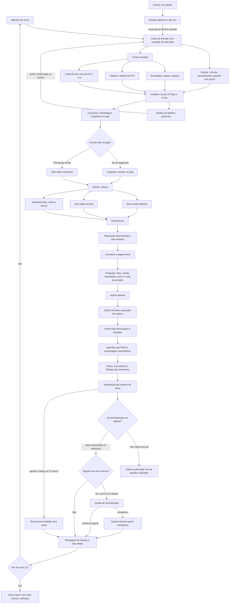
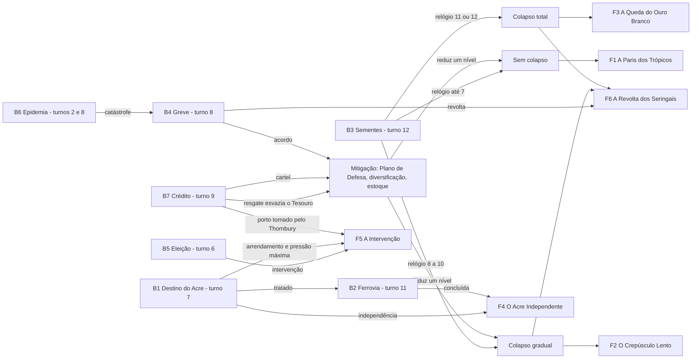
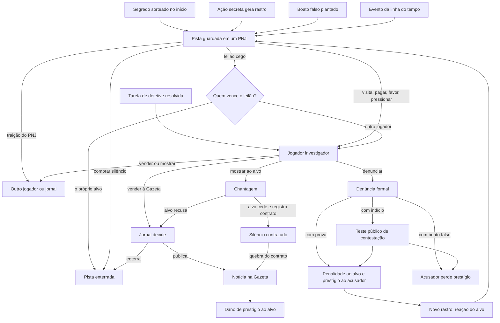

# Ouro Branco — Mapa de Interação

> Documentos irmãos: regras e números em [04-regras-e-jogabilidade.md](04-regras-e-jogabilidade.md); telas, painéis e estilo visual em [05-identidade-visual.md](05-identidade-visual.md).

> Documento 3 de 5. Descreve como os jogadores interagem com a história e entre si. Usa os nomes, lugares, datas, papéis, variantes e PNJs definidos em `01-historia-base.md` e `02-personagens-e-relacoes.md`. Números citados aqui (custos, limiares, dados) são propostas iniciais para teste; os valores de referência ficam no documento 04, e as dúvidas restantes estão na seção 10.

---

## 1. Princípios de interação

### 1.1 Os princípios

O sistema é o mestre. Isso significa, na prática:

1. **Tudo o que tem efeito no jogo passa pelo app.** Uma promessa feita no WhatsApp é só uma promessa; um contrato registrado no app é uma obrigação com custo de quebra.
2. **Toda incerteza é pública.** Quando há sorte, o jogador vê a probabilidade antes de confirmar a ação (por exemplo, "esta visita tem 50% de chance de render um boato ou mais").
3. **Todo texto foi escrito antes.** A Gazeta, as cartas privadas e as cartas de PNJ são modelos com variáveis ({JOGADOR}, {ALVO}, {PREÇO}, {LUGAR}), escolhidos por regras a partir do estado do jogo. Nenhuma IA escreve nada durante a partida.
4. **Tudo acontece dentro do sistema.** Não há notificação push, SMS ou mensagem automática no WhatsApp. Cada jogador tem uma **caixa de entrada** no seu painel, com contador de não lidos; o sistema limita os alertas a dois ou três por dia, e o turno principal deve caber em 15 minutos. O ritmo é dado pelo calendário fixo, não pelo celular apitando.
5. **Nenhum turno vazio.** Todo jogador recebe, a cada turno, pelo menos uma carta com uma escolha a fazer.
6. **Toda Gazeta termina com um gancho com prazo** ("a Assembleia vota o orçamento na quinta"), e todo prazo importante aparece como **relógio visível**.
7. **Toda dependência tem uma saída pior.** Ninguém fica preso a outro jogador: há sempre uma alternativa automática, só que mais cara, mais lenta ou mais arriscada.

Cada jogador tem, além dos recursos do seu papel:

- **Objetivo secreto com três marcos**: condições de estado que o sistema verifica a cada resolução (seção 1.2).
- **Prestígio**: reputação pública, visível para todos. É ferramenta, não placar: dá acesso a PNJs que exigem prestígio mínimo, pesa no voto, protege contra denúncias e é requisito de alguns marcos. Não decide a vitória nem desempata.
- **Ações**: por turno, duas ações abertas e uma secreta, mais a ordem de venda e os votos.
- **Pistas**: tudo o que descobriu (boatos, indícios, provas), cada pista com seu alvo e seu nível, guardada no painel O Caderno.
- **Relações com PNJs**: um valor de 0 a 5 com cada PNJ, privado.

### 1.2 Como se vence

- **Vence quem cumprir primeiro o objetivo secreto.** Cada objetivo tem **três marcos**, que são condições verificáveis pelo sistema ("ser credor de um seringal no Purus", "prestígio 6 ou mais", "Acre anexado por tratado"). Marcos podem ser perdidos e reconquistados: valem enquanto a condição for verdadeira.
- **Sinal de proximidade.** Quando alguém completa o segundo marco, a Gazeta publica uma nota indireta, sem nome ("Nos salões do Teatro Amazonas comenta-se que certa pessoa da sociedade já encomendou champanhe"). Todos sabem que alguém está perto; ninguém sabe quem.
- **Reivindicação.** A partir do turno 8, quem estiver com os três marcos ao fim de uma resolução pode reivindicar a vitória. A opção chega na caixa de entrada como reação rápida, na janela entre o fechamento e a publicação da Gazeta. Se reivindicar, a Gazeta anuncia **quem** reivindicou, mas não qual é o objetivo.
- **Turno de defesa.** Os demais têm o turno seguinte inteiro para derrubar pelo menos um marco do reivindicante (que também pode agir para se defender). Se, ao fim da resolução desse turno, os três marcos continuarem de pé, a vitória é confirmada, a Gazeta publica uma edição extraordinária e a partida termina com os epílogos do mundo (documento 1, seção 7). Se algum marco cair, a reivindicação cai e o jogo segue.
- **Fim do turno 12.** Se ninguém venceu antes, vence quem tiver mais marcos completos na última resolução. Empate: quem chegou primeiro a esse número de marcos.
- **Cartas de arco** (por volta dos turnos 5 e 9) trazem um atalho opcional para um marco e uma complicação. Não mudam o objetivo.

### 1.3 Economia em uma página

Os detalhes e números estão no [04](04-regras-e-jogabilidade.md); aqui fica só o desenho.

- **Três recursos:** contos de réis, lotes de borracha e prestígio.
- **Produção:** o seringal só produz se o aviamento foi pago antes (crédito ou caixa próprio).
- **Frete:** o lote precisa de vapor. Lote parado perde metade a cada turno.
- **Venda simultânea:** todos registram quanto vendem; a trilha de preço de Londres responde à **soma** das vendas de todos. Vender muito derruba o preço para todo mundo; segurar ajuda os outros (o dilema do cartel).
- **Exportação:** só o exportador vende direto em Londres. Os demais vendem a ele (preço negociado) ou à casa comercial automática, que paga 60% do preço (ver 04). O imposto de exportação é votado (referência: cerca de 20%).
- **Crédito e juros:** o banco de Londres (automático) empresta, cobra juros e corta crédito quando o preço cai.
- **Custo de posição:** todo turno, cada jogador paga o luxo de manter seu lugar na sociedade, e esse custo cresce com o prestígio.

---

## 2. O tabuleiro: quatro painéis

O app mostra o jogo em quatro painéis. Os três primeiros são públicos e iguais para todos; o quarto é privado. O desenho de cada um está no [05](05-identidade-visual.md).

| Painel | O que mostra | Para que serve |
|---|---|---|
| **O Rio** | Mapa com os seringais e seus donos, os vapores e suas rotas, as cargas em trânsito e paradas, a situação do Acre e das cachoeiras do Madeira | Ver quem depende de quem, onde a borracha está encalhada, quem está subindo o Purus |
| **A Bolsa** | Trilha de preço de Londres, histórico por turno, estoques declarados, dívidas públicas (contratos protestados, crédito do banco) | Decidir quanto vender, perceber cartéis e quedas, medir a fragilidade da pirâmide |
| **A Praça** | Registro público do turno: visitas abertas, contratos públicos, votos, doações, presenças (Teatro, missa, Flor-de-Lis, críquete), denúncias | Matéria-prima da investigação: quem esteve onde, com quem, quando |
| **O Caderno** | Privado: estado dos próprios marcos, pistas, relações com PNJs, alertas, cartas e a **caixa de entrada** com contador de não lidos | Tudo o que só você sabe; é onde chegam as cartas, os resultados e as reações rápidas |

A Gazeta é a capa: abre o turno e remete aos painéis ("veja na Praça quem compareceu à noite de gala").

---

## 3. Fluxo de um turno

Um turno dura cerca de 2,5 dias reais na partida piloto (3 turnos por semana, 12 turnos em cerca de 30 dias). Uma sugestão de calendário é: turno abre segunda às 9h, ordens fecham terça às 21h, resolução imediata, janela de reivindicação até quarta às 9h, Gazeta publicada quarta às 9h, e assim por diante (quarta a sexta, sexta a segunda).

### 3.1 O ritual do jogador

O turno principal deve caber em 15 minutos para quem quiser só o essencial:

1. **Ler**: a Gazeta e as cartas da caixa de entrada.
2. **Analisar**: cruzar A Praça e O Rio (e, se quiser, fazer tarefas de detetive).
3. **Conversar**: WhatsApp, fora do app, e propostas de contrato dentro do app.
4. **Decidir**: duas ações abertas, uma secreta, a ordem de venda e os votos.
5. **Resultado**: na abertura do turno seguinte.

### 3.2 Fases

1. **Abertura.** O app publica a Gazeta do turno (o resultado do turno anterior, os marcos fixos do novo, o anúncio de reivindicação se houver, o sinal de proximidade se houver e o gancho com prazo) e entrega a cada jogador, na caixa de entrada, suas cartas privadas: resultado das próprias ações, pistas obtidas, alertas, ofertas de PNJ, propostas de contrato recebidas, a carta de abertura (turno 1) e as cartas de arco (por volta dos turnos 5 e 9).
2. **Entre um turno e outro.** Tarefas de detetive opcionais (não gastam ação) e reações rápidas com janela de 12 horas (seção 4).
3. **Negociação livre.** Fora do app (WhatsApp, em grupo ou privado). Pode-se prometer, mentir, combinar, ameaçar. Nada disso vale até ser registrado.
4. **Registro de contratos e lances.** Dentro do app, a qualquer momento antes do fechamento. Contratos registrados não consomem ação. Lances em leilões de PNJ também não.
5. **Ordens.** Cada jogador escolhe duas ações abertas e uma secreta, registra a ordem de venda de lotes e, em turnos de votação, o voto (público depois da resolução, salvo voto secreto, se houver regra para isso).
6. **Fechamento e resolução.** O sistema resolve tudo em ordem determinística (seção 3.4).
7. **Janela de reivindicação.** Quem estiver com três marcos (a partir do turno 8) decide se reivindica.
8. **Publicação.** A Gazeta e as cartas do próximo turno são geradas; o ciclo recomeça.

### 3.3 Diagrama do turno

### 3.4 Ordem de resolução

A ordem é fixa e pública, para que os jogadores possam planejar.

1. **Contratos**: pagamentos e entregas registrados para este turno; quebras de contrato são marcadas.
2. **Economia**: aviamento, produção dos seringais, fretes (lotes parados perdem metade), vendas simultâneas e trilha de preço, exportação e imposto, juros e corte de crédito, custo de posição.
3. **Ações abertas**: em ordem de prestígio (maior primeiro); empates pelo dado público.
4. **Ações secretas**: em ordem inversa de prestígio (quem está atrás age por último e, portanto, com mais informação do estado do mundo). Cada uma gera seu rastro.
5. **Bifurcações e votações**: somam-se pontos; se for turno de resolução, aplica-se o desfecho.
6. **PNJs e automáticos**: agendas dos PNJs (leilões, ofertas, traições, batidas) e comportamento dos papéis sem jogador.
7. **Marcadores**: preço de Londres, Tesouro, Ordem, Saúde, Acre, Ferrovia, Relógio das Sementes, Pressão da Capital.
8. **Marcos**: o sistema verifica os marcos de todos; confirma ou derruba a reivindicação em defesa; registra quem chegou ao segundo marco (sinal de proximidade) e abre a janela de reivindicação para quem tem três.
9. **Publicação**.

---

## 4. Tarefas de detetive e reações rápidas

### 4.1 Tarefas de detetive

São quebra-cabeças opcionais entre os turnos, para quem gosta de investigar. **Não gastam ação.** O sistema os gera a partir dos dados reais da partida (o que está na Praça, no Rio, na Bolsa e nas Gazetas antigas), de modo que a resposta certa existe e é verificável. As respostas são de múltipla escolha ou de valor exato, para que a correção seja determinística.

- **Recompensa:** o primeiro a acertar leva a recompensa cheia (uma pista, contos ou +1 de relação com um PNJ); quem acertar depois, dentro do prazo, leva menos.
- **Erro:** custa pouco ou nada (na aposta de mercado, perde-se a quantia apostada, que tem teto baixo).
- **Prazo:** até o fechamento das ordens do turno.

Os cinco tipos, com um exemplo de cada:

| Tipo | Como funciona | Exemplo |
|---|---|---|
| **Cruzamento de registros públicos** | Combinar manifestos do porto, livro do Cartório, lista de presença no Teatro e horários de vapores | "Na noite de gala, o vapor *Tucunaré* deixou o Porto Flutuante às 23h rumo a Belém com 40 caixotes de 'material botânico'. O livro do Cartório do Primeiro Ofício traz dois contratos de frete lavrados na véspera. A lista de presença do Teatro Amazonas mostra que só uma das partes desses contratos não estava no camarote. Qual contrato corresponde à carga?" |
| **Telegrama cifrado** | Uma mensagem cifrada cuja chave está escondida numa Gazeta antiga | "Telegrama retido na Estação Telegráfica Subfluvial, de Manaus para Londres: ORWH VDL TXLQWD SHOR IXUR. A chave é o número de vapores atracados citado na Gazeta do turno 2." (Com deslocamento 3, lê-se "lote sai quinta pelo Furo".) |
| **Classificados da Gazeta** | Anúncios com mensagens codificadas; os jogadores também podem publicar os seus, pagando pouco, de forma anônima | "Precisa-se Rapaz Asseado, Trabalhador, Instruído, Com Ofício. Tratar na Rua da Alfândega." As iniciais formam PRATICO: alguém procura um prático que conheça o Furo do Paricá. O que o anunciante quer transportar? |
| **Aposta de mercado** | Prever a faixa de preço do próximo turno; como o preço depende da soma das vendas, apostar bem exige ler a Bolsa e adivinhar o cartel | "A borracha fina fechará o próximo turno em Londres em qual faixa: até 5 xelins por libra-peso; de 5 a 6; de 6 a 7; acima de 7?" |
| **Pergunta de PNJ** | Um PNJ faz uma pergunta cuja resposta está nos registros; acertar melhora a relação | Juvêncio Mares: "Quem estava no cais do Porto Flutuante na noite do incêndio no armazém da Rua da Alfândega?" (a resposta sai das presenças na Praça e dos vapores atracados no Rio) |

Os classificados publicados por jogadores não são verificados pelo sistema: são um canal anônimo e público de mensagens entre jogadores, que qualquer um pode tentar decifrar.

### 4.2 Reações rápidas

Alguns eventos abrem uma **janela de resposta de 12 horas** entre os turnos, que chega na caixa de entrada e conta no limite diário de alertas. Exemplos:

- **Contraoferta a suborno**: "Alguém ofereceu 20 contos ao deputado Fulano, que costuma votar com você. Cobrir a oferta?" (o deputado é PNJ; o ofertante não é revelado).
- **Lote encalhado**: um vapor quebrou no Purus com seus lotes a bordo; pagar um rebocador agora ou perder metade no próximo turno.
- **Leilão relâmpago de pista**: um PNJ põe uma pista sobre você à venda; dar lance para enterrá-la.
- **Reivindicação**: a janela entre o fechamento e a Gazeta para quem está com três marcos.

Quem não responde dentro da janela fica com a opção padrão, que é sempre não fazer nada.

---

## 5. Catálogo inicial de ações

### 5.1 Ações abertas gerais (qualquer papel)

Ações abertas aparecem para todos na Gazeta ou no painel A Praça, embora alguns detalhes possam ficar ocultos (por exemplo, todos sabem que alguém foi ao Cartório, mas não o que perguntou).

| Ação | Quem pode | Efeito na economia ou na história | O que fica público |
|---|---|---|---|
| **Investir** | Todos com dinheiro | Comprar bem produtivo (colocações, vapor, armazém, ações da ferrovia, negócio alternativo como castanha ou juta) | O investimento e o valor |
| **Diversificar** | Todos | Converter parte da fortuna em negócio fora da borracha; reduz ganho agora e protege do colapso; conta como mitigação em B3 | Que diversificou (valor oculto) |
| **Doar** | Todos | Doação à Santa Casa, à Matriz, à escola dos estivadores, ao asilo ou ao Teatro; dá prestígio e relação com o PNJ ligado | Doador e causa |
| **Patrocinar temporada** | Todos | Financia a temporada do Teatro Amazonas; prestígio proporcional; afeta o resultado da temporada | Patrocinador |
| **Visitar PNJ (aberta)** | Todos | Executa o procedimento de visita (seção 6); todos veem quem visitou quem, não o assunto | Visitante e PNJ |
| **Frequentar** | Todos | Comparecer à Flor-de-Lis, ao Teatro, à missa, ao críquete; +1 de relação com o PNJ do lugar; prestígio pequeno | Presença |
| **Propor projeto** | Governador; deputados (Coronel); qualquer um com contrato de apoio de deputado | Coloca um projeto em votação no turno seguinte | Projeto e proponente |
| **Discursar** | Todos | Empurra uma bifurcação em 1 ponto para o lado escolhido, custa prestígio pequeno se o lado perder | Discurso e lado |
| **Denunciar** | Todos com pista | Acusação pública (seção 8.3) | Acusador, alvo e acusação |
| **Vender pista ao jornal** | Todos com pista | O jornal (jogador ou automático) recebe a pista e decide publicar | Só se publicada |
| **Executar contrato** | A parte credora | Cobra um contrato quebrado; aciona garantia | A cobrança |

### 5.2 Ações abertas de papel

| Ação | Papel | Efeito |
|---|---|---|
| **Expandir colocações** | Coronel | Mais produção nos turnos seguintes; exige crédito e trabalhadores; aumenta Organização dos trabalhadores |
| **Reprimir fuga** | Coronel, Governador | Mantém produção; reduz Organização no curto prazo; gera rastro de violência com Abdias ou Dr. Valadares (é aberta, mas o rastro conta como indício) |
| **Conceder crédito** | Casa Aviadora (outros também, com menos eficiência) | Cria contrato de dívida; aumenta a fragilidade da pirâmide (B7) |
| **Executar título** | Casa Aviadora | Toma garantia de devedor inadimplente; pista pública no Cartório |
| **Classificar** | Exportador | Define a qualidade da borracha comprada de um jogador (pode rebaixar) |
| **Estoque regulador** | Exportador, Casa Aviadora | Compra e retém borracha para segurar preço; empurra B7 para cartel e conta como mitigação em B3 |
| **Fretar ou recusar** | Armador | Prioriza ou atrasa carga de um jogador por um turno |
| **Disputar concessão** | Armador e outros | Lance no leilão do Porto (turno 3) ou na renovação das linhas (turno 6) |
| **Decreto** | Governador | Uma medida por turno: alíquota temporária, nomeação, mobilização policial |
| **Fiscalizar o porto** | Governador | Aumenta a chance de apreender carga oculta no turno; afeta o estágio de Embarque do relógio |
| **Investir em saúde** | Governador (orçamento), Bispo (irmandades), qualquer doador | Sobe Saúde pública; decide B6 |
| **Escolher manchete** | Dono do jornal | Escolhe entre as três manchetes candidatas e pode enterrar uma notícia |
| **Publicar matéria** | Dono do jornal | Torna pública uma pista que possua; dano conforme o nível |
| **Levante** | Caudilho | Ataca Puerto Alonso, proclama governo ou defende o Acre; move B1 fortemente |
| **Expedição de coleta** | Naturalista | Sai de Manaus por um turno; coleta sementes ou investiga um seringal (gera pistas sobre quem estiver lá) |
| **Avançar a obra** | Engenheiro | Avança a ferrovia; gera mortos (rastro com Dr. Valadares) |
| **Emitir ações** | Engenheiro | Vende participação na ferrovia |
| **Convocar paralisação** | Líder seringueiro | Para o porto ou um seringal; move B4 |
| **Púlpito** | Bispo | Muda opinião pública sobre um tema ou pessoa |
| **Mediar** | Bispo | Oferece mediação em B1 ou B4 |
| **Nota diplomática** | Cônsul da Bolívia | Trava ação no Acre por um turno ou sobe a Pressão da Capital |
| **Oferecer concessão** | Cônsul da Bolívia | Promete direitos no Acre por contrato |
| **Noite de gala** | Empresário do Teatro | Evento que dá prestígio aos convidados e facilita ações secretas contra casas vazias naquele turno |

### 5.3 Ações secretas e seus rastros

Toda ação secreta gera um **rastro**: uma pista nova, de nível definido, colocada num PNJ plausível. Quem fez a ação recebe a informação de onde o rastro nasceu (o jogador sabe que "alguém no porto viu"), o que lhe permite tentar apagá-lo depois (comprar silêncio). O nível do rastro pode ser reduzido gastando mais (cuidado) ou aumentado por azar (dado público).

| Ação secreta | Quem pode | Efeito | Rastro gerado (nível e PNJ) |
|---|---|---|---|
| **Subornar** | Todos | Compra o voto de um deputado, a omissão de um fiscal ou o resultado de uma licitação; pode abrir reação rápida para quem já tinha aquele deputado | Indício com Queiroga (se houver papel) ou boato com Madame Odette (se em dinheiro vivo) |
| **Contrabandear borracha** | Coronel, Contrabandista, Caudilho, Exportador | Vende borracha sem pagar imposto; mais lucro; reduz Tesouro | Boato com Mestre Quirino; indício com Abdias se repetido |
| **Embarcar carga oculta** | Armador, Contrabandista, Exportador, Naturalista | Move sementes, armas ou documentos sem registro | Indício com Juvêncio (porto de Manaus) ou com Mestre Quirino (Belém e Furo) |
| **Coletar sementes** | Naturalista, Contrabandista, Exportador (pagando coletores) | Relógio +1 ou +2 no estágio de Coleta | Boato com Abdias |
| **Destruir sementes** | Todos com acesso (expedição, porto, armazém) | Relógio −2 nos estágios de Coleta ou Embarque | Boato com Juvêncio ou Abdias |
| **Sabotar vapor** | Todos (melhor com Contrabandista ou Armador) | Atrasa ou afunda carga de um rival; pode afetar navegabilidade | Indício com Mestre Quirino |
| **Plantar boato falso** | Todos | Cria uma pista falsa de nível boato sobre um alvo em um PNJ (melhor em Madame Odette) | Boato com Madame Odette sobre quem plantou (a chance é baixa, mas existe) |
| **Comprar silêncio** | Todos | Remove uma pista sobre si de um PNJ (o PNJ "esquece") | Boato com o mesmo PNJ ("fulano pagou para eu esquecer") com chance pública |
| **Espionar telégrafo** | Todos (bônus Exportador, Dono do jornal) | Lê telegramas de um alvo no turno; ganha um indício se houver | Indício com Benedita sobre quem pediu |
| **Roubar documento** | Todos (bônus em noite de gala) | Tenta obter uma prova de uma casa, escritório ou cofre | Indício com Delegado Matoso (se houver investigação) |
| **Falsificar documento** | Todos (pagando Lauro Fontes ou Queiroga) | Cria um contrato, título ou prova falsa; quem a usar em denúncia e for desmentido perde prestígio | Indício com o PNJ falsificador |
| **Armar homens** | Coronel, Caudilho, Contrabandista, Governador | Cria força armada para levante, repressão ou proteção | Indício com Juvêncio (desembarque de armas) |
| **Desviar verba** | Governador, Engenheiro, Empresário do Teatro | Transfere dinheiro público ou de investidores para si | Indício com Benedita (transferências) e, se grande, prova com Queiroga |
| **Incitar greve** | Todos (bônus Líder seringueiro) | Move B4 para greve; pode ser usado contra um coronel específico | Boato com Juvêncio |
| **Encomendar violência** | Coronel, Caudilho, Contrabandista, Governador (via polícia) | Elimina, assusta ou expulsa um PNJ menor ou um aliado de outro jogador (nunca um jogador) | Indício com Dr. Valadares e, se houver morte, prova com Delegado Matoso |
| **Chantagem anônima** | Todos com pista | Envia ao alvo uma carta mostrando a pista sem revelar quem a tem; exige algo | Boato com Lauro Fontes (a carta foi impressa ou escrita por alguém) |
| **Visitar PNJ (secreta)** | Todos | Como a visita aberta, mas ninguém vê | Boato no próprio PNJ ("fulano esteve aqui") com chance pública |
| **Cultivar em segredo** | Todos | Cultivar um PNJ sem que outros saibam | Sem rastro (custo: usa a ação secreta do turno) |

### 5.4 Ações livres (não consomem ação)

Registrar contratos, dar lances em leilões de PNJ, registrar a ordem de venda de lotes, votar na Assembleia (quem tem voto), mostrar uma pista a outro jogador (gera um registro privado entre os dois), aceitar ou recusar ofertas de PNJ que já chegaram em carta, fazer tarefas de detetive, publicar classificados, responder a reações rápidas e reivindicar a vitória (na janela própria).

---

## 6. Visita a um PNJ, passo a passo

### 6.1 Passo 1: sobre o quê perguntar

- **Uma pessoa** (um jogador específico): o resultado traz pistas apenas sobre ela e com precisão. Risco: se o alvo tiver *cultivado* esse PNJ, recebe um alerta no Caderno ("alguém perguntou por você ao tabelião"); se o resultado for "nada", há chance pública de o PNJ comentar.
- **Um tema** (Acre, sementes, porto, dívidas, febre, Teatro, greve, eleição): o resultado traz uma pista aleatória entre as que o PNJ tem sobre aquele tema, de qualquer jogador. É vago, mas discreto: ninguém é alertado.

Alguns PNJs só recebem quem tem prestígio mínimo (o cônsul britânico, por exemplo); abaixo disso, a visita não é oferecida.

### 6.2 Passo 2: abordagem

| Abordagem | Modificador no dado | Custo | Efeito na relação | Observação |
|---|---|---|---|---|
| **Pagar** | +2 | Dinheiro (proporcional ao nível desejado) | +0 | Gera rastro do pagamento |
| **Fazer favor** | +1 | Compromisso de uma ação aberta futura indicada pelo PNJ | +2 depois de cumprido | Se não cumprir, relação −3 e o PNJ espalha boato |
| **Pressionar** | Resultado garantido no nível máximo que ele tem sobre o alvo | Exige pista sobre o PNJ ou autoridade sobre ele | Cai para 0 | O PNJ dispara uma reação própria (ver ficha) |
| **Cultivar** | Sem teste | Ação | +1 | Passa a receber alertas de quem pergunta sobre você a esse PNJ |

### 6.3 Passo 3: resultado

Teste: **1d6 + relação + modificador da abordagem + modificador da pergunta** (pessoa: +0; tema: +1).

| Total | Resultado |
|---|---|
| 4 ou menos | Nada |
| 5–6 | Boato |
| 7–8 | Indício |
| 9 ou mais | Prova (se o PNJ tiver; senão, o melhor nível disponível) |

O app mostra as probabilidades antes da confirmação. Se o PNJ não tiver nenhuma pista sobre o alvo ou tema, o resultado é "nada", mas o app nunca revela se foi por falta de pista ou por azar (o jogador vê apenas "ele não disse nada de útil").

---

## 7. Como as ações alimentam as bifurcações

### 7.1 Tabela de pressões

| Bifurcação | Desfecho | Ações e papéis que empurram para ele | Turno de resolução |
|---|---|---|---|
| **B1 Acre** | Anexação por tratado | Governador (decreto de negociação), Cônsul da Bolívia (oferecer concessão), Bispo (mediar), Casa Aviadora e Coronel (financiar indenização), Engenheiro (cláusula ferroviária) | 7 |
| | Anexação pelas armas | Caudilho (levante), Coronel e Contrabandista (armar homens), Armador (transportar tropas), Dono do jornal (matérias patrióticas) | 7 |
| | Independência | Caudilho A (levante + proclamação), Exportador e Engenheiro (apoio estrangeiro), Contrabandista (armas), Estados Unidos via contrato | 7 |
| | Arrendamento | Cônsul da Bolívia A (nota diplomática, suborno), Governador B (atrasar), Exportador (capital do Bolivian Syndicate), derrota militar do Caudilho | 7 |
| **B2 Ferrovia** | Concluída limpa | Engenheiro (avançar obra), Governador (garantia), Bispo e Líder (exigir saneamento), investidores (ações), Saúde alta | 11 |
| | Concluída com escândalo | Engenheiro A (avançar sem saneamento), Desviar verba, Dono do jornal com prova | 11 |
| | Abandonada | Engenheiro B (desviar, emitir ações), Pânico de 1907 (turno 9), Contrabandista e Armador (sabotagem), Cônsul C (roubar planos) | 11 |
| | Nunca iniciada | Ninguém dá garantia até o turno 8; B1 sem cláusula; Armador e Contrabandista votam contra | 8 (verificação) |
| **B3 Sementes** | Impedidas (relógio baixo) | Governador (fiscalizar o porto), destruir sementes, denúncia com prova do agente, Armador (recusar frete), Exportador C, Naturalista B | 12 |
| | Atrasadas | Escândalo diplomático após embarque, Cônsul britânico hostil, crise de crédito em Londres | 12 |
| | Contrabandeadas | Agente de Kew (coletar, embarcar), Armador (transportar), Contrabandista (rota do Furo), Exportador A (financiar), Hargreave (proteção) | 12 |
| | Mitigação | Plano de Defesa da Borracha aprovado (turno 10), Diversificar, Estoque regulador, Lei do Aviamento aprovada | 12 |
| **B4 Greve** | Esmagada | Coronel (reprimir fuga, armar homens), Governador (polícia), Armador C (fura-greves), Casa Aviadora (cortar crédito à União) | 8 |
| | Acordo e Lei | Líder seringueiro (paralisação + negociação), Bispo (mediar, púlpito), Dono do jornal (matérias), deputados comprados, Exportador (ameaça de boicote) | 8 |
| | Revolta | Organização alta + lei rejeitada + repressão fracassada; Líder C; incitar greve; epidemia grave | 8 |
| **B5 Eleição** | Continuidade | Governador (decreto, gastos), Coronel (votos do Purus), Casa Aviadora (dinheiro), Delegado Matoso (urnas) | 6 |
| | Oposição | Dono do jornal A (campanha), Bispo (púlpito), Líder (multidão), suborno de deputados | 6 |
| | Intervenção | Dono do jornal C (dossiê), Governador C (Guarda Estadual), fraudes provadas, Pressão da Capital alta | 6 |
| **B6 Epidemia** | Contida / Grave / Catástrofe | Investir em saúde (Governador, Bispo, doadores), Naturalista C, Dr. Valadares (aviso), Empresário (baile beneficente); sem investimento tende a grave | 2 e 8 |
| **B7 Crédito** | Resiste | Casa Aviadora com caixa, devedores em dia, Diversificar | 9 |
| | Falências | Excesso de crédito concedido nos turnos 1–8, Exportador B (cartel contra a Casa), Engenheiro B (ações podres), saques, corte de crédito do banco de Londres | 9 |
| | Resgate | Governador (decreto de resgate), Assembleia | 9 |
| | Cartel | Exportador e Casa Aviadora com Estoque regulador registrado em contrato | 9 |

### 7.2 Diagrama das bifurcações aos epílogos

Leitura: setas para o mesmo epílogo representam condições que precisam se combinar (por exemplo, F6 exige revolta em B4 **e** colapso gradual ou total). A prioridade entre epílogos segue a tabela do documento 1 (F5 > F6 > F4 > F3 > F2 > F1). Os epílogos descrevem o mundo e não decidem quem venceu; a vitória vem dos marcos (seção 1.2).

---

## 8. Ciclo de informação

### 8.1 Nascimento de uma pista

Uma pista pode nascer de cinco formas:

1. **Segredo de variante**: no início da partida, cada segredo sorteado é decomposto nas três pistas da ficha do personagem e depositado nos PNJs indicados.
2. **Rastro**: toda ação secreta gera uma pista nova (seção 5.3).
3. **Boato plantado**: um jogador cria uma pista falsa de nível boato num PNJ.
4. **Evento**: marcos fixos e agendas de PNJ geram pistas (por exemplo, a auditoria do Tesouro no turno 5 ou a intervenção federal).
5. **Tarefa de detetive**: quem acerta primeiro pode receber uma pista como recompensa (seção 4.1).

Cada pista tem: alvo, nível, tema, verdade (verdadeira ou falsa, oculta de todos exceto do sistema), PNJ guardião e lista de quem já a conhece.

### 8.2 Circulação

- **PNJ → jogador**: por visita (seção 6), por oferta espontânea do PNJ (relação alta), por leilão cego.
- **Jogador → jogador**: mostrar a pista (livre; gera registro privado), vender em contrato registrado, entregar como garantia.
- **Jogador → jornal**: vender ao jornal; o Dono do jornal (ou a Gazeta automática) decide publicar.
- **PNJ → PNJ ou PNJ → jornal**: traição (Madame Odette revende, o Delegado vende a dois, Benedita amargurada vende à Gazeta).
- **Jogador → PNJ**: comprar silêncio (remove a pista do PNJ, não de quem já a sabe).

### 8.3 Resolução

- **Chantagem**: o detentor mostra a pista ao alvo (aberta ou anônima) e exige algo em contrato registrado. Se o alvo cumprir, o contrato inclui a cláusula de silêncio (quebrar o silêncio passa a ser quebra de contrato). Se não cumprir, o chantagista decide se publica.
- **Publicação**: a pista vira notícia na Gazeta. Boato publicado: prestígio −1 do alvo, e o alvo pode desmentir com sucesso se a pista for falsa (quem vendeu perde prestígio). Indício publicado: prestígio −2 e um efeito leve (perda de um voto, desconfiança de contratos). Prova publicada: prestígio −3 e efeito do segredo (ver abaixo).
- **Denúncia formal**: ação aberta. Com **prova**: penalidade ao alvo conforme o segredo (perda de concessão, multa, prisão por um turno que bloqueia ações abertas, expulsão no caso do Cônsul da Bolívia, perda de cargo no caso do Governador) e prestígio para o acusador. Com **indício**: o alvo pode contestar; o resultado depende de um teste público (dado mais prestígio de cada um). Com **boato verdadeiro**: efeito pequeno. Com **boato falso**: o acusador perde prestígio; o alvo ganha um pouco.
- **Enterro**: o alvo pode dar lance em leilão cego para enterrar a pista (sai do jogo), comprar silêncio de cada PNJ que a tenha, ou negociar com quem a conhece.

Como prestígio é requisito de alguns marcos e protege contra denúncias, publicar ou denunciar é também a forma mais direta de **derrubar um marco** de quem reivindicou.

### 8.4 Diagrama do ciclo

---

## 9. Exemplos de intriga numa partida de 8 jogadores

Configuração dos exemplos (8 jogadores): Coronel, Casa Aviadora, Exportador, Armador, Governador, Dono do jornal, Caudilho e Naturalista. Papéis automáticos: Engenheiro, Líder seringueiro, Bispo, Contrabandista, Cônsul da Bolívia e Empresário do Teatro.

Os marcos citados nos exemplos são **ilustrativos**, para mostrar a regra de vitória funcionando; os marcos de cada variante estão nas fichas do documento 2 e os limiares no documento 4.

### 9.1 "Folha de bananeira" — as sementes no vapor Tucunaré

**Variantes envolvidas.** Naturalista A (O Ladrão de Sementes, agente de Kew); Armador A (Os Vapores Fantasmas); Exportador C (A Segunda Família, quer salvar Manaus, alvo: Naturalista); Governador A (O Cofre do Teatro); Dono do jornal A (Pena de Aluguel).

Marcos ilustrativos do Exportador C: (1) o Naturalista sofreu publicação ou denúncia com prova ligada às sementes; (2) prestígio 6 ou mais; (3) estoque regulador ativo, registrado em contrato.

| Turno | Naturalista | Armador | Exportador | Governador | Dono do jornal |
|---|---|---|---|---|---|
| 1 | Secreta: *Coletar sementes* no baixo Purus (relógio 1; rastro: boato com Abdias). Aberta: *Frequentar* o críquete (relação com Hargreave 3) | Aberta: *Disputar concessão* sondando votos. Secreta: nenhuma relevante | Aberta: *Cultivar* Abdias (quer saber de sementes, porque seu objetivo exige pegar o agente) | Aberta: *Decreto* lançando o Teatro | Escolhe manchete sobre o telégrafo |
| 2 | Secreta: *Coletar sementes* nas terras do Coronel (relógio 3; rastro: boato com Abdias, agora repetido) | Recebe proposta do Naturalista no WhatsApp para levar "orquídeas para Londres"; não registra nada ainda | Recebe alerta de Abdias (cultivado): "o doutor do Museu comprou sementes de seringa". Visita Abdias por **tema "sementes"** pagando: obtém o boato | Investe em saúde (febre) | Compra o boato de Madame Odette sobre o Governador (Teatro) |
| 3 | Registra **contrato de frete** com o Armador: "material botânico, 40 caixotes, turno 4". Aberta: *Expedição de coleta* (relógio 4) | Aceita o frete, que paga o dobro. Secreta: *Comprar silêncio* de Mestre Quirino sobre o Jacy (seu próprio segredo) | Mostra o boato ao Governador no WhatsApp e propõe fiscalização do porto em troca de apoio no orçamento; o Governador quer contrato | Registra contrato com o Exportador: "fiscalização no turno 4 em troca de voto no orçamento" | Publica boato sobre "mármore folheado a ouro" (o Governador perde 1 de prestígio) |
| 4 | Secreta: *Embarcar carga oculta* no Tucunaré (rastro: indício com Juvêncio). A saída do vapor aparece no painel O Rio e vira tarefa de cruzamento para quem quiser | Transporta, conforme contrato | Secreta: *Espionar telégrafo* do Naturalista: obtém indício ("lote", "germinação") | Aberta: *Fiscalizar o porto*, conforme contrato. O dado público dá 50% de apreensão: **falha**. O relógio vai a 5 | Recebe do Exportador o indício e decide não publicar ainda: oferece-se para guardar em troca de mensalidade (ele é Pena de Aluguel) |
| 5 | Carta de arco (a mãe pergunta): atalho e complicação; ele mantém o caminho. Secreta: *Comprar silêncio* de Juvêncio (falha parcial: boato com Juvêncio de que alguém pagou) | Carta de arco: auditoria do Jacy. Ele precisa do Governador | Visita Hargreave com **Fazer favor** (promete um relatório elogioso ao cônsul): relação 4, rola alto: **prova** (contrato com Kew) | Precisa do Armador para a eleição (votos do interior via vapores) | Vê a chance do furo do século |
| 6 | Relógio em 5 antes do fim do turno 6: um dos marcos dele está cumprido | Registra com o Governador: "nomeação de auditor amigo" em troca de transporte gratuito de eleitores | Aberta: **Denunciar com prova** o Naturalista. Penalidade: Ashby perde licença do Museu e prestígio −3; o Exportador ganha prestígio e chega a 6. **Marcos 1 e 2 completos**: a Gazeta publica o sinal de proximidade, sem nome | Vence a eleição (B5 continuidade) | Publica a denúncia em manchete; ganha prestígio, mas perde a mensalidade de quem pagava para silenciar |

**Resultado.** As sementes já germinaram em Kew (relógio 5), mas o agente está exposto e não poderá atuar com facilidade nos estágios seguintes; o relógio passa a depender de Londres e cresce mais devagar. O Exportador tem dois marcos e falta o terceiro (estoque regulador), o que o empurra para um contrato com a Casa Aviadora, que sabe que ele está perto porque leu o sinal de proximidade e viu a denúncia na Praça. Se ele registrar o estoque e reivindicar no turno 8, os outros terão o turno 9 para derrubar um marco: o mais frágil é o prestígio, e o Governador, que guarda a prova do contrato da fiscalização, pode publicá-la para tirar dele um ou dois pontos. O Armador sai ileso do caso das sementes, mas devendo favores ao Governador.

### 9.2 "Duas hipotecas para uma casa só" — a quebra da Casa Saraiva

**Variantes envolvidas.** Coronel B (Falido de Casaca, alvo: Casa Aviadora); Casa Aviadora A (Os Livros Duplos, alvo: Exportador); Exportador B (O Cartel, alvo: Casa Aviadora); Dono do jornal B (O Fugitivo do Boa Esperança, alvo: Coronel).

| Turno | Coronel | Casa Aviadora | Exportador | Dono do jornal |
|---|---|---|---|---|
| 1 | Pede crédito grande à Casa (contrato registrado, garantia: o seringal) | Concede, porque precisa de juros para cobrir o rombo | Aberta: *Classificar* a borracha do Coronel como entrefina (preço menor) | Aberta: *Cultivar* Abdias (quer saber do barracão) |
| 2 | Secreta: *Subornar* um fiscal para atrasar o protesto de outra dívida (rastro: indício com Queiroga) | Secreta: *Espionar telégrafo* do Coronel: descobre telegramas a Belém (indício: a segunda hipoteca) | Propõe à Casa, no WhatsApp, um estoque regulador conjunto; ela recusa | Visita Abdias sobre **a pessoa** Coronel, pagando: obtém boato ("o Coronel está devendo até a alma") |
| 3 | Recebe alerta (cultivou Queiroga): "alguém perguntou por você". Secreta: *Comprar silêncio* de Queiroga (custa caro) | Visita Queiroga por **Pressionar** (ela tem a prova das dívidas de jogo dele, comprada de Madame Odette): obtém a **prova** da segunda hipoteca, apesar do silêncio comprado, porque a pressão é garantida (o silêncio só vale para visitas comuns) | Secreta: *Plantar boato falso* em Madame Odette: "a Casa Saraiva está quebrada" (que é verdade, sem ele saber) | Publica o boato sobre a dívida do Coronel (−1 prestígio) |
| 4 | Carta de chantagem da Casa: "pague ou eu executo as duas hipotecas". Ele propõe reestruturar | Registra contrato com o Coronel: dívida reestruturada com juros maiores e cláusula de silêncio para ambos | Visita Benedita (favor: recomenda a promoção dela) e obtém indício dos pedidos de prorrogação da Casa | Compra de Madame Odette o boato plantado sobre a Casa |
| 5–8 | Paga os juros com dificuldade; diversifica escondido | Atrai depósitos novos para sobreviver (carta de arco: os sobrinhos chegam; ela escolhe Comprar) | Rebaixa todos os lotes que vêm da Casa (cartel), apertando o caixa dela; a trilha da Bolsa mostra os preços que ele paga | Carta de arco: Abdias o reconhece como fugitivo; paga silêncio com favor |
| 9 | Pânico de 1907; o banco de Londres corta crédito. Ele **quebra o contrato** de propósito, sabendo que a Casa não pode executar sem expor a prova que ela mesma usou | Precisa decidir: executar (expõe o Coronel e, pela cláusula de silêncio quebrada, libera o Coronel para expor o rombo dela) ou perdoar (dá ao Coronel o marco "dívida com a Casa extinta") | Oferece-se para comprar os títulos podres da Casa com desconto (se ela aceitar, ele absorve o prejuízo e completa um marco dela; se recusar, ela pode quebrar e ele completa um marco seu) | Publica o indício sobre a Casa; corrida de depositantes |

**Resultado possível.** Se a Casa vender os títulos ao Exportador, ela sobrevive e completa o marco "o alvo absorveu prejuízo"; o Exportador fica dono das dívidas do Coronel, o que mantém aberto o marco do Coronel ligado à dívida. Se ela recusar e quebrar, o Coronel e o Exportador completam, cada um, o marco que dependia da quebra, e o Dono do jornal ganha a manchete do ano. Suponha que o Coronel, já com os outros dois marcos, reivindique ao fim do turno 9: no turno 10, o Dono do jornal (cujo alvo é o Coronel) pode publicar o que sabe sobre o barracão para derrubar o marco de prestígio, e o Exportador pode comprar dívidas antigas do Coronel no Cartório para recriar a pendência. Em qualquer caso, a crise B7 se resolve com peso real das escolhas dos jogadores, e não só do evento fixo.

### 9.3 "A guerra paga" — o levante do Acre

**Variantes envolvidas.** Caudilho B (O Homem de Manaus, financiado; alvo: Coronel); Coronel C (O Dono das Terras do Acre, alvo: Caudilho); Governador B (Vendido à Bolívia, alvo: Caudilho); Armador C (Os Porões). Cônsul da Bolívia automático.

| Turno | Caudilho | Coronel | Governador | Armador |
|---|---|---|---|---|
| 3 | Puerto Alonso é instalado. Aberta: *Discursar* pela anexação | Precisa de anexação por **tratado** (seus títulos bolivianos só valem se registrados antes do turno 7). Registra financiamento ao Caudilho por contrato, sem saber que o Caudilho B quer terras dele em troca | Recebe o dinheiro da Bolívia; precisa evitar anexação **pelas armas** | Transporta rifles para o Caudilho (pago pelo Coronel) |
| 4 | Secreta: *Armar homens* (rastro: indício com Juvêncio sobre os rifles) | Aberta: registra os títulos do Acre no Primeiro Ofício (gera pista com Queiroga e aparece na Praça) | Secreta: *Subornar* deputados para um projeto de "negociação pacífica"; um deputado já ligado ao Coronel abre ao Coronel uma reação rápida de contraoferta | Secreta: *Embarcar carga oculta* de arigós para seringais do Acre |
| 5 | Carta de arco: seus homens desconfiam. Aberta: *Levante* contra Puerto Alonso (vitória pelo dado público) | Alarmado: se o Caudilho vencer pelas armas, ele perde a aposta no tratado | Visita Juvêncio sobre **tema "Acre"**: obtém o indício dos rifles e descobre que vieram do Coronel | Juvêncio, cultivado pelo Caudilho, avisa o Caudilho de que o Governador perguntou |
| 6 | Pede ao Coronel, por contrato, terras do Boa Esperança no Acre "após a vitória" | Recusa registrar. Secreta: *Plantar boato falso* em Madame Odette: "Galvão quer ser rei do Acre" (para afastar aliados) | Usa o indício dos rifles para chantagear o Coronel: "financie o tratado, não a guerra" | Fica com o Governador para garantir a renovação da concessão |
| 7 | Avança mais uma vez. Mas o boato plantado reduz o apoio do Dono do jornal, que publica "o rei do Acre" | Muda de lado: financia a indenização do Tratado de Petrópolis (contrato com o Governador) | Fiscaliza o porto e bloqueia munição; propõe o tratado | Recusa frete ao Caudilho (ação de papel) |

**Resultado possível.** Com o financiamento do Coronel virando para o tratado, a munição bloqueada e a opinião pública abalada pelo boato falso, B1 termina em **anexação por tratado**. O Coronel completa o marco dos títulos registrados com tratado; o Governador completa o de "nenhuma anexação pelas armas". Se ambos já tinham os outros dois marcos, os dois podem reivindicar ao fim do turno 8, e o turno 9 vira uma corrida dupla: cada um tenta derrubar um marco do outro, e o Caudilho, que guarda a prova das cartas do financiador com Frei Bonifácio, tenta derrubar os dois. Se ele descobrir que o boato "rei do Acre" foi plantado pelo Coronel (visitando Madame Odette), pode denunciar o Coronel por boato falso, recuperar prestígio e tirar do Coronel o marco que dependia de prestígio.

---

## 10. Perguntas em aberto de design

Já decididas e retiradas desta lista: a fórmula de vitória (marcos e reivindicação), o desempate (quem chegou primeiro ao número de marcos), o papel do prestígio (ferramenta, não critério) e as notificações (só dentro do sistema). Os números da economia estão sendo fixados no [04](04-regras-e-jogabilidade.md); o que segue é o que ainda falta decidir.

### 10.1 Vitória e marcos

1. **Reivindicação fracassada.** *Decidido:* −1★ e nenhuma reivindicação no turno seguinte. Não existe blefe: só reivindica quem tem os 3 marcos cumpridos (ver 04).
2. **Duas reivindicações no mesmo turno.** *Decidido:* vence quem completou o 3º marco primeiro; se foi na mesma resolução, dado público (ver 04).
3. **O Caderno mostra em tempo real se cada marco está cumprido?** Proposta: sim. Mas um marco ligado a marcador oculto (Relógio das Sementes, Pressão da Capital) revela ao dono parte desse marcador. Aceitar o vazamento ou redigir esses marcos de outro jeito?
4. **Marcos fáceis demais cedo.** Uma condição de estado como "relógio em 7 ou menos" é verdadeira desde o turno 1. Regra de redação proposta: cada objetivo tem pelo menos um marco que exige uma ação ou um evento (contrato, votação, denúncia), não apenas um estado.
5. **Marcos que só podem acontecer tarde** (dependem da ferrovia no turno 11, por exemplo) deixam o dono sem chance de vencer cedo. Equilibrar por variante ou aceitar como perfil de jogo?
6. **Sinal de proximidade:** texto único ou variado por tema? Variar por tema ("nas rodas do porto", "na sacristia") ajuda a deduzir quem é; pode ser desejável, mas precisa de teste.
7. **Reivindicação no fim do turno 11** deixa o turno 12 como defesa; **no fim do 12** não há defesa e vale a contagem. Está bom assim?
8. **Epílogo quando a partida acaba cedo:** a projeção dos turnos restantes com comportamento padrão (documento 1, seção 7) é aceitável, ou é melhor um epílogo curto "o mundo em suspenso"?
9. **Cartas de arco:** quanto o atalho encurta (dá um marco, troca a condição de um marco por outra mais fácil, reduz um limiar)? E a complicação, é sempre pública?
10. Como tratar jogadores cujos marcos dependem de um alvo que abandonou a partida (o papel vira automático e o marco continua possível, ou é trocado)?

### 10.2 Tarefas de detetive e reações rápidas

11. Quantas tarefas por jogador por turno? Proposta: até duas, iguais para todos, para não premiar só quem tem mais tempo livre.
12. Recompensa do primeiro versus dos seguintes: cheia e metade, ou só o primeiro leva?
13. Cifras simples (deslocamento, acróstico) são resolvidas em segundos por quem usa ferramentas. Aceitar, ou preferir tarefas que dependem de ler a partida (cruzamentos) e não de força bruta?
14. Classificados de jogadores: quanto custam, quantos por turno, e o sistema registra o autor (para uma visita a Lauro Fontes revelar)?
15. Uma janela de reação de 12 horas pode cair inteira de madrugada. Pausar o relógio entre 23h e 7h?
16. O que acontece quando há mais eventos do que o limite de dois ou três alertas por dia: agrupar num resumo, adiar ou descartar os menos importantes?
17. Sem notificação automática, como o jogador sabe que o turno abriu? Proposta: o calendário fixo basta; o grupo de WhatsApp pode combinar um lembrete manual entre os próprios jogadores.

### 10.3 Informação e segredos

18. A probabilidade pública do teste de visita deve mostrar o resultado esperado considerando as pistas que o PNJ realmente tem (revelando que existe algo) ou apenas a distribuição genérica? Os documentos assumem a genérica.
19. Quantas visitas um PNJ atende por turno? (Proposta: ilimitado até 8 jogadores, fila de três a partir de 9.)
20. Quantos boatos falsos um jogador pode plantar por turno, e qual a chance de o plantio ser descoberto?
21. Denúncia com indício deve existir ou só com prova e boato? Ela adiciona nuance, mas também complexidade.
22. O jogador vê no próprio caderno se uma pista é falsa? (Proposta: não; só o sistema sabe.)
23. Quais registros entram na Praça e quais ficam ocultos (por exemplo, contratos privados aparecem só como "contrato entre X e Y" ou nem isso)? Isso define a dificuldade das tarefas de cruzamento.

### 10.4 Papéis, variantes e escala

24. Regra do Agente de Kew: quando duas variantes de agente forem sorteadas, a segunda é trocada (como proposto) ou os dois agentes coexistem e competem (o que acelera o relógio e cria uma subtrama)?
25. As variantes têm dificuldade parecida, agora medida pelos marcos? Algumas (Casa Aviadora B, Governador A) parecem mais fáceis; outras (Dono do jornal C, Contrabandista C) exigem muitas condições. Precisa de teste.
26. A ordem de entrada dos papéis de Expansão (Engenheiro 9, Líder 10, Bispo 11, Contrabandista 12, Cônsul 13, Empresário 14) é a melhor? Uma alternativa é sortear quais entram entre 9 e 13.
27. O criador do jogo, se for jogar, deve ser impedido de ver a tabela de pistas e os marcos no código? (Na prática, a proteção é o sorteio de 3 variantes por papel; vale considerar um modo "designer cego" que esconde as fichas no painel de administração.)
28. Personagens podem morrer? Os documentos assumem que nunca um jogador, mas PNJs e automáticos podem. Isso vale também para a catástrofe da febre?
29. Um jogador pode se candidatar na eleição do turno 6, ou só apoiar candidatos?
30. O que acontece se um jogador abandona a partida: o papel vira automático (com o comportamento padrão) e os segredos continuam no mundo?

### 10.5 Ritmo e interface

31. Três turnos por semana são sustentáveis para um grupo de amigos adultos? Considerar um botão de "turno longo" para fins de semana.
32. Como lidar com quem não envia ordens: ações padrão (cultivar, investir, vender metade dos lotes) ou ações perdidas?
33. O turno principal cabe mesmo em 15 minutos? Quantas notícias por Gazeta e quantas cartas por jogador cabem nesse tempo?
34. Quantos modelos de texto (cartas de PNJ, manchetes, arcos, sinais de proximidade, tarefas) são necessários? Uma estimativa grosseira: 14 papéis × 3 variantes × 2 arcos × 2 a 3 ramos, mais cerca de 30 cartas por PNJ, mais cerca de 150 manchetes, mais os modelos de tarefa de detetive. É um volume grande de escrita prévia e precisa de planejamento.
35. O voto na Assembleia é sempre público? Um voto secreto em certos projetos aumentaria a intriga.

### 10.6 Decisões tomadas nestes documentos que merecem revisão

36. A partida usa lugares e potências reais em história alternativa ("e se as sementes ainda não tivessem saído em 1890?"). Quem conhece a história real pode tentar jogar "contra o gabarito"; o final aberto e a cronologia comprimida bastam para manter a surpresa?
37. A cronologia das sementes foi deslocada para dentro da partida (o contrabando real foi anterior); a janela de embarque crítica é até o turno 6.
38. O Relógio das Sementes é oculto, com notícias indiretas na Gazeta; uma alternativa é deixá-lo público, aumentando a tensão coletiva e diminuindo a intriga.
39. Foram acrescentados três PNJs (Abdias, o regatão; Mestre Quirino, o prático-mor; Lauro Fontes, o tipógrafo).
40. O cônsul do país vizinho jogável é o da Bolívia; o cônsul britânico é PNJ.
41. Os epílogos do mundo são compostos por dois eixos (econômico e político) com prioridade fixa e parágrafos secundários; vale testar se os jogadores preferem um epílogo único mais longo.
