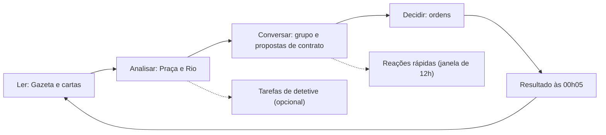

# Ouro Branco: Regras e Jogabilidade

> Valores do modo piloto (seção 8) calibrados com [simulador/economia.py](simulador/economia.py): caixa e seringais por papel, renda fixa, crédito de aviamento, frete ao armador e oferta do sistema.
> Documento de regras do sistema: como se vence, como é um turno, como funciona a economia e o que mantém o jogo vivo entre os turnos.
> Ambientação em [01-historia-base.md](01-historia-base.md) · Personagens em [02-personagens-e-relacoes.md](02-personagens-e-relacoes.md) (**contém spoilers**) · Interações em [03-mapa-de-interacao.md](03-mapa-de-interacao.md) · Visual em [05-identidade-visual.md](05-identidade-visual.md)

Todos os números deste documento são **provisórios**. Eles servem de ponto de partida para o simulador em planilha e devem ser ajustados com partidas de teste.

---

## 1. Princípios

1. **O sistema é o mestre.** Toda regra é determinística. Quando há sorte, a probabilidade é pública antes da decisão. Nenhuma IA roda durante a partida: todo texto do jogo é escrito antes, com variáveis.
2. **Ganha quem cumpre o próprio objetivo primeiro.** Dinheiro e prestígio são meios, nunca o placar.
3. **Todo mundo depende de alguém, e toda dependência tem uma saída pior.** Ninguém consegue travar sozinho o jogo de outra pessoa, e sempre há algo a negociar.
4. **Conta de cabeça.** Valores pequenos. Um turno se decide em 10 a 15 minutos no celular.
5. **Sempre há algo em jogo.** Todo turno termina com um prazo pendente e toda pessoa recebe pelo menos uma escolha.
6. **Tudo dentro do sistema.** Não há notificação por push, SMS ou WhatsApp. O jogo avisa pela caixa de entrada do próprio app. A conversa entre jogadores acontece por fora, onde o grupo quiser.

---

## 2. Vitória

### 2.1 Objetivo em 3 marcos

Cada jogador recebe, por sorteio, um papel e uma das três variantes de objetivo secreto desse papel. O objetivo é sempre formado por **3 marcos**:

- Cada marco é uma **condição de estado** que o sistema verifica sozinho. Exemplos: "possuir 2 seringais no Acre", "ter dívida ativa do armador a seu favor", "ser nomeado barão".
- Cada marco exige **interagir com pelo menos um outro jogador**: um contrato, um voto, uma troca ou um conflito.
- Marcos **podem ser perdidos e reconquistados**, porque são estados. Se você vende o seringal, o marco cai.
- O Caderno mostra os seus 3 marcos como **selos de lacre**: vazio, cumprido ou perdido.
- **Calibragem:** sem oposição, os 3 marcos levam de 7 a 9 turnos. Com oposição, de 10 a 12.

### 2.2 Sinal de proximidade

Quando alguém completa o **2º marco** (estando os três ao mesmo tempo ou não), a Gazeta do turno seguinte publica uma nota indireta, sem nome. Exemplo: *"Fontes do Cartório indicam que uma das grandes casas de Manaus está a um passo de algo grande."* A nota é escrita para cada variante, de modo que leitores atentos possam deduzir quem é.

### 2.3 Reivindicação

1. Se ao fim da resolução os **3 marcos estiverem cumpridos ao mesmo tempo**, abre-se para o jogador uma **reação rápida de 12h** para **Reivindicar**. A defesa dos outros acontece no turno seguinte.
2. Não é permitido reivindicar antes do **turno 8**. (O simulador de marcos mostrou que, liberando no turno 6, a mesa vence por volta do turno 7. No turno 8, quase todas as vitórias caem entre os turnos 9 e 12.)
3. A Gazeta seguinte anuncia em destaque **quem reivindicou**, mas não qual é o objetivo.
4. Os demais têm **1 turno** para derrubar pelo menos um marco. Para isso precisam deduzir quais são os marcos, usando pistas, a Praça e o Rio.
5. Ao fim desse turno, se os 3 marcos continuarem de pé, o jogador **vence e a partida acaba**. Se algum cair, a reivindicação falha e o jogo segue. A punição é leve: **−1★ e nenhuma reivindicação no turno seguinte**. Depois disso o jogador pode reivindicar de novo.
6. Se duas pessoas reivindicarem no mesmo turno e as duas sobreviverem, vence quem completou o **3º marco primeiro**. Se foi na mesma resolução, decide um dado público.
7. **Nenhum marco começa cumprido.** Todo objetivo tem pelo menos um marco que exige uma ação ou um evento provocado pelo jogador.

### 2.4 Fim no turno 12

Se ninguém vencer até o fim do turno 12, vence quem tiver **mais marcos cumpridos** naquele momento. Se houver empate, vence quem atingiu esse número **primeiro**. Em seguida o jogo exibe o **epílogo do mundo**, ou seja, o estado econômico e político final (ver documento 01, seção 7), independente de quem venceu.

### 2.5 Cartas de arco

- **Turno 1:** apresenta o personagem, o objetivo e o contexto.
- **Turnos ~5 e ~9:** cada carta traz um **atalho opcional** e uma **complicação**.
  - O **atalho** é um caminho alternativo e mais arriscado para cumprir um dos marcos.
  - A **complicação** é um obstáculo novo, ou o aviso de que uma pista sua vazou para algum personagem não-jogável.
- O objetivo **nunca muda**.

### 2.6 Atalhos de recuperação

- **Nenhum objetivo fica impossível.** Quando um marco depende de uma bifurcação ou de um evento único que saiu para o lado errado, abre-se um **atalho de recuperação** (descrito na ficha da variante). Ele é mais caro, leva de 2 a 3 turnos, exige outro jogador e deixa rastro.
- **Marco por caminho original × marco por atalho.** O marco cumprido pelo desfecho original de uma bifurcação já resolvida é **intocável**. O marco cumprido por atalho depende de um contrato e **pode ser derrubado** como qualquer contrato: quitando, rescindindo com multa ou denunciando com prova. Essa regra vale sobre qualquer linha "intocável" das fichas.
- **Atrasar o Relógio das Sementes depois da germinação.** A partir da posição 5 o relógio não volta mais. A ação secreta **Mexer nas sementes** (Naturalista) ou a ação aberta **Fiscalizar o porto** (Governador), quando bem-sucedida, pode **congelar o relógio por 1 turno**, inclusive o avanço automático do senhor Grey. É no máximo um congelamento por turno, qualquer que seja o número de jogadores agindo. Um marco que peça "o relógio não andou por 2 turnos" se cumpre com dois congelamentos seguidos.

### 2.7 Prestígio é ferramenta

O prestígio vai de 0 a 10 e não conta pontos. Ele serve para:

| Uso | Regra provisória |
|---|---|
| Abrir portas | Alguns personagens não-jogáveis só recebem visitas com prestígio mínimo (o cônsul britânico pede 5, o bispo pede 3) |
| Peso na Assembleia | Voto vale 1, mais 1 se o prestígio for 6 ou mais |
| Resistir a denúncias | Uma denúncia baseada em indício falha contra quem tem prestígio maior que o do acusador; só uma prova derruba |
| Exigência de marcos | Alguns marcos pedem prestígio (título de barão, cadeira no Teatro) |
| Custo | Mais prestígio aumenta o gasto com luxo (seção 4.6) |

---

## 3. O turno

### 3.1 Calendário

- **3 turnos por semana**, que fecham na terça, quinta e domingo às 23h59.
- O sistema resolve na hora, e a Gazeta e as cartas ficam disponíveis por volta das 00h05.
- Cada turno equivale a cerca de 2 anos no jogo (1890 a 1912 em 12 turnos).
- Opcional: um **turno longo** no fim de semana, de sexta a domingo, para grupos com pouco tempo.
- **Aviso de turno aberto:** o app não envia nada para fora. Alguém do grupo avisa manualmente no WhatsApp quando a Gazeta sai.

### 3.2 Ritual do jogador

### 3.3 Ordens por turno

| Tipo | Quantidade | Exemplos |
|---|---|---|
| **Ações abertas** | 2 | Investir, visitar um personagem não-jogável, doar, discursar, expandir colocações, fretar, decretar |
| **Ação secreta** | 1 | Subornar, contrabandear, plantar boato, comprar silêncio, sabotar vapor |
| **Ordens econômicas** (livres) | Sem limite | Pagar aviamento, quanto vender e a quem, armazenar |
| **Ações livres** | Sem limite | Registrar contrato, dar lance, votar, mostrar pista, responder tarefa de detetive, reivindicar |

O catálogo completo de ações está no documento 03, seção 3.

### 3.4 Ordem de resolução (fixa e pública)

1. Contratos: pagamentos e entregas. Contratos quebrados são marcados.
2. Aviamento e produção.
3. Frete.
4. Vendas, cálculo do preço, imposto e pagamentos.
5. Juros e cobranças.
6. Ações abertas.
7. Ações secretas, em ordem de prestígio do menor para o maior. Cada uma gera o seu rastro.
8. Bifurcações, votações e eventos do calendário.
9. Agendas dos personagens não-jogáveis e dos papéis automáticos.
10. Gasto com luxo.
11. Verificação de marcos, reivindicações e sinal de proximidade.
12. Montagem da Gazeta, das cartas e das tarefas de detetive.

### 3.5 Quem não envia ordens

- Recebe uma **ordem padrão**: paga o aviamento se tiver caixa, vende toda a produção à casa comercial automática, paga o luxo e cultiva o personagem não-jogável com quem tem melhor relação.
- Depois de **3 turnos seguidos sem ordens**, o papel vira automático (comportamento descrito no documento 02). Os segredos e pistas continuam no mundo, e a pessoa pode voltar a qualquer momento.

---

## 4. Economia

### 4.1 Recursos

| Recurso | Símbolo | Observação |
|---|---|---|
| Contos de réis | ₵ | Dinheiro |
| Lotes de borracha | 🟤 | 1 lote equivale a muitas pélas. Estraga se ficar parado fora de um armazém |
| Prestígio | ★ | De 0 a 10. É ferramenta, não pontuação |

**Bens**, que rendem algo todo turno: seringal, vapor, armazém, ações da Madeira-Mamoré e negócios alternativos (castanha, juta, comércio urbano).

### 4.2 Produção

| Item | Valor provisório |
|---|---|
| Produção de um seringal | 3 lotes por turno |
| Aviamento (pago antes, no mesmo turno) | 4₵ (turnos 1 a 3), 5₵ (4 a 7), 6₵ (8 a 12). **O custo não cai quando o preço cai** |
| Seringal sem aviamento pago | Não produz |
| Malária, greve | De −1 a −3 lotes, conforme o evento ou a bifurcação |
| Expandir colocações | +1 lote por turno, permanente. Custa 6₵ e aumenta a Organização dos trabalhadores |
| Número de seringais no mapa | Número de jogadores + 2 (os que não têm dono são do sistema) |

### 4.3 Frete

- Cada vapor leva **6 lotes por turno** até Manaus.
- O frete de referência é **10% do P_base por lote** (mínimo de 0,3₵). Ele cai junto com o preço no colapso.
- O armador jogador define o próprio frete, entre metade e o dobro da referência, e pode recusar carga. Só a carga que cabe nos vapores dele paga a ele.
- O vapor automático cobra a referência, enquanto houver espaço.
- Saída pior: um **regatão** (mascate do rio) leva no máximo 2 lotes por jogador, a 1₵ por lote, com um turno de atraso.
- **Lote parado no barranco perde metade por turno.** Um armazém em Manaus guarda até 6 lotes sem perda e custa 1₵ por turno.

### 4.4 Venda e preço: o dilema do cartel

1. **Preço base do turno** (P_base), igual para todos:

| Turno | 1 | 2 | 3 | 4 | 5 | 6 | 7 | 8 | 9 | 10 | 11 | 12 |
|---|---|---|---|---|---|---|---|---|---|---|---|---|
| P_base (₵ por lote) | 4 | 4,5 | 5 | 5,5 | 6 | 6 | 6,5 | 7 | 7 | 7 | 7 | 7 |

   Com o colapso, a oferta asiática corta o P_base de acordo com o Relógio das Sementes: posição 9–10 tira **35%**, posição 11–12 tira **60%**, com mínimo de 1,5. O Pânico de 1907 e a crise de crédito tiram mais 1 ou 2 no turno em que acontecem.

2. **Demanda de referência:** D = 2 × número de seringais no mapa. A capacidade total de produção (3 por seringal) é **maior que D**. Se todos venderem tudo, o mercado transborda.

3. **Trilha de preço:** depois que todos enviam as ordens, o sistema soma os lotes vendidos (V).
   - **P = P_base − 0,25 × (V − D)**, arredondado para 0,25.
   - O preço nunca passa de **P_base + 2** nem fica abaixo de **1**.
   - Todos recebem o mesmo P naquele turno.
   - Exemplo com 8 jogadores (10 seringais, D = 20, produção máxima de 30): se todos vendem tudo, P cai 2,5. Se seguram até ficar perto de 20, P se mantém. Quem fura o acordo vende mais, lucra mais e derruba o preço para todos.

4. **Ordem limitada:** o jogador pode definir um preço mínimo. Se P ficar abaixo desse valor, os lotes não são vendidos e ficam no armazém, ou estragam.

### 4.5 Exportação, imposto e contrabando

| Canal | Quem | Recebe |
|---|---|---|
| Exportação direta para Londres | **Só quem tem licença** (exportador, ou quem comprar uma licença) | P × (1 − imposto) |
| Venda ao exportador | Qualquer um, com contrato registrado no turno. A licença permite comprar até **8 lotes de terceiros por turno** | Preço negociado |
| Casa comercial automática | Qualquer um | 60% de P |
| Contrabando (ação secreta) | Coronel, contrabandista, caudilho, exportador | 75% de P, sem imposto. Deixa rastro |

- O **imposto de exportação** começa em 20% e muda por votação na Assembleia (entre 10% e 30%). A receita vai para o Tesouro do Amazonas.
- A faixa natural de negociação com o exportador fica entre 60% e 80% de P. O simulador usou 75%. Esse espaço é onde acontecem a conversa e a traição.

### 4.6 Crédito, juros e luxo

**Crédito**
- A casa aviadora jogadora empresta com os juros que quiser, por contrato.
- A casa aviadora automática empresta a **25% por turno**, até 10₵ por cliente.
- O **Banco Thornbury** (automático) empresta à casa aviadora a 10% por turno. **Se o preço cair em dois turnos seguidos, o banco exige a devolução de metade do saldo.** É assim que a pirâmide de dívidas desaba.
- **Calote:** o credor executa a garantia, o devedor perde 2★ e uma pista pública é registrada no cartório.

**Luxo (custo de posição)**, pago todo turno:
- Custa **1₵ + 0,5₵ por ponto de ★ acima de 3**, arredondado para cima.
- Quem não paga perde 1★.
- Durante a alta, todos querem mais ★, o que aumenta o gasto com luxo e o endividamento. Na queda, a conta continua chegando.

**Conversão de dinheiro em prestígio**
- Doar ou patrocinar custa 3₵ por +1★.
- A segunda conversão no mesmo turno custa 6₵, a terceira 12₵.
- Ninguém compra a vitória.

### 4.7 Papéis econômicos automáticos

| Papel sem jogador | Comportamento fixo |
|---|---|
| Exportador | Compra de qualquer um a 75% de P, até 8 lotes por turno (melhor que a casa automática, pior que um bom contrato) |
| Armador | Frete de 0,5₵ por lote, capacidade de 2 vapores, sem recusar carga |
| Casa aviadora | Empresta a 25% por turno até 10₵ por cliente e executa a garantia no primeiro atraso |
| Coronel | Produz e vende tudo à casa automática, sem segurar estoque. Pressiona o preço para baixo |
| Governador | Aceita qualquer contrato cujo pagamento alcance o **valor publicado**: 5₵, mais 1₵ para cada contrato que já assinou no mesmo turno. O valor aparece antes de o jogador decidir |

Contra um papel automático não há negociação, só a tabela. Ter uma pessoa no papel muda a partida.

### 4.8 Renda dos papéis sem seringal

Quem não produz recebe uma renda fixa por turno, para pagar luxo, visitas e subornos: Governador 2₵ (mais o seringal inicial), Dono do jornal 4₵ (assinaturas e anúncios), Naturalista 3₵ (bolsa de Kew). O Armador vive do frete, a Casa Aviadora dos juros e o Exportador da margem.

### 4.9 Exemplo: o coronel no turno 1 e no turno 5

> Exemplo calculado com os valores antigos de preço. Os valores atuais, calibrados pelo simulador, estão nas seções 4.3 a 4.5 e em [simulador/resultados.md](simulador/resultados.md).

| Item | Turno 1 | Turno 5 |
|---|---|---|
| P (supondo V perto de D) | 4 | 8 |
| Venda de 3 lotes ao exportador a 70% de P | +8,4 | +16,8 |
| Aviamento | −4 | −5 |
| Frete | −1,5 | −1,5 |
| Juros (aviamento financiado a 20%) | −0,8 | −1 |
| Luxo (★ 4 no turno 1, ★ 6 no turno 5) | −2 | −3 |
| **Resultado** | **≈ +0,1** | **≈ +6,3** |

No começo a margem é apertada. Na alta ela é generosa e convida a expandir com crédito. No turno 9, se as sementes germinaram, P pode cair para 4 com aviamento a 6₵ e luxo alto, e o resultado fica negativo.

---

## 5. Entre os turnos

### 5.1 Caixa de entrada (dentro do app)

- Todo aviso chega na **caixa de entrada** do painel, com contador de não lidos. Não há push nem mensagem externa.
- No máximo **3 alertas por dia**. O excedente é agrupado num resumo.
- Tipos de alerta:
  - "Alguém perguntou sobre você a Madame Odette."
  - "Um contrato seu vence no próximo turno."
  - "Uma oferta de leilão fecha em 18 horas."
  - "Uma reação rápida está aberta."

### 5.2 Reações rápidas

Alguns eventos abrem uma **janela de 12 horas** para responder sem esperar o turno. A resolução é determinística no fim da janela. Exemplos:
- **Contraoferta:** alguém tentou subornar o seu deputado. Você pode cobrir o valor.
- **Defesa de carga:** a polícia vai revistar o porto. Você pode pagar para mover a carga.
- **Desmentido:** uma denúncia contra você vai sair na Gazeta. Você pode pagar ao jornal ou apresentar uma contraprova.

Cada jogador pode ter no máximo uma reação rápida aberta por vez.

**Pausa noturna:** o relógio das janelas para entre 0h e 8h. Uma janela aberta às 23h fecha às 19h do dia seguinte. Ninguém perde uma reação por estar dormindo.

### 5.3 Tarefas de detetive (opcionais)

São **1 ou 2 por turno**, geradas a partir dos dados reais da partida. Não gastam ação. As respostas são **de múltipla escolha ou por seleção de nomes e lugares**, nunca texto livre, para que o sistema corrija sem ambiguidade.

| Tipo | Material | Recompensa (primeiro a acertar / demais acertos) |
|---|---|---|
| **Cruzamento de registros** | Manifesto do Porto Flutuante, livro do Cartório, lista de presença do Teatro, horários dos vapores | Indício / boato |
| **Telegrama cifrado** | Cifra de substituição simples, com a chave escondida numa Gazeta anterior | Conteúdo do telegrama (indício) / nada |
| **Classificados** | Anúncios codificados, alguns publicados por jogadores (custa 1₵ publicar) | Saber quem combina com quem |
| **Aposta de mercado** | Prever a faixa de P do próximo turno | 2₵ / 1₵ |
| **Pergunta de personagem** | "Quem estava no cais na noite do incêndio?" | +2 de relação / +1 |

Erro não custa nada, exceto na aposta, que tem um custo de 1₵ para entrar.

### 5.4 Ganchos

- Toda Gazeta termina com o quadro **"Próximos prazos"**: votações, leilões, vencimentos, eventos do calendário e reivindicações em curso.
- Todo jogador recebe pelo menos uma carta com escolha por turno.
- Relógios ficam sempre visíveis: eleição em N turnos, porcentagem da ferrovia, ordem pública, saúde pública.

---

## 6. Escala por número de jogadores

| Jogadores | Papéis | Seringais | D | Observação |
|---|---|---|---|---|
| 4 | Economia | 6 | 12 | Poder e conflito são automáticos |
| 6 | + Poder | 8 | 16 | |
| 8 | + Conflito | 10 | 20 | Tamanho recomendado para o piloto |
| 9–14 | + Expansão | jogadores + 2 | 2 × seringais | Considerar limite de visitas por personagem não-jogável |

---

## 7. Para o simulador em planilha

Itens a testar antes do piloto:
1. Com 8 jogadores seguindo estratégias simples (vender tudo, segurar, cartel), quantos turnos até alguém quebrar? E até a pirâmide de dívidas desabar?
2. Os 3 marcos de cada variante cabem em 7 a 9 turnos sem oposição?
3. O gasto com luxo é pesado demais no começo?
4. A casa comercial automática a 60% é ruim o bastante para valer negociar, e boa o bastante para não travar ninguém?
5. A distância entre P_base e o aviamento faz o colapso doer sem eliminar ninguém?

---

## 8. Modo piloto (primeira partida)

A primeira partida com o grupo usa uma versão **enxuta**. Todo o resto deste documento continua valendo como regra completa, e cada corte abaixo pode voltar numa segunda temporada.

### 8.1 Princípio: a interface faz a conta

O jogador não precisa conhecer fórmula nenhuma:
- **Venda:** a tela mostra uma estimativa, por exemplo *"vender 3 → cerca de 16₵, mas o preço pode cair"*. A trilha de preço aparece como figura, não como equação.
- **Luxo:** aparece como uma conta já calculada no resumo do turno.
- **Visita:** a chance de cada resultado aparece em barra antes de confirmar.
- **Marcos:** os selos mostram o que falta, em uma linha.

### 8.2 Liberação progressiva

| Turno | O que se libera | Papel do turno |
|---|---|---|
| 1 | Economia (aviamento, venda, crédito, contratos) e visitas a personagens | Turno-tutorial: a carta de abertura explica cada painel |
| 2 | Ação secreta, pistas e rastros | |
| 3 | Assembleia (votos, discursos), tarefas de detetive | |
| 4 | Reações rápidas | |
| 8 | Reivindicação | |

### 8.3 Ações do piloto: 12 por jogador

**10 ações comuns a todos:**

| Abertas | Secretas |
|---|---|
| Investir (seringal, vapor, armazém, ações) | Subornar |
| Doar ou patrocinar | Plantar boato |
| Visitar personagem | Comprar silêncio |
| Discursar | Espionar o telégrafo |
| Denunciar (exige pista) | Visita secreta |

**2 ações exclusivas por papel:**

| Papel | Exclusivas |
|---|---|
| Coronel | Expandir colocações · Contrabandear (secreta) |
| Casa Aviadora | Conceder crédito · Executar título |
| Exportador | Estoque regulador · Classificar |
| Armador | Fretar ou recusar · Embarcar carga oculta (secreta) |
| Governador | Decreto · Fiscalizar o porto |
| Dono do jornal | Publicar matéria · Enterrar notícia |
| Caudilho | Levante · Armar homens (secreta) |
| Naturalista | Expedição de coleta · Mexer nas sementes (secreta: coletar ou destruir) |

Contratos, votos, lances, venda e reivindicação continuam sendo ações livres.

### 8.4 Personagens não-jogáveis: 6 em cena

| Em cena | Também guarda as pistas de |
|---|---|
| Anselmo Queiroga (tabelião) | Lauro Fontes (tipógrafo) |
| Benedita Lins (telegrafista) | Mr. Lionel Hargreave (cônsul britânico) |
| Madame Odette (Pensão Flor-de-Lis) | |
| Juvêncio Mares (estivador-chefe) | Abdias Salomão (regatão), Mestre Quirino (prático-mor) |
| Delegado Severino Matoso | |
| Frei Bonifácio (padre confessor) | Dr. Heitor Valadares (médico) |

Os 5 personagens que saem de cena continuam existindo no mundo e podem aparecer na Gazeta, mas não recebem visitas. Suas pistas e rastros vão para o personagem em cena indicado na tabela. Nada do documento 02 se perde.

### 8.5 Simplificações

| Sistema | No piloto |
|---|---|
| Luxo | **3 faixas fixas:** ★ 0–3 custa 1₵ · ★ 4–6 custa 2₵ · ★ 7–10 custa 4₵ |
| Tarefas de detetive | Só **cruzamento de registros** e **aposta de mercado** |
| Reações rápidas | Só **contraoferta de suborno** e **reivindicação** |
| Bifurcações | Todas existem e podem cumprir marcos, mas a Gazeta e a tela mostram só **2 ou 3 "em pauta"** por vez, com relógio visível. As outras andam ao fundo |
| Frete | Sem regatão. Vapor automático ou armador jogador |
| Venda | Sem ordem com preço mínimo. O lote não vendido vai para o armazém, se houver, ou estraga |

### 8.6 Fica para a segunda temporada

Ordem com preço mínimo, regatão, telegrama cifrado, classificados codificados, aposta em múltiplas faixas, reações de defesa de carga e de desmentido, os 6 papéis de Expansão (o piloto é feito para 8 jogadores) e os 5 personagens fora de cena como visitáveis.

### 8.7 Teste de simplicidade

As regras que o jogador precisa ler cabem em [06-guia-do-jogador.md](06-guia-do-jogador.md), uma página. Se alguma regra nova não couber ali, ela fica escondida na interface ou é cortada.
